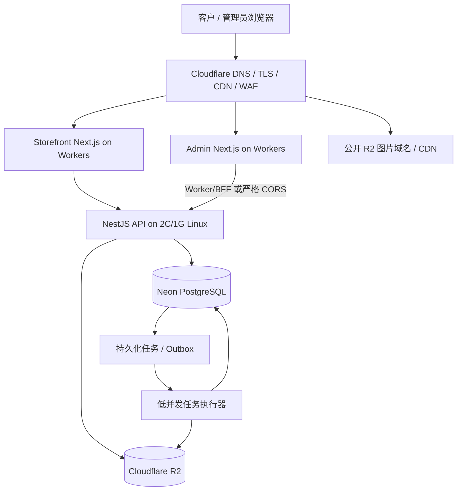

# 02. 系统架构设计

> 当前目标生产架构以 `docs/33-lightweight-cloudflare-neon-r2-implementation.md` 为实施基线。本文描述目标逻辑边界；现有代码仍有 Redis/BullMQ 与服务器端 Next.js 运行路径，迁移完成前不得将目标状态描述为已上线。

## 1. 目标架构

## 2. 部署边界

- **Storefront**：保留英文产品目录、动态商品详情、SEO、WhatsApp 询盘。目标为 Cloudflare Workers，但须通过当前 Next.js 15.5.27 与 adapter 的兼容性 POC；不能未经审计直接强制静态导出。
- **Admin**：保留中英双语管理界面。目标为 Cloudflare Workers；必须验收登录、Session Cookie、CSRF、权限、上传、Excel 下载和服务端代理行为。
- **API**：NestJS 是唯一可信业务校验、认证和授权边界；公共 DTO 使用字段 allowlist，不直接返回 Prisma 完整模型。
- **Neon PostgreSQL**：唯一业务数据源；保留 PostgreSQL/Prisma，不迁移 SQLite。生产运行时与 migration 使用合适的连接方式并分离职责。
- **Cloudflare R2**：文件和图片对象唯一正式存储；数据库保存元数据、key、hash、状态和业务关联。
- **任务执行器**：目标以 PG 持久化任务/Outbox 替代 Redis/BullMQ。现有任务处理代码只有在验证重试、租约、原子领取和幂等后才能移除 Redis。
- **Cloudflare CDN**：只缓存公开页面/公开商品派生图；后台、登录态、上传授权、Excel、PI、私有原图均不得共享缓存。
- **服务器**：不再运行前后台 Next.js，也不部署 PostgreSQL/Redis；只运行 NestJS API 与任务处理运行时。API 和任务执行器是否同进程必须经过目标 2C/1G 内存/延迟压测决定。

## 3. 当前代码约束

仓库当前两个前端 workspace 为 Next.js 15.5.27。Storefront 使用 Server Component 服务端获取数据并生成动态 metadata；Admin 依赖 Next rewrite、Session 与动态 CRUD。Cloudflare 的可用部署能力不代表本仓库每一项能力自动兼容。先在独立 preview 分支验证；若 adapter 不兼容，应暂时使用 Cloudflare 代理现有 Node SSR，不可删减 SEO、locale、身份认证或后台功能来强行上线。

当前 `apps/api` 与 `apps/worker` 包依赖 `bullmq`、`ioredis`，故生产 Redis 目前仍属于代码实际依赖。目标是在完成 PG runner 分阶段迁移后才移除这些依赖。开发环境 `infra/docker-compose.dev.yml` 可继续保留本地 PostgreSQL/Redis，除非单独完成开发体验调整。

## 4. API 与业务安全

- API 版本前缀为 `/api/v1`，清楚区分 `/api/v1/public/*` 和 `/api/v1/admin/*`。
- liveness/readiness 必须以实际 controller 路由为准；文档中列出路由不代表代码已经实现。
- 后端每个管理 API 都进行认证和权限检查；按钮/菜单隐藏不代表授权。
- 访客端商品列表/详情、SSR props、HTML、metadata、JSON-LD、sitemap、缓存、公开图片元数据不得包含内部价格。
- 所有输入做 DTO 校验；分页、排序、上传大小、像素数、导出数据量和任务耗时有上限。
- Session secret、Neon URL、R2 key、Worker→API 凭证不能进入 `NEXT_PUBLIC_*`、提交或日志。
- 变更业务数据与创建任务尽量处于同一 DB 事务；R2 与 PostgreSQL 无跨系统事务，用幂等和可重试任务保证最终一致性。

## 5. 任务系统目标

优先复用 `FileDeletionJob`、`OutboxEvent`、`QuoteExportJob`。确认每张表的职责后再添加缺失字段或表，禁止创建多个竞争的任务状态真相源。PG runner 应具备原子 claim、租约/心跳、有限重试、幂等键、失败可见性和人工重试。图片生成、物理文件删除、报价 Excel 生成不得被合并进普通 HTTP 请求路径。

## 6. 代码模块边界

1. Auth / Admin User / RBAC
2. I18n / Menu / Dictionary / Global Settings
3. Categories / Products / Tags / Product Media
4. Ads / Content Pages / SEO
5. Quote Templates / Quote Exports / PI
6. Customers / Inquiry Activities / Salespeople
7. Analytics Events / Visitor Sessions / Aggregates
8. File Assets / R2 adapter / Upload confirmation
9. Durable Tasks / Outbox / Retry / Health & Metrics

复用现有 NestJS 模块。除非有单独的部署/扩展需求，不拆成微服务。

## 7. 轻量化与部署约束

- 目标生产架构、迁移顺序、R2 key 与任务处理规格详见 `docs/33-lightweight-cloudflare-neon-r2-implementation.md`。
- Redis/SQLite 取舍与 PG queue 的补充分析见 `docs/31-lightweight-deployment-sqlite-redis-image-optimization.md`。
- Cloudflare Next.js、BFF/Cookie、缓存与源站入口见 `docs/32-cloudflare-frontend-server-api-deployment.md`。
- 老的全栈 Node 部署步骤见 `docs/29-production-server-deployment-runbook.md`，迁移期间仅可作为回滚/临时路径；它仍然描述旧拓扑，正式采用目标架构后应按新实施基线部署。

## 8. 非功能验收

- 公共商品查询在 DB 侧分页并有真实索引。
- 前台 SEO / Open Graph / locale 不因迁移退化。
- 文件删除、图片派生、Excel 导出在 runner 重启、Neon 短暂不可用、R2 超时情况下可恢复。
- 已完成数据库备份恢复实测，不以“备份配置存在”作为通过。
- 2C/1G 主机无 OOM、无持续 swap thrash；任务不会明显拖垮 API。
- 所有 test/build 检查记录真实结果；没运行的检查不能标记通过。
