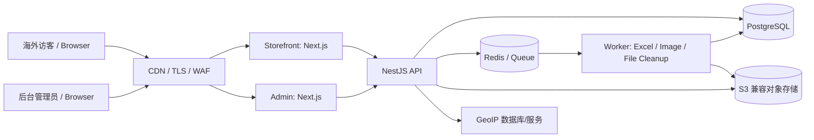

# 02. 系统架构设计

## 1. 架构图

## 2. 应用边界

- `storefront`：公开英文页面、SEO、产品筛选和批量 SKU 清单；禁止拥有后台数据库直连权限。
- `admin`：中英双语后台 UI；通过 API 访问受保护资源；角色控制菜单与按钮可见性。
- `api`：唯一业务规则与授权边界；负责校验、权限、品类树、商品公开投影、客户重复检查、文件任务和分析采集。
- `worker`：执行长耗时/高风险任务，包含 Excel 报价单生成、图片缩略图、物理文件清理、统计聚合；不再承载 Excel 转 PDF 任务。Worker 不应直接对外开放端口。
- `database`：持久化业务数据；迁移版本化；生产应用用户遵循最小权限原则。
- `object storage`：原始图片、派生图、Excel 模板、导出文件、PDF 和 PI 文件；数据库保存 key、MIME、大小、哈希与业务引用。

## 3. 推荐实现细节

- Monorepo 使用共享 TypeScript 类型、Zod/DTO schema、设计系统和 lint/format 配置，但前台和后台的文案、路由及打包产物分离。
- API 使用 `/api/v1` 版本前缀；健康检查 `/health/live` 与 `/health/ready` 分离。
- 公共 API 与管理 API 明确分组：`/api/v1/public/*`、`/api/v1/admin/*`。公共接口采用字段白名单投影，不直接返回 ORM Product 对象。
- 前台缓存采用可失效策略：商品更新/上下架/品类变更后，按产品/品类 tag 失效；不得因 CDN 缓存产生已下架商品仍可访问的问题。
- 异步任务具备 job id、状态、进度、重试次数、错误代码、创建者、取消/超时策略与幂等性。
- DB 事务只包住数据库操作；对象存储和 DB 无原子事务时，使用 outbox/saga 模式与可重试清理任务。
- 国家 GeoIP 解析应有供应商抽象，允许离线 GeoIP 数据库替换供应商，降低单点依赖。

## 4. 逻辑拆分模块

1. Auth / Admin User / RBAC
2. I18n / Menu / Dictionary / Global Settings
3. Categories / Products / Tags / Product Media
4. Ads / Content Pages / SEO
5. Quote Templates / Quote Exports / File Assets
6. PI Documents / PI Lines / PI Templates
7. Customers / Inquiry Activities / Salespeople
8. Analytics Events / Visitor Sessions / Country Aggregates
9. Audit Logs / Background Jobs / Health & Metrics

## 5. 非功能性目标（第一阶段建议）

- 页面首屏以 SEO 和移动端体验优先；关键 Web Vitals 持续监控，不在本阶段承诺未经测试的绝对数值。
- 公共产品列表支持服务端分页和索引；不得一次性加载全量产品。
- 大文件转换和导出转为队列任务；API 请求设置合理超时和请求体上限。
- 关键数据定期备份；上线前演练恢复，不能仅确认“备份任务成功”。
- 日志结构化并带 requestId/jobId；日志不含密码、访问 Token、完整客户电话和原始 IP。
