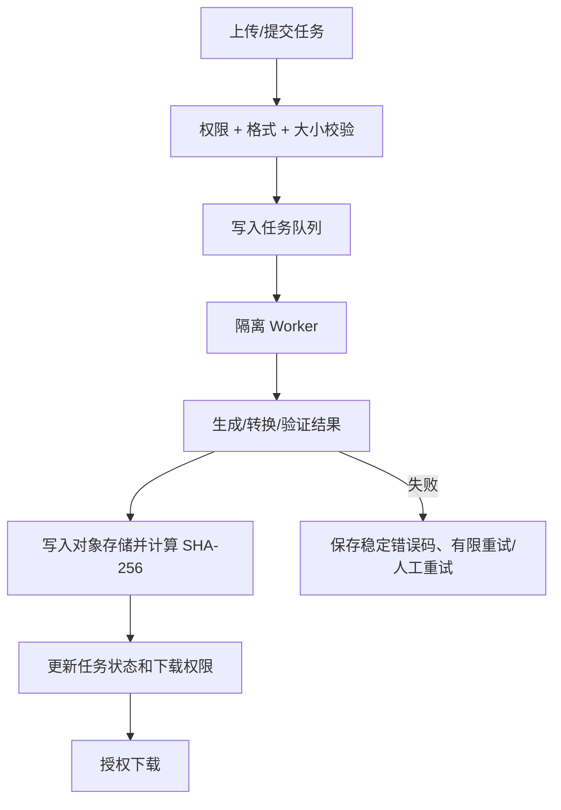

# 08. Excel 报价导出与 PI 优化方案

## 1. 共用文件处理流水线

## 2. 报价单模板管理

模板记录建议字段：模板名称、用途（产品报价表/PI）、适用语言、文件 key、版本号、状态（草稿/启用/停用）、字段映射 JSON、工作表名、表头行、商品明细起始行、创建人、校验结果、上传时间。

### 模板规范推荐方案

1. 上传 `.xlsx`；MVP 禁止宏和外部链接公式，模板大小和工作表数量受限。
2. 使用固定字段键而不是依赖列号硬编码，例如 `product.sku`、`product.name`、`product.size`、`product.weight_g`、`product.packaging`、`product.carton_size_cm`、`product.carton_weight_kg`、`product.carton_qty`、`product.price_cny`。
3. 支持两类映射：表头列映射（适合常规表格）和单元格占位符（适合固定版式）；模板启用前运行预检并预览。
4. 模板版本不可原地覆盖已被历史导出引用的版本；新上传生成新版本，历史记录可追溯使用的模板版本。
5. 用户指定品类时，先解析所选节点与后代范围，再对去重后的产品集合生成快照；展示预计数量和状态筛选。
6. 导出时服务端执行权限过滤、字段白名单、模板校验、公式/外部链接安全检查。导出文件内部可按授权模板包含内部价格，但不得发布到前台或公共 CDN。

## 3. Excel 导出记录和文件删除

- 单次导出商品数由 `QUOTE_EXPORT_MAX_PRODUCTS` 限制，默认 5000；超过上限直接返回
  `QUOTE_EXPORT_TOO_LARGE`，不得在 1GB 主机上无界加载。

导出记录至少保存：任务 ID、导出人、导出时间、模板 ID/版本、所选品类 ID 快照、是否含后代、筛选条件快照、产品数量、状态、文件 key、哈希、大小、错误码、保留期限。

删除流程：
1. 校验 `quote_export.delete` 权限并要求用户二次确认。
2. 将记录标记 `deletion_pending` 并创建删除任务；隐藏下载入口。
3. Worker 删除对象存储文件；文件不存在也可视作已删除（幂等）。
4. 删除成功后硬删除导出记录或保留最小审计元数据；失败则记录错误并重试，超过次数告警。
5. UI 说明“删除请求已提交/删除失败，可重试”，不能显示成功后仍允许下载旧文件。

## 4. Excel 转 PDF 当前状态

- Excel 转 PDF 已按 `docs/38-admin-excel-to-pdf-conversion-implementation.md`
  重新引入，提供受 RBAC 保护的后台入口、8 MiB 分块上传 API、PostgreSQL durable
  task、隔离 Worker 中的 LibreOffice 转换、私有 PDF 下载与删除。
- 单份 `.xlsx` 上限 200 MiB；仅接受无宏工作簿，宏、外链、OLE/ActiveX、加密 ZIP、
  zip bomb 和不合规 OOXML 均拒绝。输入与输出不得进入公开对象存储或 CDN。
- 商品报价单 `.xlsx` 与 PI `.xlsx` 仍由现有 `quote-export` 和 ExcelJS Worker 生成；
  Excel 转 PDF 不修改报价/PI 业务数据、金额快照和原始工作簿。
- 历史 `pdf_conversion_jobs`、对象存储文件和审计记录继续保留；重新引入使用
  additive migration，不执行破坏性数据删除。
- 生产启用前须完成迁移、Worker LibreOffice/字体/临时盘检查、金样本视觉回归和
  接近 200 MiB 工作簿的 staging 容量验收。

## 5. PI（Proforma Invoice）内部制作细节优化

### 5.1 结构拆分

PI 主表（`pi_documents`）：PI 编号、revision、状态、币种、日期、有效期、卖方/买方/收货人快照、联系人、地址、贸易条款（Incoterms 及地点）、付款条款、交货期、装运方式、起运港/目的港、银行信息快照、备注、商品金额、折扣/运费/保险/其他费用、最终总额、创建人/审批人/时间。

PI 明细（`pi_items`）：行号、SKU、产品名称快照、描述、数量、单位、单价、币种、行折扣、行金额、包装/箱规快照、交期备注。不要只引用实时商品字段，否则商品更新会改变已发 PI 内容。

### 5.2 计算规则

- 服务器重新计算 `line_amount = quantity × unit_price - discount`；按配置计算小计、额外费用与总额。
- 数值使用 Decimal；币种决定小数位和舍入规则；持久化计算策略或版本，确保历史 PI 可复现。
- 商品的 `price_cny` 是内部参考价；PI 单价可人工报价并使用选定币种，除非业务明确启用汇率换算功能，否则不可自动将 CNY 值转换成 USD 并视为正式报价。
- 显示值四舍五入前后规则明确；服务端金额是唯一可信源。

### 5.3 状态流转

建议：`draft` → `review`（可选审批）→ `issued` → `superseded` / `cancelled`。草稿可编辑；正式发出的 PI 修改时新建 revision 或 duplicate，不覆盖文件与金额快照。

### 5.4 Excel 模板要求

- 可映射卖方/买方字段、标题、PI No、日期、币种、商品行和汇总金额。
- 模板预检要求必需字段完整、明细行样式存在、公式范围可控。
- 生成后重新打开/解析文件做完整性检查；不可信模板不允许读取任意服务器文件、执行宏或外部连接。
- 同一 PI 的每次导出记录模板版本、revision 和文件哈希。

## 6. 导出和公式注入

所有来自用户/产品的文本写入 Excel 时，必须防止以 `=`, `+`, `-`, `@` 等字符开头的值被 Excel 解释为公式。具体转义方式由统一 helper 实现并测试；可信公式只能来自受控模板/服务端逻辑。
