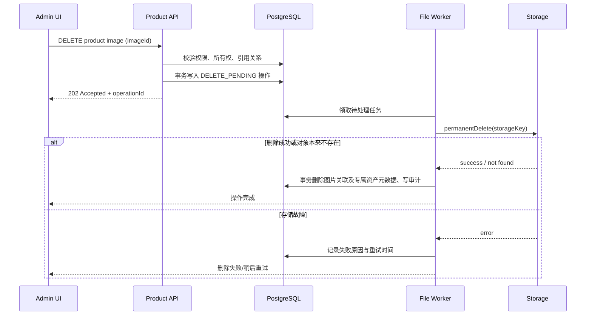

# 商品管理 CRUD、图片库维护与物理删除：可执行设计和技术实施方案

> 文档编号：ADM-PRODUCT-24  
> 适用页面：后台 `/zh-CN/products`、`/en-US/products` 及新增/编辑商品页  
> 目标：让商品新增、编辑、下架和删除流程清晰可靠；允许管理员真正上传、预览、设置主图、排序和永久删除产品图片。  
> 文档性质：开发实施基线；实现前必须核对当前代码、API、migration 与存储配置，不代表功能已实现。

---

## 1. 现状与问题清单

根据提供的三张截图，当前商品管理存在以下问题：

1. 列表只显示图片数量，没有缩略图和图片维护入口；大量商品图片数为 `0`，无法从列表快速识别是否缺图。
2. 新建/编辑使用窄抽屉，商品字段很多，页面依赖内部滚动；底部按钮固定，编辑内容时容易遗漏后续字段。
3. 表单中“商品尺寸 (mm)”重复三次，“箱规尺寸 (cm)”重复三次，没有明确的长、宽、高含义，容易错填。
4. “品类 ID”直接填写 UUID，对操作人员不友好，容易填错或绑定到不存在/不合适的品类。
5. 图片目前没有可见的图库区域、上传进度、主图标记、拖拽排序、替代文本和删除结果提示。
6. 标签选择虽有搜索控件，但需要验证它是否使用真实标签 API；不应通过逗号分隔文本写入关联表。
7. 商品发布状态、生命周期状态、新品、精选是不同业务维度，必须分别呈现和保存。
8. 商品内部价格 CNY 仅供后台报价/PI 等内部业务使用，绝不能出现在前台 API、HTML、SSR 状态、搜索索引或公共缓存中。
9. 用户明确要求：**删除商品图片必须真实删除存储中的文件，不接受只删除数据库关联或仅隐藏图片的逻辑删除。** 因为数据库与本地磁盘/S3 等对象存储不共享事务，必须设计可重试的物理删除流程，不能在存储删除失败时提示成功。

## 2. 改造目标与范围

### 2.1 本次范围

- 商品列表：搜索、过滤、缩略图、状态 Badge、图片数量、分页、清晰的行操作。
- 商品新建和编辑：改为独立的完整编辑页；字段分组；品类树选择；标签多选；双语内容维护。
- 商品图片图库：多图上传、上传进度、预览、封面设置、排序、替代文本、永久删除、失败重试。
- 商品删除：将正常下架与不可逆物理删除区分；先校验引用关系和图片文件，再执行完整删除。
- 后端 API、RBAC、数据库/迁移、物理删除任务、审计、日志、缓存、测试、部署运维。

### 2.2 本次不做

- 不做在线支付、购物车结算或前台展示商品价格。
- 不擅自引入新的云存储厂商；沿用当前存储适配器，缺少抽象时再按接口方式补齐。
- 不未经核对直接替换商品状态枚举/字典来源、重建 Product 表或改动所有商品字段。
- 不提供通过修改原始文件名或客户端路径决定存储位置的能力。

## 3. 后台 UI 设计

### 3.1 商品列表页

保留现有后台 Shell、侧栏、Breadcrumb 和全局设计 Token；仅改造内容区域。

**页头**
- 标题“商品管理”，副标题显示商品维护用途。
- 右侧主按钮“新建商品”。
- 可选展示总数、草稿数、已发布数、缺少图片数等统计；只使用真实接口数据，不用写死数字。

**筛选工具栏**
- 关键词：SKU、英文名称、中文名称。
- 品类：复用品类树选择器，可选择某一级及其子级作为查询范围；是否递归查询通过明确的筛选开关决定，默认查询所选节点及后代。
- 发布状态：草稿、已发布、已下架。
- 生命周期：可用、预售、已停产。
- 标记：新品、精选；标签；图片状态（有图/无图）。
- “查询”“重置”按钮；筛选条件写入 URL query，刷新后可恢复。

**建议列表列**

| 列 | 规则 |
|---|---|
| 图片 | 第一张有效封面缩略图；无图显示统一占位图和“缺少图片”提示；点击可打开图库预览 |
| SKU | 等宽字体，可复制；正常情况下创建后锁定，变更必须遵守业务引用规则 |
| 商品名称 | 英文主名称；可在次行显示中文辅助名称，不用两个过宽列 |
| 品类 | 展示完整或可悬浮查看的品类路径，而不是 UUID |
| 发布状态 | 颜色和文案统一的 Badge |
| 生命周期 | 单独 Badge，不与发布状态混用 |
| 标记 | Featured / New 等业务标记 |
| 图片数 | 例如 `4 images`；点击进入编辑页的图片区域 |
| 更新时间 | 使用统一时区格式 |
| 操作 | 编辑、预览、下架/上架、更多操作中的永久删除 |

避免将所有字段平铺成超宽表格。桌面端保持主要信息可读，窄屏使用卡片列表或允许仅表格容器横向滚动，不允许整个页面横向溢出。

### 3.2 新建/编辑：改用完整编辑页

当前商品字段多，窄 Drawer 不适合作为主编辑容器。建议路由：

- `/[locale]/products/new`
- `/[locale]/products/[id]/edit`

桌面端内容最大宽度建议 1200–1360px，表单使用 2 列网格；手机端改为单列。顶部显示返回、SKU/商品名称、当前状态；底部使用 sticky action bar，包含“取消”“保存草稿”“保存”“发布/下架”（按状态和权限显示）。离开未保存表单时提示确认。

若现有路由架构暂时无法独立页面，临时方案是使用宽度 `min(1040px, 96vw)` 的全屏式 Drawer；不得继续使用当前约 450px 宽的窄抽屉编辑完整商品。

### 3.3 表单分区

#### A. 基本信息
- SKU（必填、唯一；编辑时依规则锁定）。
- URL slug（必填、唯一；可生成建议值，允许业务人员确认修改；已发布 slug 修改应有重定向/SEO 处理策略）。
- 商品名称：使用语言 Tab 或分组，至少 `en-US`、`zh-CN`。
- 商品描述：同样按 locale 维护；前台默认只读取英文内容。
- 品类：从真实 Category Tree API 选择，不允许手输 UUID；当前 Prisma 草案的 `Product.categoryId` 为必填字段，因此表单必须要求选择品类。截图中“留空表示未分类”的辅助提示与 schema 矛盾，必须删除该提示；若业务确实允许未分类商品，则应单独做 `categoryId` nullable migration 并全面调整查询，不能只改前端提示。服务端必须校验 categoryId 存在且允许关联。

#### B. 状态与展示
- 发布状态：草稿、已发布、已下架。
- 生命周期：可用、预售、已停产。
- 新品、精选、排序值。
- 状态来源必须与后端数据模型一致。当前草案的 `Product.publishStatus` 和 `Product.lifecycleStatus` 是 Prisma Enum；实施前检查字典迁移是否已完成。若仍为 Enum，不能把新增任意字典 code 直接写入 Enum。过渡期通过统一 Adapter 映射已有合法 code；状态字典化必须单独做兼容迁移与全链路测试。
- 已停产商品不得因为仍为 `PUBLISHED` 就在前台显示购买暗示；前台可见规则需统一定义（建议已停产默认不可公开展示或显示停产状态，最终由产品规则确认）。

#### C. 产品规格

| 字段 | 标签必须明确显示 | 校验 |
|---|---|---|
| sizeLengthCm | 商品长度 (cm) | 大于 0 或空；允许一位小数，提交时转换为现有 `lengthMm` 整数字段 |
| sizeWidthCm | 商品宽度 (cm) | 大于 0 或空；允许一位小数，提交时转换为现有 `widthMm` 整数字段 |
| sizeHeightCm | 商品高度 (cm) | 大于 0 或空；允许一位小数，提交时转换为现有 `heightMm` 整数字段 |
| weightG | 商品重量 (g) | Decimal，大于 0 或空 |
| packagingTypeCode | 包装方式 | 优先从已有字典 API 选取；如当前仍为自由文本，须按现状兼容迁移，不能在 UI 假装已完成字典化 |
| cartonLengthCm | 箱规长度 (cm) | Decimal，大于 0 或空 |
| cartonWidthCm | 箱规宽度 (cm) | Decimal，大于 0 或空 |
| cartonHeightCm | 箱规高度 (cm) | Decimal，大于 0 或空 |
| cartonWeightKg | 箱规重量 (kg) | Decimal，大于 0 或空 |
| cartonQty | 每箱数量 | 正整数，大于 0 或空 |

每个尺寸字段必须有独立、准确的 label，不能重复出现三个相同的“商品尺寸”标题。数值通过 Decimal 传输与保存，前端显示单位但不把单位拼进数值字符串。

#### D. 内部报价信息
- 内部价格 CNY 使用单独的“仅内部可见”分区，权限独立控制，例如 `product.cost.read` / `product.cost.update`（实际权限编码需先核对现有 Permission，不得直接假设已存在）。
- 后端使用 `Decimal(14,2)`，禁止 JS 浮点运算做报价金额计算。
- 列表是否显示内部价格由权限和业务需要决定，本方案默认列表不显示，编辑页独立分区显示。
- 公共商品 API DTO 不包含价格字段；不能只靠隐藏 UI 或 CSS 防泄漏。

#### E. 标签与运营
- 标签使用 API 驱动的可搜索多选控件，保存 `tagIds: string[]` 或等价关联 DTO；禁止逗号字符串。
- 标签选项只显示启用标签；编辑历史商品时，如某标签已停用，显示当前关联但给出停用提示，避免无意丢失历史数据。
- `isFeatured`、`isNew` 与 Tag 的 `featured` / `new-arrival` 可能重复。先统一事实来源，不能自动互相覆盖。建议运营标记字段用于业务逻辑，Tag 用于可扩展的展示标签，具体以现有实现审查结果为准。

#### F. 图片图库（重点）

图像区域放在清晰的独立卡片，使用网格缩略图，而不是放在表单末尾的一个文件输入框。

每张图片显示：缩略图、主图标识、排序位置、文件尺寸/像素（可选）、替代文本、删除状态。提供：
- 拖放或点击上传，多图选择；显示逐文件进度、成功/失败结果。
- 预览大图。
- “设为主图”。每个商品必须最多一张主图；有图片时保存后应有且仅有一张主图。主图删除时自动选择排序最前的一张有效图片作为新主图，或要求操作人员选择替代主图。
- 拖拽排序，并提供键盘可用的上移/下移操作作为替代。
- 为每张图片编辑 `altText`（默认建议使用英文产品名/用途；不把内部 SKU 或价格放到 alt 中，除非业务确实需要）。
- “永久删除图片”独立危险操作；需二次确认并明确告知将删除实际存储文件、无法通过普通页面恢复。
- 上传失败、格式不支持、超过数量/大小限制、物理删除失败都要显示可理解的原因，并提供重试。

新建产品时图片可先上传为 staged asset，保存产品时再将 assetIds 与商品关联；取消新建后，未被引用的 staged 文件由定时清理任务按 TTL 清理。编辑现有商品时同样采用“先上传 staging，再显式提交关联”的方式，避免页面关闭后数据库出现半成品关联。

### 3.4 图片列表占位和错误状态

- 图片加载失败使用本地占位图并显示修复提示；不要让整个表格行布局跳动。
- `imageCount` 是服务端聚合数据，不能由前端自行编造。
- `processing` 图片不作为有效主图，不允许发布产品（是否强制取决于发布规则，建议发布前要求至少一张有效主图）。
- 删除中图片显示“正在永久删除”，删除失败显示“删除失败，可重试”，不能提前假报“已删除”。

## 4. 图片物理删除的明确业务定义

### 4.1 什么叫物理删除

对于商品图库中的“永久删除图片”，本项目定义为：

1. 删除真实存储对象，不只是删除 `ProductImage` 数据库行。
2. 成功后删除或清理对应 `ProductImage` 与专属 `FileAsset` 元数据。
3. 清除相关缓存/缩略图衍生文件，避免公共页面仍能访问旧 URL。
4. 写入不含敏感文件内容的审计记录。
5. 对象存储删除失败时不返回最终成功；保留可重试任务和状态。

如果生产对象存储启用了版本控制/复制，`permanentDelete` 适配器必须按部署策略处理对象版本和副本。应用应明确“主存储已永久删除”与“备份保留期内的历史备份清除”不是同一概念；如业务要求连备份也彻底抹除，需同步制定并验证备份清除策略。

### 4.2 共享对象防护

当前 schema 中：
- `ProductImage` 既有 `storageKey`，又有可选 `fileAssetId`；这两个字段有重复存储对象 key 的风险。
- `FileAsset` 不仅可能被 `ProductImage` 使用，还可能被 Category 封面或广告引用。
- 部分关联目前采用 `onDelete: SetNull`，这并不代表可以安全物理删除文件；引用记录仍可能留着旧的 `storageKey`。

因此，删除前后端必须校验：
- 图片 ID 属于指定商品。
- 存储 key 是服务端生成的受管 key，不允许客户端传路径。
- 该 `FileAsset` 未被其他商品图片、品类封面或广告引用。
- `storageKey` 没有被其他 `ProductImage` 或业务实体引用。
- 图片没有处于其他文件操作处理中。

如果同一个物理文件被多个业务对象引用，**不得在一个引用的删除操作中悄悄删掉共享文件，也不得只清除关联却报告已经物理删除。** 返回 `409 ASSET_IN_USE`，列出可展示的引用类型与处理建议。建议从设计上规定每张商品图片有独立对象 key，禁止跨业务直接复用同一个 FileAsset；如需要复用，应复制对象并创建新的 storageKey。

### 4.3 可靠的删除流程（数据库与对象存储不共享事务）

推荐采用可重试的删除任务/outbox，而不是在数据库事务中直接调用慢速对象存储：



要求：
- `DELETE_PENDING` 之后，该图片立即从公共 DTO/缓存中排除，后台仍显示删除进度。
- 对象不存在（404/NoSuchKey）视为删除已达成，保证任务幂等。
- 存储删除成功后才清除数据库元数据；失败不得删掉 key 线索。
- worker 任务至少一次执行；操作需幂等；指数退避重试，并配最大重试后人工重试入口。
- 数据库写入操作任务与状态更新要在同一个事务中完成。
- 如果当前项目已经有可复用的 outbox/job 框架，必须复用，不得另建重复队列；若没有，新增轻量 `FileOperation`/outbox 模型。

### 4.4 推荐删除状态

| 状态 | 含义 | UI 行为 |
|---|---|---|
| `READY` | 正常可用 | 可预览、设封面、排序、编辑 alt、永久删除 |
| `DELETE_PENDING` | 已发起物理删除 | 禁止再次删除/设封面；显示进度 |
| `DELETE_FAILED` | 物理删除失败 | 不作为公共可见图片；显示原因与“重试删除” |
| 已完成（操作记录） | 对象和元数据清理完成 | 从商品图库移除；审计日志可查询结果 |

不应只在前端维护以上状态；状态必须由后端返回。可选择将其放在 `FileAsset.status` 和 `FileOperation.status` 中；若现有类型用字符串，必须使用常量/枚举约束有效值。

## 5. 数据库与模型实施建议

当前 Prisma 草案已包含 `Product`、`ProductTranslation`、`ProductImage`、`FileAsset`、`Category`、`Tag`、`ProductTag` 和 `AuditLog`。优先复用已有模型，不重建商品或图片表。

### 5.1 需先审查的点

1. `ProductImage.storageKey` 与 `FileAsset.storageKey` 是否一致，是否有 `fileAssetId = null` 的历史图片。
2. 是否存在同一 `storageKey` 被多条 ProductImage、Category.coverAsset 或 Ad 引用。
3. `FileAsset.status` 当前有效值有哪些、有哪些 worker 会处理状态。
4. 现有图片上传是后端代理、本地文件还是对象存储直传；存储配置、CDN 缓存与缩略图目录在哪里。
5. `ProductImage` 删除和 `Product` 删除的现有服务是否会直接 cascade 数据库关联，从而丢失 object key。
6. `Product` 目前使用 enum 保存发布/生命周期状态；检查字典迁移是否已落地。未落地时不允许把任意字典项直接写入 enum。

### 5.2 建议增量增加的操作模型

如没有可复用的通用 outbox/job，建议增加 `FileOperation`（名称可按现有项目约定调整），记录：

- `id` UUID
- `operationType`（例如 `PERMANENT_DELETE_PRODUCT_IMAGE`、`PERMANENT_DELETE_PRODUCT_ASSETS`）
- `storageKey`（唯一操作中保存原始 key 线索）
- `productId`、`productImageId`、`fileAssetId` 可空引用字段/实体快照
- `status`（PENDING / PROCESSING / SUCCEEDED / FAILED）
- `attempts`、`nextRetryAt`、`lastErrorCode`、`requestedById`
- `idempotencyKey`（唯一，避免重复入队）
- `createdAt`、`updatedAt`、`completedAt`

该表只保存对象 key 和任务元数据，不保存图片内容。审计 metadata 记录操作对象、结果和 requestId，不记录用户文件二进制、签名 URL 或存储凭证。

若采用 FileOperation，需添加版本化 Prisma migration 和索引（如 `status,nextRetryAt`、`productId,createdAt`、`idempotencyKey` 唯一约束）。如果已有统一 outbox，直接扩展它即可，不需要重复建表。

### 5.3 图片 key 与元数据一致性

- 服务端生成不可预测、不可由用户选择的 key，例如 `products/{productId-or-stagingId}/{uuid}.webp`。
- 数据库存 `storageKey`，不存可永久公开的原始本地路径；公开 URL 应由存储/CDN 层基于 key 生成。
- 上传时 `ProductImage.storageKey` 与 `FileAsset.storageKey` 必须一致；长期建议以 `FileAsset.storageKey` 为唯一权威字段，待兼容期结束后再考虑移除冗余列。
- 删除时只使用数据库读取的 key，禁止接收 `?path=/...` 等用户指定路径。
- 若历史图片缺少 FileAsset，提供一次性审计与补齐脚本；不能直接猜测文件目录并批量删除。

## 6. API 契约建议

具体路由应先与现有 NestJS Controller 命名对齐，以下为语义基线。

### 6.1 商品 CRUD

| Method | Endpoint | 用途 | 权限建议 |
|---|---|---|---|
| `GET` | `/api/admin/products` | 分页列表、筛选、排序白名单 | `product.read` |
| `POST` | `/api/admin/products` | 新建草稿/商品基本信息 | `product.create` |
| `GET` | `/api/admin/products/:productId` | 商品编辑详情（含 translations、tags、images） | `product.read` |
| `PATCH` | `/api/admin/products/:productId` | 更新商品字段、翻译、tagIds | `product.update` |
| `POST` | `/api/admin/products/:productId/publish` | 发布/上架 | `product.publish` |
| `POST` | `/api/admin/products/:productId/unpublish` | 下架 | `product.unpublish` |
| `DELETE` | `/api/admin/products/:productId` | 受保护的永久删除流程 | `product.delete` |

若当前权限目录没有上述精细编码，需先核对并新增受审查的 Permission seed；禁止只靠前端隐藏按钮。

### 6.2 图片操作

| Method | Endpoint | 用途 |
|---|---|---|
| `POST` | `/api/admin/media/staging` | 上传图片到暂存区，返回 fileAssetId、预览信息、校验结果 |
| `POST` | `/api/admin/products/:productId/images` | 将已上传的暂存资产关联到指定商品 |
| `PATCH` | `/api/admin/products/:productId/images/order` | 批量更新排序，提交完整有序的 imageId 列表 |
| `PUT` | `/api/admin/products/:productId/images/:imageId/cover` | 设置主图 |
| `PATCH` | `/api/admin/products/:productId/images/:imageId` | 更新 altText 等可编辑元数据 |
| `DELETE` | `/api/admin/products/:productId/images/:imageId` | 申请永久物理删除，返回 202 + operationId |
| `GET` | `/api/admin/file-operations/:operationId` | 查询物理删除任务结果 |
| `POST` | `/api/admin/file-operations/:operationId/retry` | 对失败任务发起受权限保护的重试 |

DELETE 请求体/查询参数不得允许指定 arbitrary storageKey。`productId` 和 `imageId` 由服务端验证归属。`DELETE` 返回建议：

```json
{
  "operationId": "uuid",
  "status": "PENDING",
  "messageKey": "product.image.deletePending"
}
```

公共商品 API 仅返回经过白名单定义的图片 URL、altText、宽高和排序信息，不返回存储凭证、内部 key、操作状态细节或价格字段。

### 6.3 错误码

| HTTP | code | 用途 |
|---|---|---|
| 400 | `VALIDATION_FAILED` | 文件格式、数值、字段或排序列表不合法 |
| 401/403 | `UNAUTHENTICATED` / `FORBIDDEN` | 未登录或缺少对应权限 |
| 404 | `PRODUCT_NOT_FOUND` / `PRODUCT_IMAGE_NOT_FOUND` | 记录不存在或图片不属于该商品 |
| 409 | `SKU_ALREADY_EXISTS` / `SLUG_ALREADY_EXISTS` | 唯一值冲突 |
| 409 | `ASSET_IN_USE` | 存储对象被其他实体共享，不允许单独物理删除 |
| 409 | `PRODUCT_NOT_DELETABLE` | 商品状态或业务引用不允许永久删除 |
| 413 | `FILE_TOO_LARGE` | 超过上传大小限制 |
| 415 | `UNSUPPORTED_IMAGE_FORMAT` | 图片格式不支持 |
| 422 | `IMAGE_LIMIT_EXCEEDED` | 商品图片数达到限制 |
| 503 | `STORAGE_UNAVAILABLE` | 存储依赖暂时不可用；不能冒充删除成功 |

## 7. 图片上传与安全校验

默认限额建议（最终应配置化）：
- 允许 JPEG、PNG、WebP；默认拒绝 SVG、HTML、脚本、压缩包和伪装文件。
- 单张图片最大 10 MB；单商品最多 20 张；阈值必须配置化，不能只在前端校验。
- 校验文件签名（magic bytes）、实际解码结果、MIME、扩展名、尺寸及像素上限；不能仅信任浏览器 Content-Type。
- 服务端重新编码/生成缩略图时移除 EXIF/GPS 等不必要元数据；原图保留策略需与运营需求一致。
- 使用随机 object key；原文件名只存作展示元数据，禁止直接用来拼目录。
- 临时签名 URL 有短时有效期；不把它写入公共配置或审计日志。
- 上传/删除均需登录、权限校验、速率/大小限制、请求 ID 和审计事件。
- 图片处理任务失败不得把 `processing` 状态的图片标成 `READY`；发布前按规则确认至少一张有效图片。

## 8. 商品和图片删除规则

### 8.1 两个动作要分开

- **下架/停用**：商品保留，前台不再显示；不删除图片文件。
- **永久删除商品**：只允许在后端检查通过后执行。建议仅对草稿或已下架、无被保护业务引用的商品开放；已发布商品必须先下架。删除需二次确认。
- **永久删除图片**：只删除选中的图片对象与关系，不应误删整个商品；如删除的是主图，自动选择下一张有效图片或要求先指定新主图。

### 8.2 商品永久删除与级联风险

目前 `Product.images` 对应关系在 Prisma 里使用级联删除。如果直接 `DELETE Product`，数据库可能先级联删除 `ProductImage` 行，却没有删除对象存储文件，且丢失待清理的 key。因此禁止在 Controller/Service 里直接 `prisma.product.delete()` 后再尝试查图片。

推荐流程：
1. 事务中锁定商品，校验状态、权限、引用关系，收集所有图片 key 和 FileAsset ID，并为每个对象写入删除操作；将商品标记为删除处理中或暂时下架。
2. Worker 对所有对象做幂等物理删除。
3. 所有图片对象确认已删除后，事务删除图片关联、专属 FileAsset、ProductTranslation、ProductTag 和 Product 记录，并写审计结果。
4. 任何一张图片删除失败时，保留商品与剩余元数据/任务线索，显示失败并允许重试；不提前完成数据库级联删除。

如果为了实现“删除中”状态需要新增 `deleteStatus` 或 `deletedAt` 字段，必须使用版本化 migration、回填默认值、索引评估以及回滚说明。若不新增字段，也必须通过 FileOperation 的实体状态让列表能够明确显示删除进度。

### 8.3 并发与幂等

- 多个管理员同时删除同一图片时，只有一个操作能进入 `DELETE_PENDING`；重复请求返回同一 operationId 或稳定的冲突结果。
- 上传期间不允许删除尚未提交关联的 staging asset，除非该 staging asset 也走相同的物理清理任务。
- worker 重试不能误删新上传并复用的 key；所有 object key 唯一且不可复用。
- 保存排序/封面操作时使用事务或乐观锁，防止并发操作产生多个主图。

## 9. 权限、审计与缓存

权限编码建议（实际使用前核对现有 Permission 数据）：
- `product.read`
- `product.create`
- `product.update`
- `product.publish`
- `product.unpublish`
- `product.delete`
- `product.image.upload`
- `product.image.update`
- `product.image.delete`
- `product.cost.read`
- `product.cost.update`

审计动作建议：`product.created`、`product.updated`、`product.published`、`product.unpublished`、`product.deleted`、`product.image.uploaded`、`product.image.cover_changed`、`product.image.reordered`、`product.image.permanent_delete_requested`、`product.image.permanent_delete_succeeded`、`product.image.permanent_delete_failed`。

审计应记录 actor、productId/imageId、operationId、requestId、时间、结果与安全的差异摘要；不记录图片二进制、签名 URL、密钥或内部价格原值。商品/图片变更成功后，失效前台产品详情、列表、品类商品列表、Featured/New 缓存，以及 CDN 图片缓存；物理删除完成后使对应图片 URL 不再返回原对象。

## 10. 前后台数据边界

- Admin DTO 与 public DTO 分离，不能把 Prisma `Product` 直接序列化到公共页面。
- 公开 API 对字段采用 allowlist：SKU、英文名称/描述、公开品类、图片公有 URL、公开标签、规格字段以及允许公开的状态/标记。
- `priceCny` 永不进入 public API、SSR props、HTML、结构化数据、搜索索引、前台日志或公共缓存。
- 公共图片读取只允许 `FileAsset.status=READY` 且被已发布可见产品引用的对象。
- 前台产品列表不展示内部 CNY 价格，详情页仅提供 WhatsApp 询盘入口。

## 11. 测试计划与验收标准

### 11.1 CRUD 与表单

- [ ] 新建草稿，保存后可在列表搜索到，语言字段正确回显。
- [ ] 重复 SKU、重复 slug 被服务端拒绝，错误定位到对应字段。
- [ ] 编辑英文/中文名称、描述、品类、规格、包装、标签、标记后刷新仍一致。
- [ ] 品类必须从实际树选择，错误/已删除 categoryId 会被服务端拒绝。
- [ ] 长宽高标签独立、单位正确；负数、非数字、数量小数等非法值被拒绝。
- [ ] 发布和下架分开执行，生命周期状态不覆盖发布状态。
- [ ] SKU/slug 修改规则符合已发布及引用状态约束。
- [ ] 商品永久删除在不满足条件时返回明确 409；不会因删商品而误删除其他业务共享的文件。

### 11.2 图片上传和物理删除

- [ ] 上传 JPEG/PNG/WebP 成功，表单展示缩略图、文件尺寸、进度和 alt。
- [ ] 拒绝伪造 MIME、错误扩展名、损坏图片、超大小和超数量文件。
- [ ] 新建商品的 staging 图片保存后正确关联；取消表单后过期清理不会误删已关联图片。
- [ ] 设置封面后刷新仍为封面；删除封面后系统选择新封面或要求先选择。
- [ ] 拖拽/键盘排序后刷新顺序一致，禁止外部/其他商品 imageId 混入排序请求。
- [ ] 点击永久删除后状态进入 pending；对象存储 mock/本地目录中对应对象确实不存在后，UI 才显示完成。
- [ ] 删除成功后，`ProductImage` 和其专属 `FileAsset` 元数据按方案清理，不留下死 URL。
- [ ] 对象本来不存在时任务幂等完成；对象存储不可用时显示失败、保留 key/任务并可重试，不谎报成功。
- [ ] 共享 Asset 删除返回 `ASSET_IN_USE`，不会破坏广告或品类封面。
- [ ] 并发双击/重复调用不会重复破坏数据；失败任务重试不会误删新对象。
- [ ] 商品永久删除先处理所有图片文件；失败时商品与清理线索仍保留。

### 11.3 权限、安全和响应式

- [ ] 无 `product.read` 用户不能读管理列表/详情；无 `product.image.delete` 用户直接请求删除 API 返回 403。
- [ ] 客户端不能传入路径来删除任意本地文件或对象存储 key。
- [ ] 公共 API、HTML、SSR、JSON-LD、缓存不包含价格和内部存储 key。
- [ ] 360px 手机、平板、桌面均可上传、排序、设封面、二次确认和查看删除任务。
- [ ] 删除确认框说明不可恢复；表单有 loading、disabled、错误/空状态和未保存退出提示。
- [ ] lint、typecheck、单元/集成/E2E 与生产构建通过；执行结果记录在交付报告。

### 11.4 最终验收主流程

1. 创建草稿产品，填写 SKU、双语名称、品类、规格和标签。
2. 上传至少 3 张图片，设置第 2 张为封面，调整顺序，保存。
3. 重新进入编辑页验证图片、封面、顺序与 altText 回显。
4. 对其中一张执行“永久删除”，确认真实存储对象已删除并且数据库引用已清理。
5. 模拟存储删除失败，确认 UI 不显示成功、操作保留并可重试。
6. 发布产品并从英文前台查看图片；确认不显示价格。
7. 下架后确认公共列表不再出现产品，但后台可继续查看和维护。
8. 测试永久删除商品：其图片物理清理完成之前不得删除数据库商品及图片 key 线索。

## 12. 监控和运维要求

- 记录待处理/失败的物理删除任务数、最长等待时间、重试次数、存储删除失败率和 staging 孤儿文件数量。
- 对 `DELETE_FAILED` 超过阈值或队列积压配置告警。
- 维护人员只可通过受控任务重试失败删除；禁止用手工 `rm -rf` 或删除整个 storage prefix 解决单张图片问题。
- 本地文件存储目录必须在容器卷/持久化目录内，不放在源码 `public/` 作为可任意覆盖的上传位置；生产建议使用私有 S3 兼容 Bucket + CDN 读策略。
- 定期执行 staging 过期清理和孤儿文件对账。自动对账只可删除“确认未被任何数据库实体引用且超过保留期”的对象，并先进入审计/报告流程；不能按数据库单一字段猜测删除范围。
- 对象存储版本控制、复制、备份 retention 策略必须记录在部署文档。若要求备份副本也立刻清除，需单独验证供应商能力和备份合规策略。

## 13. 数据库迁移、发布与回滚

1. 审核当前 Prisma schema、数据库 migration、FileAsset 数据和全部存储 key 的引用。
2. 对历史图像做只读核对报表：图片数量、无 FileAsset 数、storageKey 不一致、重复 key、缺失对象、孤儿对象、共享引用。
3. 若需要新增 FileOperation/outbox 或删除状态字段，新增版本化 migration；先在测试库验证回填与索引。
4. 部署后端兼容版本（支持读取旧图与新 FileAsset）；再部署新 UI。
5. 在小批量测试商品上执行物理删除验证，确认 storage object 与数据库都符合预期，再开放全部管理员权限。
6. 回滚代码时停止新删除任务消费者或保留兼容消费者，不得直接回滚数据库并丢弃仍待执行的对象 key。失败任务须保留到恢复后重试。
7. 对已完成的物理删除无法通过普通数据库回滚复原，必须在 UI 和确认框中明确不可逆；若确需恢复，只能从受控备份恢复并作为新对象重新入库。

## 14. 推荐实施拆分

### P0：先打通基本维护
- 商品编辑页布局和字段分组。
- 列表缩略图、图片数量、无图提示。
- 品类树选择、标签多选、状态与单位校验。

### P1：图片图库
- 暂存上传、多图预览、封面、排序、altText。
- FileAsset 与 ProductImage 一致性校验。
- 上传权限、格式/大小/数量限制。

### P1：物理删除闭环
- 删除确认、引用校验、FileOperation/outbox、worker 幂等删除与重试。
- 删除状态可见、审计、缓存失效、孤儿文件对账。
- 商品永久删除必须先可靠清理图片，禁止数据库 Cascade 先丢 key。

### P2：运营增强
- 列表多条件筛选、批量下架、缺图筛选、操作记录入口。
- 图片健康报告、缺失对象扫描和操作耗时监控。

## 15. 给 AI 编码助手的执行提示词

> 请先读取项目根目录 `AGENTS.md`、`docs/06-admin-public-ui-standard.md`、`docs/07-backend-standard.md`、`docs/11-image-upload.md`（如果该文件存在）和本专项文档 `docs/24-product-management-crud-and-image-storage.md`，并读取 `.agents/skills/product-management/SKILL.md`。先检查现有商品页面、NestJS Controller/Service/DTO、Prisma schema/migrations、FileAsset 存储适配器、图片上传接口、权限数据和缓存实现；列出真实现状与差距，再分阶段修改。
>
> 强制要求：商品新增/编辑改成适合长表单的完整编辑页；区分商品长宽高与箱规长宽高；品类必须使用树选择而不是 UUID 文本；标签使用真实 API 的结构化多选；列表显示主图和图片数量；实现多图上传、预览、封面、排序、altText 和永久删除。永久删除必须真实删除对象存储/本地受管目录中的图片，不得只删数据库行或隐藏 UI；对共享 Asset 返回冲突；对象存储失败时保留 key 与任务并支持幂等重试；商品硬删除前必须完成全部图片物理删除，防止 Prisma Cascade 丢失存储 key。禁止客户端传路径；每个管理 API 逐项校验权限；公共 API/HTML/SSR/cache 绝不能出现商品内部价格。
>
> 未经核对不得新增重复表或替换已有商品状态来源。任何 schema 变更必须提交 migration、回填校验与回滚步骤。完成后运行 lint、typecheck、单测、集成测试、E2E 和 build，并输出改动清单、测试结果、物理删除验证证据、环境差异和剩余风险。不得用静态假数据或未接 API 的控件冒充功能完成。

## 16. 完成定义（Definition of Done）

- [ ] 商品列表筛选、查看、编辑、新建、下架和受保护永久删除闭环可用。
- [ ] 所有复杂字段都有明确名称、单位、校验及中英文后台翻译。
- [ ] 图片真正可上传、预览、排序、设主图、编辑 alt 并永久删除。
- [ ] 物理删除流程具备共享引用保护、任务状态、幂等、重试、审计和缓存清理。
- [ ] 对象存储失败不会向操作人员报告假成功；数据库 key 线索不会提前丢失。
- [ ] 商品删除不会因数据库级联先行而留下不可追踪的图片文件。
- [ ] 公共 DTO、前台 HTML/SSR/缓存中均未泄漏内部价格。
- [ ] migration、回滚、部署环境配置、测试和 AI 执行报告齐全。
