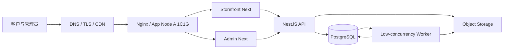

# 31. 轻量化部署、SQLite / Redis 取舍与图片性能优化方案

> 仓库：`NotFeel/b2b-inquiry-platform`
> 适用场景：小团队运营的 B2B 产品目录 + WhatsApp 询盘网站
> 目标基础设施：2 台 1 vCPU / 1 GB RAM 服务器
> 当前建议：**先维持 PostgreSQL 兼容性，先移除运行时 Redis 依赖的可选方案评估；图片走对象存储 + CDN；不要在生产上直接将当前 PostgreSQL schema 改为 SQLite。**
> 执行方式：AI 先审计真实调用链，按阶段实施、测试和文档同步，不得只改配置。

---

## 1. 结论摘要

### 1.1 SQLite 是否可行？

SQLite 对于低写入量、单机、数据量适中的目录网站很轻便，但**当前仓库不能把 PostgreSQL URL 换成 SQLite URL 就启动**。现有 `database/prisma/schema.prisma` 明确使用：

- `provider = "postgresql"`
- 大量 PostgreSQL 原生类型，例如 `@db.Uuid`、`@db.VarChar`、`@db.Timestamptz`、`@db.Decimal`、`@db.Date`
- Json/Decimal、枚举、外键、复合索引和多表事务等数据能力
- 约 50 个业务模型，涉及用户/RBAC、菜单与多语言、品类、商品、图片资产、报价导出、PI、询盘/分析、审计、文件删除和 Outbox

改为 SQLite 涉及 schema 全面调整、Prisma schema 校验、迁移基线重建、SQL/查询兼容检查、金额与时间行为测试，以及完整数据迁移与回滚。Prisma 文档列出了 SQLite 的类型映射和枚举/数据类型注意事项；其数据库语义不应假定与 PostgreSQL 完全一致。参考：[Prisma SQLite connector](https://docs.prisma.io/docs/orm/v6/overview/databases/sqlite)、[Prisma 数据库特性矩阵](https://www.prisma.sh/docs/orm/v6/reference/database-features)。

**推荐决策：**

- 如果当前 PostgreSQL 已经部署：暂不为节省一份数据库容器而迁移 SQLite。先评估把 DB 放到托管 PostgreSQL，或同一台服务器上限制资源运行。
- 如果项目还未正式上线、没有需要保留的数据，而且愿意接受一轮 schema 与查询改造：可另开 SQLite 试验分支，用完整测试集验证后再决定。
- 两台 1C/1G 机器不能让同一个 SQLite 本地文件同时作为两台服务器的共享生产数据库。SQLite 文件必须位于可靠的单一持久化存储边界；把数据库文件放共享网络文件系统并让多个 API 实例同时写不是推荐方案。
- 如果两台机器要承载同一站点的两份 API 并同时写业务数据，保留 PostgreSQL 更稳妥。

### 1.2 可以不使用 Redis 吗？

可以评估。移除 Redis 的关键不是“把 REDIS_URL 删除”，而是现在 API 与 Worker 都直接依赖 `bullmq` 与 `ioredis`，需要替换异步任务分发方式。

当前业务存在报价单 Excel 异步导出、图片处理、文件物理删除/重试以及数据库 `FileDeletionJob` / `OutboxEvent`。其中文件删除文档已规定：任务需持久化、可重试、失败不能谎报成功；不能为了省去 Redis 而删除这些可靠性要求。

**适合当前规模的默认方案：数据库持久化任务表 + 一个低并发 Worker 轮询。**

- PostgreSQL 仍存储业务状态、任务状态、重试时间、错误码与幂等键。
- Worker 定时按 `status + runAfter` 扫描待执行任务，使用数据库事务/原子 claim 防止重复领取。
- 小型任务按序或并发 1 执行；图片处理和 Excel 导出限制最大内存、文件尺寸与执行时间。
- 业务写入和任务创建应通过事务/outbox 保证一致性。
- 不删除任务历史、失败重试、幂等、审计与监控。
- 如果任务量增长，再引入 Redis/BullMQ；不要提前为没有证据的容量问题保留必需的 Redis 服务。

注意：**数据库轮询 Worker 可以去掉独立 Redis，但不代表一定能去掉 Worker 进程。** 长耗时 Excel 生成、图片处理与物理文件删除不应该全塞进用户 HTTP 请求里。

### 1.3 两台 1C/1G 能否部署？

可作为试运行/低流量目标，但属于紧配置，不能在没有压测的情况下承诺稳定容量。Next.js Storefront、Admin 和 NestJS API/Worker 同时运行，构建进程也可能消耗较多 RAM；Next 官方建议关注应用内存、依赖数量和构建内存。参考：[Next.js 内存优化指南](https://nextjs.org/docs/app/guides/memory-usage)。

目标按以下方式分工：

| 组件 | 服务器 A：应用节点 | 服务器 B：数据/任务节点 |
|---|---|---|
| Nginx / TLS | 必需 | 不部署公网入口 |
| Storefront Next.js | 1 个生产进程 | 不部署 |
| Admin Next.js | 1 个生产进程 | 不部署 |
| NestJS API | 1 个生产进程，限制连接与并发 | 不部署 |
| Worker | 可与 API 同机但限并发；资源紧时仅保留必要任务 | 1 个低并发 Worker（仅当能安全访问共享 DB/对象存储） |
| PostgreSQL | 优先托管；否则需与方案统一选择 | 可放此节点，但 1GB 对 DB、备份及系统页缓存仍很紧 |
| Redis | 目标方案移除后不部署 | 不部署 |
| 图片/报价文件 | 不作为容器临时文件长期保存 | 对象存储更优，不建议只存 B 机本地盘 |

更稳妥的轻量部署优先级：
1. **优先：应用两节点以外使用托管 PostgreSQL + 对象存储/CDN**。两台 1C/1G 只负责运行时，避免 1GB 服务器同时承载数据库和应用。
2. 如果所有资源都必须放在两台机器内，可把一台作为唯一应用节点，另一台作为数据库/Worker，但 RAM 仍紧，并没有数据库高可用。
3. 不要在两台服务器都放独立 SQLite 数据库并期待它们自动同步。
4. 两台服务器不等于高可用。若 DB 只有 B 节点，B 故障会影响两台应用；需接受恢复时间目标或使用托管 DB。

---

## 2. 轻量化目标架构

### 2.1 推荐的生产拓扑

首选结构：托管 PostgreSQL + S3 兼容对象存储/CDN，不运行 Redis；数据库任务表作为小型后台作业调度源。



说明：
- Worker 可以在 A 或 B 运行，先通过基准测试选择。若 API 与 Web 已占满 A 内存，把 Worker 放 B；但 B 上还应避免同时承担重数据库负载。
- 若数据库必须自托管，可部署在 B，并将 PostgreSQL 最大连接、shared_buffers、maintenance_work_mem、worker 并发等调到符合 1GB 的水平；必须实测，不能直接照搬 4–8GB 服务器配置。
- API/Worker 访问数据库使用私网/防火墙白名单；PostgreSQL 不公开给全网。
- 图片和生成 Excel 文件不放在应用镜像/临时目录作为唯一副本。
- 构建在 CI 或开发机完成，服务器只拉取已构建产物或执行受控安装，避免 1GB 主机同时跑完整 Next.js build。

### 2.2 服务资源约束

目标初始限制，最终值以运行监控修正：

- Worker 并发：1。
- Excel 导出：限制单次商品数/工作簿行数与内存占用；大导出设置业务上限。
- 图片处理：单任务一张/少量图片；限制文件大小、像素总数、输出宽度和超时。
- Node 生产进程：限制同时处理的上传/导出请求；设置 systemd restart 与适度的 OS swap（swap 只能缓解瞬时峰值，不替代 RAM）。
- Nginx：限制上传体积、请求速率和连接读取时长。
- PostgreSQL：限制 max_connections；应用使用合理的连接池上限。禁止让每个 Web 进程各自开大连接池。
- 日志：轮转并限额；不要无限增长。
- 监控：CPU、RSS/内存、swap、OOM、磁盘、HTTP 5xx、P95、DB 连接/慢查询、任务积压、失败重试与图片处理时间。

---

## 3. 去掉 Redis：数据库任务队列的实现规格

### 3.1 先盘点所有 Redis 用途

全仓库搜索：

```bash
git grep -n -E 'REDIS_URL|ioredis|bullmq|new Queue|new Worker|QueueEvents|queue.add|queue.get|Redis|redis' -- ':!pnpm-lock.yaml'
```

对每一个命中点分类：
- BullMQ 异步任务。
- 普通缓存。
- Session 或一次性 token（如果存在）。
- 限流/计数（如果存在）。
- 其他库的底层 Redis 连接。

只有在确定所有运行时代码路径都有替代方案后，才移除 Redis。若 Redis 只用于 BullMQ，改造范围会小很多；若还有其他使用者，必须分别设计替代实现。

### 3.2 持久化任务表是唯一真相

优先复用 `FileDeletionJob` 与 `OutboxEvent` 等现有表。报价导出当前的 `QuoteExportJob` 已作为业务导出记录存在，但不能直接把所有通用任务都塞进去。先检查现有模型是否已有可复用的通用任务表，再决定要不要新增一个轻量 `BackgroundTask` / `WorkerTask`。

若必须新增通用表，至少包含：
- `id`、`type`、`payload`（仅结构化且经过 schema 校验）、`status`。
- `attempts`、`maxAttempts`、`runAfter`、`lockedAt`、`lockedBy`。
- `idempotencyKey`（唯一）、`lastErrorCode`、`createdAt`、`updatedAt`、`completedAt`。
- 按 `status + runAfter` 的查询索引。
- payload 不能存凭据、文件二进制、session token 或客户敏感原文。

不要同时保留两套相互矛盾的任务状态真相。确认队列策略后再决定 `QuoteExportJob` 是业务记录还是调度载体，并保持“业务导出记录”和“执行任务”的语义清晰。

### 3.3 Worker 调度与防重复

- Worker 启动后连接数据库，完成优雅关闭。
- 每轮只领取有限任务；claim 必须通过事务/条件更新完成，禁止两个 Worker 同时执行同一个任务。
- 若数据库提供了当前版本支持的安全行锁/跳过锁语义，可使用；若要支持 PostgreSQL 与 SQLite 两个 Provider，必须实现并测试独立的并发领取策略，不可假定 SQL 完全相同。
- 无任务时使用可配置轮询间隔（例如 1–3 秒），不是 tight loop。
- 成功后先确认结果持久化，再把任务标记为成功。
- 失败按错误类别决定是否重试；指数退避且有最大次数，永久格式错误不要无限重试。
- worker 崩溃后，其他 worker 能按过期 `lockedAt` 恢复任务。
- API 返回 task ID/业务导出 ID，后台按 API 查询真实任务状态，不依赖 Redis event stream。
- 任务删除、取消和清理操作幂等且可审计。
- 图片物理删除失败时任务保留为失败/待重试，UI 不显示假成功。

### 3.4 移除 Redis 的代码清单

执行者需逐项确认并更新：

- API 中 BullMQ Producer、Queue 注入、Redis module/provider 和相关连接关闭代码。
- Worker 中 BullMQ `Worker`、Queue、QueueEvents、Redis 连接和调度代码。
- 相关 package.json 依赖：`bullmq`、`ioredis`（只有没有其他用途时才移除）。
- `.env.example`、配置 schema、部署 runbook、compose 开发依赖、README 和架构图。
- 文件删除 worker 的现有恢复扫描任务；确保不再需要 Redis 队列消息也能恢复持久化的删除请求。
- Excel 导出任务状态轮询、错误状态、重试、下载授权和产物保留策略。
- 测试夹具、mock、CI 依赖服务和文档。
- Redis 现存数据不自动清空；下线前确认没有在途队列消息，记录无法迁移的任务并有明确终态。

不要仅仅把 BullMQ 换成内存数组或 setTimeout。进程重启后，内存任务会丢失，不能满足现有删除可靠性要求。

---

## 4. SQLite 评估与迁移方案（可选，不是第一步）

### 4.1 SQLite 的准入条件

只有同时满足以下条件才推进生产迁移：
- 当前数据可通过备份和导出方式安全迁移；项目没有依赖 PostgreSQL 专有 SQL 行为。
- 实际 schema 的 Provider 特性逐项改造并通过 Prisma validation/generate。
- 对金额、日期时区、JSON、枚举、大小写敏感唯一约束、全文搜索与分页排序等行为做了数据库级测试。
- 生产架构只有一个 SQLite 写入边界；第二台服务器不能独立维护一份不同步的数据文件。
- 已明确 DB 文件、`-wal`/`-shm`、备份、权限、磁盘容量与恢复流程。
- 数据迁移具备计数对账、关键表抽样、哈希/总额核对及停机切换步骤。
- 完整回归测试和回滚演练通过。

### 4.2 Schema 改造注意点

- 从 schema 中去掉 PostgreSQL 专属 `@db.*` 属性，并调整 datasource provider。
- 用可跨 Provider 的类型策略表示 UUID、时间、Decimal/金额、日期和 JSON；保留业务层的 Decimal.js 金额计算规则。
- SQLite 没有 PostgreSQL 所有原生类型和约束语义的直接等价物。不得把金额从定点精度改成 JavaScript 二进制浮点。
- 检查 Prisma 6.19.3 当前版本支持的 SQLite schema 特性，不要根据其他 Prisma 主版本的教程直接复制配置。
- 所有迁移脚本和 seed 需在空 SQLite 库与已有数据升级副本上实际验证。
- 检查原来用 PostgreSQL 原生类型、日期、聚合、Json 筛选、排序/唯一性判断的原始 SQL。
- 现有生产数据库如果已有数据，先建隔离副本完成迁移评估。不能在生产直接把 provider 改掉后运行 migrate deploy。

### 4.3 数据切换步骤

1. Freeze：暂停写操作并记录源库快照/备份。
2. Export：使用确定且可重放的迁移脚本导出各实体，保持外键顺序。
3. Import：导入新 SQLite 文件，明确处理 UUID、UTC 时间、Decimal、Json、枚举值。
4. Verify：对所有核心表核对行数；核对管理员/角色/权限、商品、品类树、产品图关联、模板/导出、PI 金额快照、文件删除任务、审计日志。
5. Smoke test：登录/登出、RBAC、CRUD、商品发布、前台查询、询盘、图片上传/删除、报价 Excel、备份恢复。
6. Cutover：只在维护窗口切换连接和流量。
7. Rollback：保留 PostgreSQL 源库只读或停写冻结状态，切换失败回到旧版本；在稳定前不要双写两种数据库。

### 4.4 建议的阶段门

SQLite 是第二阶段技术决策，不要与“去 Redis、缩图、部署双机”三个变更一次性合并。先在专用分支运行 schema 和业务兼容性实验，输出：
- 可兼容字段/原生属性清单；
- 不兼容查询/迁移清单；
- 数据类型和金额测试结果；
- 文件锁/备份恢复方案；
- 预计改动目录与回滚方案。

若改造范围大，继续用 PostgreSQL 更简单，因为现有系统已按 PostgreSQL 设计。

---

## 5. 图片优化方案

### 5.1 总体原则

现有仓库已经有：
- `sharp` 依赖（Worker）；
- `UPLOAD_MAX_BYTES`、`UPLOAD_MAX_PIXELS`、`IMAGE_DERIVATIVE_WIDTHS=320,640,1280` 配置；
- `FileAsset` 资产记录（含尺寸、大小、SHA-256、派生图 JSON）；
- `ProductImage` 与文件删除任务/outbox 的一致性设计；
- `docs/11-image-upload.md` 已定义派生尺寸、去除 EXIF/GPS、CDN 和清理规则。

因此应**完善当前图片处理流水线，不添加新的图片资产表，不为图片优化额外部署重型常驻服务**。

### 5.2 推荐产物规格

配置初始建议，最后以页面布局/实际图片测试调整：

| 用途 | 目标宽度 | 目标格式 | 用途说明 |
|---|---:|---|---|
| 小型列表/卡片 | 320 px | WebP（必要时 JPEG 回退） | 移动端/小卡片 |
| 常规卡片/搜索结果 | 640 px | WebP（必要时 JPEG 回退） | 桌面列表/高清屏 |
| 商品详情 | 1280 px | WebP（必要时 JPEG 回退） | 详情主图/放大前 |
| 首页大横幅 | 独立图片位，尺寸受限 | WebP/AVIF（浏览器协商且经验证时） | 不使用商品原图代替大横幅 |
| 原始图 | 按需保留私有原图 | JPEG/PNG/WebP | 仅在业务确需替换/再生成时保存，设置保留策略 |

AVIF 通常可进一步减少传输体积，但编码成本及耗时需基于低内存服务器实测。默认先提供 WebP，防止在 1GB 服务器上同时进行高并发复杂编码。

### 5.3 上传接口约束

- 服务端检查扩展名、MIME、文件签名、解码结果、宽高与总像素数；SVG 默认拒绝。
- 限制单文件大小（初始 10 MB）、最大像素数（当前示例 50 MP，但应以实际压力测试设定更保守的限额）。
- 原始文件写入临时/隔离区时使用随机 storage key；禁止路径穿越、覆盖和用户控制存储路径。
- 清除 EXIF/GPS 元数据；不能仅更改 MIME 或扩展名冒充压缩成功。
- 不要将大图片 buffer 长时间保存在 Node 请求对象/内存中；使用受限临时文件或可控流，明确清理时机。
- 写入资产状态为 processing；成功生成派生图后设置 ready；失败要有错误码与可重试状态，不能发布半成品。
- 同一内容可计算 SHA-256 用于诊断/重复检测；默认不要跨业务实体自动共享删除语义不清的文件。

### 5.4 派生图与存储 Key

建议统一结构（最终遵从现有 StorageAdapter/key 规则）：

```text
public/products/{assetId}/320.webp
public/products/{assetId}/640.webp
public/products/{assetId}/1280.webp
private/originals/{assetId}/source.{ext}
public/categories/{assetId}/640.webp
public/banners/{assetId}/desktop.webp
public/banners/{assetId}/mobile.webp
```

要求：
- public 与 private key 的访问控制必须真实落实，不能仅靠目录名。
- 仅公开且已发布的派生图可经 CDN 缓存。
- 原图、报价单、PI、管理员附件使用私有存储和鉴权下载；禁止公开 bucket 和长效无签名链接。
- 上传完成后先验证对象真实存在且尺寸/大小匹配，再提交可见的业务关联。
- 替换图片使用新 key，确认新图成功后再解除旧图引用和进入旧对象清理流程。

### 5.5 前台响应式加载

- 列表/卡片只加载 320 或 640 变体；详情只在需要时加载 1280。
- 使用 `srcset` / `sizes` 或 Next.js `Image` 组件，根据容器宽度加载合适文件。
- 图片设置确定宽高或 aspect ratio，避免布局跳动；图片加载失败展示默认占位图。
- 商品列表、轮播和图库使用懒加载；首屏主图可设置优先级，其余图片不要全部 eager。
- 不能把 1280 图的 URL 填到所有卡片，也不能下载原图后用 CSS 缩小。
- alt text 从产品/图片数据读取；装饰图按无障碍规则使用空 alt。
- 图片更新时更新资产版本/key 并失效 Next 缓存/CDN；优先不可变 URL + 缓存，不采用长期缓存的同 URL 原地覆盖。

### 5.6 CDN 与图片服务选型

**方案 A（推荐，维护最少）：S3 兼容对象存储 + CDN**

- 应用只上传/生成尺寸，公开派生图由对象存储/CDN 发放。
- 使用版本化/不可变 key，CDN 设置合理缓存头；图片删除/替换按现有引用检查与物理删除任务处理。
- 不把用户上传的私密文件放到公开 CDN。
- 适合已经决定用 S3 兼容存储的生产方案。

**方案 B（更轻的运维）：Cloudflare 代理 + Images/Resize 能力**

- 对公开商品图利用 Cloudflare 图像优化与响应式图像能力减少源站出网与变体存储。
- 需要先核算付费产品、域名代理限制、源图访问策略、变体缓存成本和供应商绑定风险。
- 不使用 Cloudflare Images 时，可以在兼容范围内用 CDN + 自行生成 WebP 变体。
- Cloudflare 文档支持按 URL/Workers 变换图片，并建议通过 `srcset` 或自动宽度响应式加载。参考：[Images optimization features](https://developers.cloudflare.com/images/optimization/features/)、[Responsive images](https://developers.cloudflare.com/images/optimization/make-responsive-images/)。

**方案 C（最低月费但责任最大）：本地持久化文件 + Nginx 静态文件服务**

- 可作为少量图片时的临时方案，但要单独备份，设置非公开上传目录，保证第二台服务器访问策略一致。
- 不建议两台服务器各存一份独立图片；上传到 A 的图片不能在用户被负载均衡到 B 时变成 404。
- 如使用本地存储，需要共享挂载/同步设计，但要评估共享存储可用性与一致性；对象存储通常更简单稳妥。
- 不把上传目录放在代码 release 目录；发布、回滚不能覆盖它。

### 5.7 图片存储与运维容量

- 使用对象存储时，服务器只处理图片和短期临时文件，不长期存所有图片原件。
- 如果使用本地临时目录，为进程配置磁盘配额/清理策略，并保证任务失败也能回收临时文件。
- 建议后台显示原始尺寸/文件大小/派生图状态，方便运营发现未压缩大图。
- 可建立只读维护报告：总资产数、原图大小分位数、派生图失败数、未绑定资产数、引用丢失数、疑似重复 SHA 数。
- 清理脚本先 dry-run；实际物理删除必须显式确认和审计。
- 除非业务确认，不自动删除所有原图、历史文件或证书；“优化存储”与“删除历史数据”分开做。

---

## 6. 调整现有图片删除一致性机制

现有文件删除设计不能因移除 Redis 而退化：

1. UI 提交删除后，DB 事务写入 `DELETE_PENDING` / `FileDeletionJob` / `OutboxEvent`。
2. Worker 轮询 DB 领取任务并确认 lock/lease。
3. Worker 对象存储删除（幂等）；对象已不存在视作删除成功。
4. 删除成功后清除可移除的资产元数据、派生图；更新状态与审计记录。
5. 删除失败保留 key、attempts、lastErrorCode，按 runAfter 退避重试。
6. 任务超过阈值触发日志/告警并可手工重试。
7. 产品永久删除等待其图片删除任务完成后才删除数据库产品记录。
8. 测试覆盖 worker 重启、双 worker 争抢、对象不存在、存储超时、重试和重复点击。

注意：数据库与 S3 不存在跨系统原子事务；设计目标是可恢复的一致性，不是声称两个系统有同一个 ACID transaction。

---

## 7. 代码改造阶段与顺序

### Phase 0：基线与分析

- 新建分支：`refactor/lightweight-deploy-sqlite-redis-image`（若已存在先检查）。
- 记录 `git status`、当前 commit SHA、Node/pnpm 版本与现有测试结果。
- 审核 `AGENTS.md`、真实 schema、migration、API/worker 队列注册、所有 Redis 引用、图片 adapter 与部署 runbook。
- 输出 Redis 调用清单、可替换任务、SQLite 不兼容清单和图片代码调用链。
- 不在此阶段删除数据、不切换数据库。

### Phase 1：无数据库迁移的减负（先做）

- 修正生产部署文档，使服务器仅在 CI/受控构建机执行 Next 构建。
- 限制 Worker concurrency = 1、压缩并发与上传体积/像素数。
- 用 Sharp 统一生成 320/640/1280 WebP 派生图，检查 EXIF 清理、输出完整性与失败清理。
- 前台列表改用对应变体和响应式加载。
- 对公共静态图片接入 CDN 或对象存储 CDN；确认隐私文件不公开。
- 加入运行资源测量/验收，不凭感觉调优。
- 保持 PostgreSQL 与 Redis 以免同时增加迁移风险（可先做独立的数据库任务队列 POC）。

### Phase 2：移除 Redis POC

- 在独立分支把一种低风险任务（推荐文件删除 sweep）切换为持久化 DB 轮询。
- 通过 worker 重启、数据库短暂失败、对象存储失败、多 Worker 重复执行测试。
- 再迁移图片处理；最后迁移 Excel 导出（避免用户导出路径先受影响）。
- 所有生产任务在切换前完成/终止并记录；不清空 Redis。
- 当 API 与 Worker 无剩余 Redis 使用者且队列监控一致后，移除 BullMQ/ioredis 依赖与 Redis 服务。
- 更新开发 Compose、环境校验、README、架构图、监控、部署手册。
- 先保留一段时间 Redis 快照/旧配置作为回滚资料，但不要让旧队列与新 DB 队列同时接受新任务。

### Phase 3：SQLite 试验（可选）

- 使用真实 schema 的副本创建独立 SQLite schema 分支；不直接改主分支。
- 改造 datasource/provider 与全部原生类型，生成独立迁移。
- 测试所有查询、事务、排序、唯一约束、金额计算、时间与 JSON 行为。
- 用脱敏或虚构的大致规模数据进行读写压测，记录 CPU、RSS、响应时间、锁等待与备份恢复时间。
- 若两台服务器方案需要多节点共享写入，或 schema 兼容改造过大，终止 SQLite 路线并保留 PostgreSQL。

### Phase 4：最终部署验证

- 分开执行前台/Admin/API/Worker 构建和进程内存测量。
- 在 1C/1G 等目标规格执行真实流量场景：前台列表、详情、后台登录、商品编辑、上传图片、报价 Excel 导出、删除图片、备份与恢复。
- 验收 RSS、OOM、P95、错误率、任务积压、DB 连接、文件一致性。
- 观察一个完整运营周期后再关闭旧基础设施。

---

## 8. 测试与验收清单

### 数据层
- [ ] 若保持 PostgreSQL：迁移及数据访问回归通过。
- [ ] 若试验 SQLite：schema validation、generate、空库 migrate、升级数据迁移、金额/时间/JSON/唯一约束测试全通过。
- [ ] 两台应用不能各自写入独立的 SQLite 文件。
- [ ] 数据备份和恢复在目标机器实测完成。

### 队列
- [ ] 不再依赖 Redis 的业务功能已逐项测试。
- [ ] Worker 任务领取无重复执行，重启后可以恢复。
- [ ] 文件删除请求不会静默丢失，失败保留可重试信息。
- [ ] Excel 导出仍能生成、下载、查询历史。
- [ ] 不存在永久错误无限重试或内存无限累积。

### 图片
- [ ] 上传 JPEG/PNG/WebP 合法文件，输出宽度按配置生成。
- [ ] 拒绝 SVG/伪造 MIME/畸形图像/过大像素/超大文件。
- [ ] 校验 EXIF/GPS 元数据移除。
- [ ] 前台列表不加载 1280 原图，详情加载合适大小。
- [ ] 图片更新/删除后 CDN 和 Next 缓存刷新。
- [ ] 私有 PI/报价文件无法通过公开 CDN URL 访问。
- [ ] 共享引用图片删除有保护，物理对象与 DB 状态一致。
- [ ] 存储失败重试正常，无孤儿文件或“假删除成功”。

### 资源与部署
- [ ] 两台目标机器上完成内存/CPU/磁盘实际测量。
- [ ] 生产构建不与业务请求竞争 1GB RAM。
- [ ] Node 服务能优雅停止、重启；worker 并发=1。
- [ ] Nginx/TLS、防火墙、私网数据库与备份有效。
- [ ] OOM、5xx、DB 连接、任务积压与文件删除失败可告警。

建议在仓库根目录执行：

```bash
pnpm install --frozen-lockfile
pnpm lint
pnpm typecheck
pnpm test
pnpm build
pnpm format:check
```

这些只是待执行命令。报告必须给出实际运行结果；未运行的不能写成通过。

---

## 9. 回滚原则

- 图片派生图可以继续保留旧资产引用，直到新变体验证和缓存切换成功；不要先删除原图。
- Redis 迁移期先留旧版本代码/配置与队列快照，不得双系统同时创建相同任务。
- SQLite 试验期不动现有 PostgreSQL 正式库；切换失败直接返回旧版本连接与 PostgreSQL，不做盲目的反向同步。
- 数据库迁移须在正式切流量前完成对账与演练；回滚必须考虑已经写入新数据库的新数据。
- 删除对象、资产行、导出记录和审计信息不能只依靠 Git revert 撤销。
- 资源调优回滚到已记录的 concurrency、内存限制、图像格式和 Nginx 参数。

---

## 10. AI 编码助手执行指令

严格遵循仓库根目录 `AGENTS.md`，按顺序执行：

1. **不要直接把 schema 改成 SQLite**。先完成 SQLite 兼容性报告，列出所有不兼容类型/查询、数据迁移和备份方案。
2. 先把图片流水线、WebP 派生图、响应式前台加载与 CDN 规范落地在现有架构内。
3. Redis 改造先从持久化 DB 任务 POC 开始，先文件删除、后图片处理、最后报价 Excel，逐个功能上线验证。
4. 未经完整扫描不得删除 `bullmq`、`ioredis`、`sharp`、Worker 或通用文件存储代码。
5. 不凭空新增第二套图片表或第二套任务状态源；尽量复用 `FileAsset`、`ProductImage`、`FileDeletionJob`、`OutboxEvent`、`QuoteExportJob`。
6. 不直接执行线上迁移、删除生产文件、清空 Redis 或切换生产连接。
7. 修改任何文件后更新相关文档、测试与部署变量说明。
8. 交付必须包含文件级改动、实际测试日志/结果、残留 Redis 使用点、SQLite 可行性结论、图片压缩前后测量与回滚步骤。

本方案的优先级是：**不丢数据与图片 > 可靠的文件删除/报价 Excel > 简化基础设施 > 极限降低资源。**
