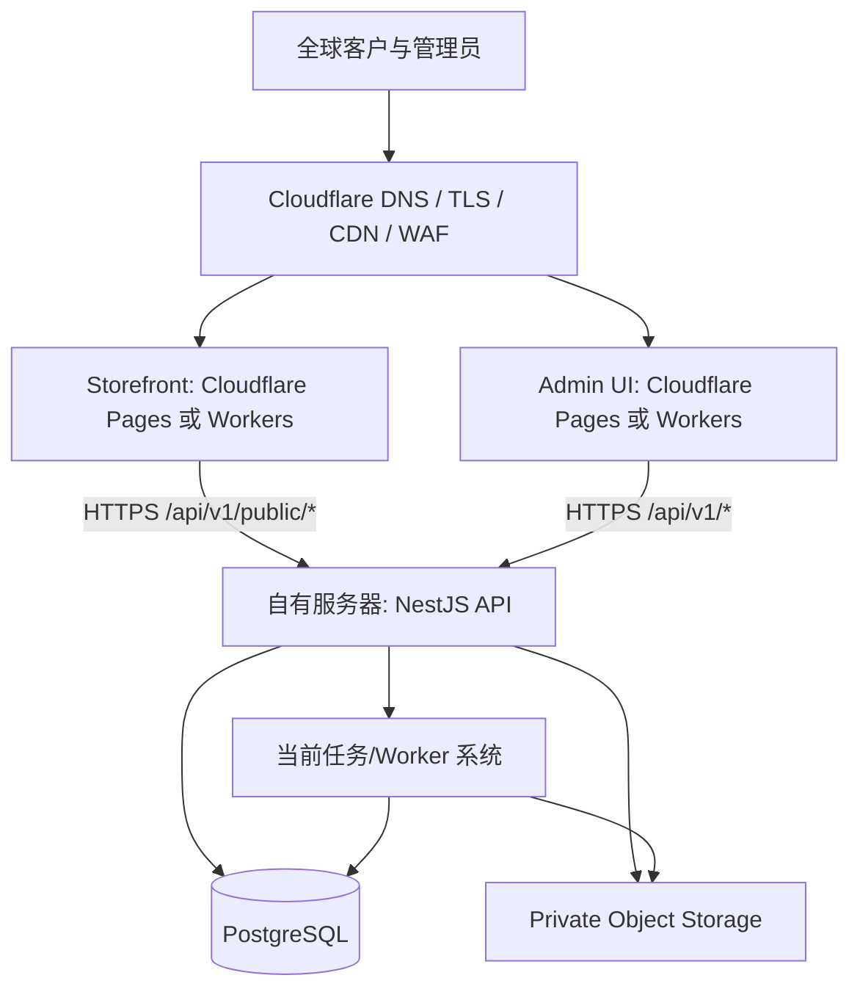

# 32. Cloudflare 承载前台与后台界面，服务器运行 API 的部署方案

> 仓库：`NotFeel/b2b-inquiry-platform`
> 当前前端技术栈：Next.js 15.5.27（Storefront 与 Admin 两个独立 workspace）
> 后端：NestJS API；当前数据库 schema 使用 PostgreSQL；生产文件/任务能力按当前实现核对。
> 目标：将前台网站和后台管理 UI 尽可能迁移到 Cloudflare，API 与业务数据服务继续运行在自有服务器。
> 文档状态：实施方案；**不是已完成的部署或代码迁移**。
> 相关官方文档：
> - [Cloudflare Pages: Next.js static export](https://developers.cloudflare.com/pages/framework-guides/nextjs/deploy-a-static-nextjs-site/)
> - [Cloudflare Workers: Next.js / vinext](https://developers.cloudflare.com/workers/framework-guides/web-apps/nextjs/)
> - [Cloudflare Workers: OpenNext adapter](https://developers.cloudflare.com/workers/framework-guides/web-apps/opennext/)
> - [Next.js static exports](https://nextjs.org/docs/app/guides/static-exports)

---

## 1. 架构结论

**可以将前台和后台界面部署到 Cloudflare、后端 API 部署到服务器，但必须先区分静态托管和 Next.js 服务端运行。**

仓库现状检查结果：

- `apps/storefront/package.json` 的 `build` 为 `next build`，使用 Next.js 15.5.27。
- `apps/admin/package.json` 的 `build` 为 `next build`，也使用 Next.js 15.5.27。
- `apps/storefront/next.config.mjs` 使用 Middleware 为路径添加 locale，并使用 rewrite 将公开 inquiry POST 请求代理到 API。
- `apps/admin/next.config.mjs` 使用 rewrite 将 `/api/v1/*` 从 Admin 同源代理到 API；后台还有登录、Session cookie、RBAC 和动态 CRUD。
- Storefront 首页目前是 async Server Component，构建时/请求时通过 `storefrontApi` 获取站点配置、分类、广告、商品、内容页和首页分区；metadata 也从 API 获取。这意味着它不是当前已证明可以直接静态导出的纯静态页。

所以：

1. **不要只把应用改成 `output: 'export'` 就直接部署。** 先逐页审计 Server Components、动态数据获取、middleware、rewrites、route handlers、cookies/headers、ISR、动态路由和 Next Image。
2. 如果将页面重构为客户端请求 API、公开页面仅输出静态 shell/静态 SEO 内容，可评估 Pages 静态导出。但需要重新设计动态 SEO、分享 metadata 和 locale 路由。
3. 如果要保留大部分 Next.js SSR / middleware 功能，可对 Cloudflare Workers 的 Next.js 运行适配器做兼容性 POC。Cloudflare 当前文档对新的全栈 Next.js 部署推荐 vinext；OpenNext 文档适合现有适配器用户。由于仓库现状为 Next.js 15，不能不经兼容性验证就直接切换到基于新版本/新适配器的构建方案。
4. **默认推荐先评估“Cloudflare Workers 运行 Next.js 的兼容性”，再决定是否将 Storefront 改成纯静态。** Admin 的认证态页面和同源 API 代理尤其需要实际运行验证。

---

## 2. 推荐的目标架构



### 2.1 域名建议

| 域名 | 职责 | 托管位置 |
|---|---|---|
| `www.example.com` | 英文产品前台 | Cloudflare Pages/Workers |
| `admin.example.com` | 后台管理界面 | Cloudflare Pages/Workers |
| `api.example.com` | 后端 API HTTPS 域名 | 指向 API 服务器，并由 Cloudflare 代理/保护 |
| `cdn.example.com`（可选） | 公开图片派生图 | 对象存储 + Cloudflare CDN |

如果想让后台界面和 API 共用一个域名，可将 `admin.example.com/api/*` 路由到 API、其他路径交给 Admin Worker，但这要求在 Cloudflare 路由层设计并测试清晰的路由规则。初期拆成三个 hostname 更容易排查和维护。

### 2.2 两种前端部署路线

| 路线 | 适用性 | 优点 | 必须验证/代价 |
|---|---|---|---|
| A. Pages 静态导出 | 适用于可静态输出的前台页面，以及改造成纯客户端应用的后台 shell | 静态资源托管简单、边缘分发、服务器不承担页面渲染 | 不能自动支持 Next.js 运行时特性；动态商品数据/SEO、Middleware、rewrites、cookies 需改造 |
| B. Workers 承载 Next.js 运行时 | 希望保留 SSR、路由处理和较多 Next.js 能力 | 更接近现有 Next.js 的页面架构 | adapter/runtime 兼容、节点 API、缓存、图片优化和依赖均需实测；可能需要更新/调整构建链 |
| C. 混合方式 | 前台先静态化，后台使用 Workers 运行时，或反之 | 根据两端需求分别优化 | 需维护两种构建/发布流程；只有在实际兼容性结果证明更合适时采用 |

第一阶段建议：建一个独立部署验证分支，先让 **Admin 与 Storefront 各自通过一个最小页面在 Cloudflare 预览环境运行**，再逐页迁移业务页面。不要一开始同时重写页面获取数据方式、身份认证和构建系统。

---

## 3. API 边界和请求约定

### 3.1 前台公开 API

前台只调用明确的公开 endpoints，例如：
- 公开站点配置、公开导航、公开分类树。
- 已发布产品列表/详情及其公开字段。
- 公开广告、工厂内容页。
- 询盘意向提交。

必须继续遵守：
- **任何公开 API、静态导出文件、SSR HTML、Metadata、JSON-LD 和缓存中不得包含内部产品价格。**
- 公开缓存不缓存后台用户数据、Session 或含有管理上下文的 API response。
- 查询参数、分页、排序和筛选继续由 API DTO 校验；客户端输入不能绕过权限或字段白名单。

### 3.2 Admin 管理 API

后台需要调用受保护接口：登录/退出、Session 检查、用户与角色、菜单、字典、商品、图片、报价模板、Excel 导出、审计等。所有授权仍由 NestJS API 服务端执行，不能因为部署到 Cloudflare 就依赖前端路由保护。

必须选择以下一种方式，并在 POC 后固定：

**模式 1：前端浏览器直接请求 `https://api.example.com`**

- Admin 与 API 为不同 Origin，需正确配置 CORS allowlist、credentials 和预检请求。
- 不得使用 `Access-Control-Allow-Origin: *` 配合 credentials。
- Session cookie 要设置正确的 `Secure`、`HttpOnly`、`SameSite`、Domain/Path。不要为了方便将 cookie 扩大到不必要的所有子域。
- CSRF 防护、Origin/Referer 校验和有状态操作保护必须继续有效。
- API 做限流和审计；Cloudflare WAF 是补充防护，不是应用授权替代物。

**模式 2：由 Cloudflare Worker/BFF 代理到服务器 API**

- 浏览器请求同源 `https://admin.example.com/api/v1/*`，Worker 透传到 API 私有源站。
- 需确认 Worker adapter 能正确读取/透传 Cookie、Set-Cookie、多重 Set-Cookie、请求体、文件上传 multipart、文件下载流和状态码。
- Worker 不保存服务端管理员会话作为自身内存状态；最终 Session 校验仍由 API 完成。
- 可降低跨域和 cookie 复杂度，但引入代理实现、日志和错误排查维护成本。
- Worker 的源站 API 地址和服务凭据应放在 server-side secret/binding；绝不放入 `NEXT_PUBLIC_*` 或浏览器 bundle。

仓库当前 Admin 依赖 Next.js rewrite 做同源 API 代理；如果把 UI 变成纯静态 Pages，rewrite 不再自动等价于当前 Next 服务端代理。要么改用 Worker/BFF，要么改为直接请求 API 并重新完成 CORS/cookie/CSRF 验证。

### 3.3 文件上传、下载和 Excel 导出

- 商品图片上传可以评估后端签发短期预签名 URL，让浏览器直接上传到私有/受控的对象存储，从而降低 API 服务器流量和内存压力。签名需要限定对象 key、内容类型/长度、过期时间和业务用途，上传完成后 API 验证对象再绑定数据库。
- 若当前 StorageAdapter 不支持预签名上传，不可仅改前端 URL；必须实现服务端签名、回调/确认和失败清理。
- 报价单 Excel 生成继续由服务器/Worker 执行。Cloudflare 只负责安全地访问任务状态和下载接口，不在静态构建过程中生成文件。
- 私有报价/PI 文件下载应使用授权 API 流式下载，或短期有效的私有对象签名 URL；不可公开放进 Cloudflare Pages 静态目录或 public cache。
- 上传限制、MIME/签名验证、大小/像素校验、文件删除任务和审计要保留。

---

## 4. Cloudflare Pages 静态导出路线的实施检查

只有选中静态导出路线时才执行本节。先用预览分支试验，不能直接改生产。

### 4.1 Storefront 页审计

当前首页在服务器组件中读取 API 结果并动态生成 metadata。逐页审查：
- 首页、产品列表、产品详情、分类树与分类详情。
- `generateMetadata` 的商品标题/描述/OG 图片。
- 动态 slug 路由：静态导出需要确定构建时哪些路径可预生成。后台新增商品后如何更新 sitemap、页面 HTML 和 canonical。
- Middleware 的 locale redirect/header 逻辑。纯静态 Pages 需要通过 Pages _redirects、Functions 或客户端逻辑重构，不能假设 Next Middleware 自动存在。
- 公开 API fetch 的缓存/错误/空状态与 SEO 需求。
- 站点配置、分类和商品变化后的重建/缓存失效机制。

SEO 选择策略：

- 如果需动态商品详情 HTML 和实时 OG metadata，优先考虑 Workers 运行时方案。
- 如果商品量有限且发布频率低，可静态生成已发布商品页面，并在商品/分类发布后自动触发构建；但构建时间与平台限制必须经过实际测试。
- 不要让前端仅客户端 fetch 后才显示商品名，造成分享预览/搜索引擎 metadata 缺失。

### 4.2 Admin 页审计

Admin 是登录后强动态的管理应用。要静态化可以，但必须确认：
- 初始 HTML 不含敏感业务数据或内部价格。
- 所有管理数据在浏览器登录后通过后端 API 加载。
- 未登录用户只会看到登录页/无敏感内容 shell。
- 页面路由跳转不依赖服务器端 Next.js session 读取；如果有，必须重写。
- API 调用、文件上传、Excel 导出下载、登录/登出、刷新后 Session 恢复均经过真实浏览器测试。
- 不要把管理员身份、权限结果或 API secret 在 build time 写进静态文件。
- 将 SPA fallback/路由回退与真实 404 分开，避免所有未知 URL 都返回错误的 200 页面。

### 4.3 Cloudflare Pages 配置起点

官方静态导出流程通常需要 app 的 Build command 输出静态目录，再将输出目录作为 Pages artifact；具体命令应使用仓库已有固定 pnpm 与实际 workspace 名称。

配置前先在本地建立独立的导出脚本，例如 workspace 专属 `build:cf-pages`，其内部执行固定版本 pnpm、构建共享 workspace packages，再调用目标 app 的静态导出构建。不要把根目录整个 monorepo 构建产物误当成 Pages 输出目录。

在没有完成 Next config、应用代码和静态导出兼容前，**不要设置生产 Pages Build command**。仅修改 Dashboard 页面无法令 Next.js SSR 自动变静态。

---

## 5. Cloudflare Workers Next.js 运行时路线

如果保留 Next.js SSR 或服务端能力，应在独立分支里评估 Cloudflare 当前推荐的 Next.js Workers 路线。

### 5.1 POC 目标

1. 先选择一个应用（建议先 Storefront）验证，不同时迁移两端。
2. 核对仓库 Next.js 15.5.27 与适配器、Wrangler、兼容标志和 Node API 的版本支持。
3. 最小接入适配器与 Wrangler 配置；新增包版本固定到 package.json/lockfile，禁止无约束 `latest`。
4. 跑本地 build / preview；验证 middleware、server component fetch、metadata、动态路由、图片 URL、环境变量和 API 代理。
5. 用真实后台/前台关键路径做 E2E；检查 Cloudflare 和 Next.js 的错误日志。
6. 通过之后再决定是否迁移剩余页面与第二个 workspace。

### 5.2 兼容风险

- 当前 Next.js 版本可能与 Cloudflare 当前新推荐的 adapter 路线不一致；必须基于官方当前兼容矩阵验证。
- `next.config.mjs` 的 rewrites、middleware、HSTS/安全 headers 需映射到实际 Cloudflare 运行方式；不能假定各平台行为自动相同。
- 动态 API 数据应设置合适缓存。带 Cookie 的管理接口禁止被公共共享缓存缓存。
- 如果适配器需要运行时 Node API，应设置官方要求的兼容标志并验证使用到的 APIs；兼容层不等于完整的普通 Linux Node 环境。
- Next Image 需要实际确认图片优化后端。可改由 `sharp` worker 预生成变体并用对象存储/CDN 提供，不要假定 Cloudflare Pages 上自动拥有 Node `sharp`。
- 观察构建时间、Worker CPU/执行预算、页面 SSR 错误率和缓存命中，不预先承诺性能提升比例。

---

## 6. API 服务器加固与 Cloudflare 接入

### 6.1 API 网络入口

推荐让 API 只对 Cloudflare 所需源站路径提供 HTTPS 入口，并在服务器安全组/firewall 中限制来源。若使用 Cloudflare Proxy，不要只依赖 DNS 不公开服务器 IP；完成真实源站访问控制。

可选策略：
- Cloudflare 代理 `api.example.com`，源站 Nginx + HTTPS，配置 Cloudflare IP allowlist 并定期维护官方 IP 段。
- 使用 Cloudflare Tunnel 将 API 源站连接到 Cloudflare，避免对公网开放 API 源站端口；先验证部署复杂度和运行守护。
- 更严格场景对边缘 Worker 到源站使用受控身份校验/mTLS（以实际产品计划与架构支持为准）。

禁止仅通过 UA/header 字符串自称 Cloudflare 来授权请求；伪造头不能等同于可信网络身份。

### 6.2 Nginx 与应用信任代理

- 若启用了 Cloudflare Proxy，API 真实客户端 IP 需要使用 Cloudflare 官方的可信代理配置，而不是盲目相信任意 `X-Forwarded-For`。
- 在 NestJS `trust proxy` 或等效机制中只信任实际入口代理；安全配置错误会导致日志 IP、限流和审计归属不准确。
- HTTPS 对外终止后仍应使用严格 Cookie 安全属性；若源站内网链路可用 TLS，优先加密。
- API 速率限制应按业务端点设计：登录、询盘提交、文件签发/上传确认和批量导出采用不同策略。
- Cloudflare WAF/机器人管理作为外层保护；所有 API DTO、RBAC、字段白名单和业务限流仍在 API 内执行。

### 6.3 CORS / CSRF / Cookie

- 如果用浏览器直连独立 `api.example.com`，精确配置 `ADMIN_ALLOWED_ORIGINS`，不允许通配 Origin；credentialed 请求正确处理预检与错误响应。
- Cookie 属性需匹配实际域名与跨站请求方式；更稳妥做法是先评估同源 Worker/BFF 代理，让 Cookie 维持在 `admin.example.com` 作用域。
- 对修改状态的请求使用现有 CSRF/Origin 策略并补测试；不能只依赖 SameSite 或 CORS。
- 登录成功/失败、退出、过期 Session 和页面刷新必须通过浏览器实测。

---

## 7. GitHub Actions / 部署流程

### 7.1 分开发布

建议工作流拆为：
- Storefront Pages/Workers build & deploy。
- Admin Pages/Workers build & deploy。
- API server build/test 发布（独立流程）。
- Shared contracts/i18n 改动触发前后台关联构建。
- 数据库迁移仍在服务器/受控发布环境执行，绝不放进静态前端构建步骤。

### 7.2 安全变量

- Cloudflare Workers/Pages 使用对应部署环境里的 Secrets/Environment Variables，生产与 Preview 分开。
- `NEXT_PUBLIC_*` 会进入客户端资源，只允许公开的 base URL、公开 feature flag 等。
- API key、Worker-to-origin secret、Storage credentials、Session secret、数据库 URL 不能以公开变量暴露。
- 配置要在构建和运行两个阶段分别确认：SSG/SSR 构建时可能需要公开配置，但不允许读取生产私密数据来生成可缓存的静态产物。

### 7.3 发布门禁

部署前执行当前仓库已定义的：
```bash
pnpm install --frozen-lockfile
pnpm lint
pnpm typecheck
pnpm test
pnpm build
pnpm format:check
```

Cloudflare POC 还需补：
- Pages build artifact 存在且输出目录正确；或 Workers build/preview/deploy 成功。
- 前台 SEO、sitemap、robots、canonical、Open Graph 分享图片和动态 slug 通过。
- 后台登录、刷新后 Session、RBAC、菜单翻译、所有 CRUD、上传/删除图片与 Excel 导出下载通过。
- Admin/Storefront 对 API 错误、超时、跨域/预检、未登录和权限不足正确展示。
- 生产环境 API 不暴露内网配置、内部错误、数据库错误或内部价格。
- Cloudflare 公共缓存规则排除管理接口、Cookie 页面和私有文件。
- 自定义域名、HTTPS 和回滚版本可用。

所有检查都以真实命令输出为准；此文档不表示已经执行构建或部署。

---

## 8. 分阶段实施任务

### Phase 0：运行方式审计

- [ ] 清点 Storefront/Admin 全部路由和动态数据来源。
- [ ] 搜索 `cookies()`、`headers()`、`generateMetadata`、Server Actions、route handlers、middleware、rewrites、dynamic params、`fetchCache`、`revalidate`、Next Image 使用。
- [ ] 确认 Admin 哪些页面只在 client side 请求 API、哪些依赖 Next Server。
- [ ] 输出逐路由清单：静态可导出 / 需要 SSR / 需要 Worker 代理 / 需要重写。
- [ ] 不修改生产配置。

### Phase 1：Cloudflare POC

- [ ] 建立独立分支 `deploy/cloudflare-frontend-poc`。
- [ ] 选一个最小页面部署预览环境。
- [ ] 固定 adapter 与 Wrangler 版本并验证 Next 15 兼容性。
- [ ] 验证公开 API、locale、metadata、图片和 Cookie/rewrites 行为。
- [ ] 未过兼容验证不迁移主前端。

### Phase 2：前台迁移

- [ ] 按选定路线迁移 Storefront。
- [ ] 保留英语默认 locale、商品发布状态、公开字段白名单和 SEO。
- [ ] 对动态商品页定义静态重建或 Worker SSR/ISR 缓存更新策略。
- [ ] 验证 WhatsApp CTA、询盘提交和 API 限流。

### Phase 3：后台迁移

- [ ] 决定静态 Admin + 直接 API，或 Admin Worker/BFF 代理。
- [ ] 处理 login/logout/session cookie/CSRF/CORS。
- [ ] 验证角色、菜单、字典、设置、商品和图片 CRUD。
- [ ] 验证 Excel 任务创建、状态轮询、下载权限和私有文件。
- [ ] 不把后台业务数据预生成进静态产物。

### Phase 4：API 源站与 DNS

- [ ] 给 API 配置独立稳定域名和 HTTPS。
- [ ] 配置 Cloudflare Proxy / Tunnel 与服务器防火墙。
- [ ] 修正真实客户端 IP、rate limit、可信代理和审计。
- [ ] 设置 Cloudflare cache bypass 与私有文件访问策略。
- [ ] 以测试账号验证外部 API 入口，确认没有裸源站绕过策略（如果采用源站限流）。

### Phase 5：切流量和回滚

- [ ] 先部署到 `pages.dev` 或 Workers preview 域名测试。
- [ ] 用临时子域名验证全链路，尤其是跨域 Cookie / 文件下载。
- [ ] 再切正式 DNS；旧服务器前端继续保持可回滚。
- [ ] 观察 4xx/5xx、P95、静态资源缓存命中、API 错误率和登录/询盘转化。
- [ ] 若失败，回退 DNS/Worker route 到原站点；API 与数据库数据不回滚或删除。
- [ ] 回滚后验证公开页面、登录和 Excel 导出。

---

## 9. Definition of Done

- [ ] 文档与代码实际架构一致，不存在未验证的 Next.js 运行时假设。
- [ ] Storefront/Admin 均已在 Cloudflare 预览环境完成真实构建和浏览器验收。
- [ ] API 保持部署在服务器，后台认证/授权完全由 API 验证。
- [ ] 登录/登出/Session refresh/Cookie/CSRF/CORS 通过测试。
- [ ] 前台产品页 SSR/静态 SEO 与 Open Graph 策略验收完成。
- [ ] 后台 CRUD、RBAC、图片上传/物理删除和商品报价 Excel 导出完整可用。
- [ ] 私有图片/Excel/PI 文件不进入公开缓存。
- [ ] API 源站不会被未授权路径绕过 Cloudflare 入口策略（若采用该设计）。
- [ ] secrets 没有进入 Git、HTML、JS bundle、source map 或日志。
- [ ] build/lint/typecheck/test 已报告真实结果。
- [ ] DNS 切换、回滚和源站故障恢复步骤已演练。


## 11. 2026-10-21 官方兼容性复核补充

本节用于补充上文，不改变“先预览、后切域名”的总原则。

### 11.1 Cloudflare 官方当前推荐路线与本仓库的关系

截至 2026-10-21，Cloudflare 官方 Next.js Workers 指南将 **vinext** 作为新应用/迁移尝试的推荐路径，并要求在现有应用中先执行兼容性检查。官方同时提供 OpenNext 适配器文档作为既有应用的备选。由于本仓库使用 Next.js 15.5.27，而当前 vinext 指南的示例主要面向 Next.js 16 迁移路径，**不能直接把官方示例中的命令复制到本仓库后就视为兼容**。

推荐顺序：
1. 保留现有生产构建方式与 lockfile；
2. 在独立分支和独立 Cloudflare preview 环境执行 `vinext check`（仅作为检查，不立即将其设为生产构建）；
3. 核对实际输出、vinext 兼容矩阵和依赖限制；
4. 若不兼容，按固定版本验证 `@opennextjs/cloudflare`；
5. 如果两种 SSR 路径都不适合当前版本，优先采用“Cloudflare CDN/WAF + 原 Node SSR”或局部静态化，而不是强迫迁移。

官方依据：
- [Cloudflare Next.js / vinext](https://developers.cloudflare.com/workers/framework-guides/web-apps/nextjs/)
- [Cloudflare OpenNext adapter](https://developers.cloudflare.com/workers/framework-guides/web-apps/opennext/)
- [Workers limits](https://developers.cloudflare.com/workers/platform/limits/)

### 11.2 两个应用的具体判断

**Storefront：建议先迁移验证。** 首页当前为 async Server Component，服务端会取站点配置、分类、广告、商品、内容页和首页分区，metadata 也会访问 API。因此当前应用不能假定为纯静态导出。先试 SSR adapter，再判断是否值得重构成构建时生成的静态站。

**Admin：可以运行在 Cloudflare，但暂时不建议优先切生产。** Admin 的 rewrite 负责同源 API 代理，后台依赖登录 Session、RBAC、商品 CRUD、图片上传/物理删除和报价单 Excel 下载。任何 adapter/静态化变更都必须先验证这些服务端和 Cookie 行为。若要快速得到 Cloudflare 的域名、TLS、WAF 收益，可先用 Cloudflare 代理原 Node Admin，待兼容测试通过再迁移 Worker SSR。

### 11.3 不应忽略的 Workers 限制

Workers 的执行运行时与服务器 Node 不同。Cloudflare 当前限制文档列出 128 MB Worker 内存；CPU 上限根据 Free/Paid 方案不同，请求体上限也依账户计划。后台页面渲染通常比大文件处理更容易适配，但上传代理、请求体缓冲、大型响应、Node 兼容模块必须逐项测试。不要把 Sharp 图片转码或 ExcelJS 大工作簿生成迁移进页面 Worker；这些仍让服务器 Worker 执行。

### 11.4 当前建议架构

第一阶段：
- Cloudflare：DNS、TLS、CDN、WAF；公开商品图片/CDN；Storefront Worker/Pages 预览环境。
- 服务器：NestJS API、PostgreSQL、当前 Redis/BullMQ、任务 Worker。
- Admin：预览环境先做 Workers SSR 测试；生产暂留 Node 直到登录、代理、上传、下载和 RBAC 全部通过。

若 Storefront 的动态 SEO 与当前服务端数据加载无法在静态导出方案中保留，选 Workers SSR POC；若 SSR adapter 不兼容，就让 Node SSR 继续工作。不能为了避免服务器进程而删掉必要的 metadata、locale middleware、询盘代理或授权检查。


## 12. AI 执行指令

严格遵循根目录 `AGENTS.md`。

1. 先读本文件和已有部署文档，列出所有 Next.js route/SSR/代理/认证依赖。
2. 不要立刻对 Admin 和 Storefront 同时改造；先使用预览环境做一个工作流 POC。
3. 优先保留当前产品业务、RBAC、价格隔离、图片生命周期和 Excel 导出行为；只改变托管与网络边界。
4. 不把任何服务端密钥放进前端环境变量。
5. 所有新增平台依赖与 adapter 固定具体版本并写入 lockfile。
6. 不要声称 Cloudflare 已部署成功，除非已经完成实际构建、预览、浏览器验收和域名验证。
7. 最后交付具体改动文件、实际验证结果、未通过项目、Cloudflare 配置清单和回滚步骤。
