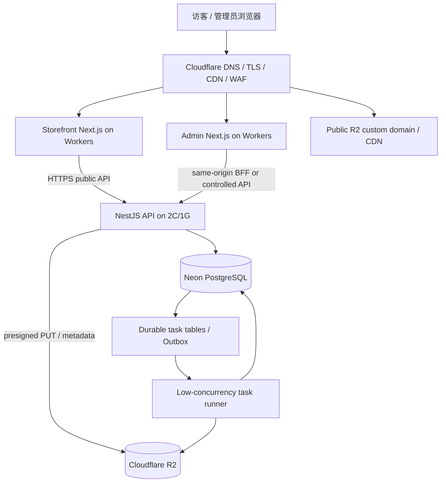

# 33. 轻量生产架构落地方案：Cloudflare + Neon + R2 + NestJS

> 状态：可执行实施基线；此文档是目标架构方案，不代表代码迁移、部署或验收已经完成。
> 目标资源：一台 2 vCPU / 1 GB RAM Linux 后端服务器。
> 目标托管：Cloudflare Workers（前台/后台）+ Neon PostgreSQL + Cloudflare R2。
> 版本核对日期：2026-10-23。
> 总原则：先验证，分阶段迁移；不同时进行数据库迁移、认证重写、文件迁移和任务队列替换。

## 1. 决策摘要

### 1.1 最终目标

- 前台：现有 `apps/storefront` Next.js 保留，目标部署到 Cloudflare Workers；先做兼容性 POC。
- 后台：现有 `apps/admin` Next.js 保留，目标部署到 Cloudflare Workers；登录、Cookie、CSRF、RBAC 与文件下载全部验收后再切生产。
- API：现有 `apps/api` NestJS 部署到单台 2C/1G 服务器，是唯一业务授权和数据写入边界。
- 数据库：Neon PostgreSQL。保留 Prisma/PostgreSQL，不迁 SQLite。
- 对象存储：Cloudflare R2。图片、派生 WebP、报价模板、报价 Excel、PI 文件等都用对象存储，不以服务器本地盘作为唯一副本。
- CDN：Cloudflare。公开商品图片走公开自定义域名，管理员文件、报价、PI 必须私有。
- 队列：目标是不运行 Redis。经过完整代码审计后，使用 PostgreSQL 持久化任务表、Outbox、原子 claim、租约、幂等和有限重试。
- 任务运行：图片转码与 Excel 生成不能塞入普通 HTTP 请求。初期可把任务执行器以同代码库、独立启动入口部署；只有实测 RSS 和 API 延迟足够时，才与 API 同进程。
- 构建：GitHub Actions 或开发机完成 build；生产服务器不执行整个 monorepo 的前端 build。

### 1.2 不在本次范围内

- 不把 Prisma provider 改成 SQLite。
- 不重写产品、RBAC、询盘或报价业务。
- 不将 Sharp 图片处理或大型 Excel 生成移入 Cloudflare Worker。
- 不将后台私密资产放进公共 CDN。
- 不承诺 2C/1G 在未压测情况下能承载任何固定并发量。
- 不在没有迁移清单及验证的情况下删除 Redis、BullMQ 或 Worker 代码。

## 2. 目标架构



### 2.1 域名

用实际域名替换示例值：

| 域名 | 用途 | 路由 |
|---|---|---|
| `www.example.com` | 英文公开前台 | Cloudflare Workers |
| `admin.example.com` | 中英后台 | Cloudflare Workers |
| `api.example.com` | NestJS REST API | Cloudflare Proxy 或 Tunnel 到源站 |
| `images.example.com` | 公开图片 | R2 自定义域名，允许公开读取的图片 bucket |

私有文件必须使用私有 R2 bucket 和授权下载/短期 URL。不要用同一个公开 URL 命名空间提供 Excel、PI 或尚未发布的商品原图。

### 2.2 服务边界

- Browser：只持有页面代码和用户 Session Cookie；不保存数据库/R2 密钥。
- Storefront：只访问公开 API；公共 DTO 使用字段 allowlist，任何输出层都不得包含内部价格。
- Admin：通过同源 Worker/BFF 路由或配置严格的跨域 API 请求；展示控制不能替代 API 授权。
- NestJS API：验证 DTO、Session、CSRF、RBAC、业务状态、任务创建和对象 key 所有权。
- Neon：唯一业务数据库；生产环境使用受控的运行时连接和独立迁移连接。
- R2：文件实体存储；数据库保存 key、MIME、大小、SHA-256、状态、业务引用等元数据。
- Task runner：处理图片转码、文件物理删除、Excel 导出及必要的聚合任务。不得直接对公网暴露端口。

## 3. 仓库当前实现与需要处理的差异

已审阅的仓库内容显示：

- 根目录使用 pnpm workspace，packageManager 为 `pnpm@11.25.0`；根 engines 写的是 Node `>=20.11.0`，实施前应核对 pnpm 11 的实际 Node 要求并统一 CI/runtime 版本。
- `apps/storefront` 与 `apps/admin` 当前都是 Next.js 15.5.27。
- Storefront 当前有服务端数据获取、动态 metadata、locale middleware/rewrite 相关依赖，不能直接假设为 Pages 静态导出。
- Admin 使用 Next rewrite 做 API 同源代理，并依赖后台登录、Session、RBAC、动态 CRUD。
- `apps/api` 与 `apps/worker` 当前都依赖 `bullmq`、`ioredis`。
- `.env.example` 当前有 `DATABASE_URL`、`REDIS_URL` 和 `STORAGE_DRIVER=local` 及 S3 配置，需要为生产 Neon/R2 与迁移连接规范作同步。
- `infra/docker-compose.dev.yml` 是本地开发 PostgreSQL/Redis，不应直接当生产编排。
- 现有模型包含 `FileDeletionJob`、`OutboxEvent` 和 `QuoteExportJob`。实施前需逐字段对照，避免重复建任务表或让任务状态出现多个真相源。
- `docs/29-production-server-deployment-runbook.md` 现有默认步骤仍按服务器运行 Storefront/Admin/API/Worker、Docker PG/Redis、Nginx 的架构编写，需要明确目标架构取代路径。
- 仓库 README 中 `docs/32-cloudflare-frontend-server-api-deployment.md` 链接重复，应顺便去重。

此清单只是静态仓库审阅，不表示相关命令已在本地执行或运行时已验收。

## 4. Cloudflare Workers 前后台迁移

### 4.1 不允许直接改成静态导出

在独立分支逐项验证现有应用：
- `middleware` 的 locale 重定向和请求行为。
- `next.config.mjs` 的 rewrites/headers。
- 动态商品 slug 路由、服务端组件与 `generateMetadata`。
- 服务端 fetch 的缓存、失效、错误和超时。
- Next Image/图片域名设置。
- Node.js APIs、原生依赖与 adapter 兼容性。
- Admin 的 cookies/headers、登录态、服务端代理、文件上传和文件下载。

先执行最小 POC，adapter 和 Wrangler 必须固定版本并写入 lockfile。候选路线按下面顺序评估：
1. 对当前 Next.js 15.5.27 与依赖执行 Cloudflare 官方兼容性检查。
2. 在隔离分支固定版本验证 OpenNext Cloudflare adapter。
3. 若当前版本/依赖不能可靠运行，暂停 UI runtime 迁移；先用 Cloudflare 代理现有 Node SSR，或单独评估局部静态化。
4. 只有有真实兼容报告后才更新生产部署配置。

不能因为“可在 Cloudflare 部署 Next.js”就假定仓库现有每项 Server Component、middleware、rewrite 和原生包都会工作。

### 4.2 首选 API 请求模式

先 POC 同源 Worker/BFF 代理模式：
- 浏览器访问 `admin.example.com/api/v1/*`。
- Worker 将请求代理给 API 源站。
- 代理不得在 Worker 内存保存 Session；Cookie 和权限由 NestJS 认证。
- 验证多个 `Set-Cookie` 头、请求体/multipart、状态码、超时、下载流及错误响应。
- 源站地址及 Worker→API 凭证放 Cloudflare server-side secrets/bindings，禁止进入 `NEXT_PUBLIC_*` 或浏览器 bundle。

替代方案是浏览器直连 `api.example.com`。只有在精确 CORS allowlist、credentialed cookie、SameSite/Secure、CSRF 和 Origin 校验通过测试后才可选择。禁止通配 Origin 与凭证并用。

### 4.3 缓存策略

- 公共已发布商品只缓存不含价格的 public DTO/HTML。
- 管理 API、登录/退出、带 Cookie 响应、询盘私密数据、报价模板、Excel、PI 和上传签名响应均 bypass shared cache。
- 商品发布/更新/下架后有明确 cache purge/tag revalidation 策略。
- 不得缓存需要实时校验发布状态但又无法及时失效的数据。
- 公开图片采用 content-version/hash 的不可变对象 key 与长期 CDN cache；替换图片使用新 key，不原地覆盖长期缓存对象。

## 5. Neon PostgreSQL 接入

### 5.1 环境变量

目标变量为设计规范。实际改代码前必须确认 Prisma schema/datasource 与 database package 的 env 读取方式；禁止先改模板后宣称代码已兼容。

```dotenv
# Neon pooled runtime URL
DATABASE_URL=postgresql://<runtime-user>:<password>@<pooled-host>/<db>?sslmode=require

# Direct connection for controlled migrations only
DIRECT_DATABASE_URL=postgresql://<migration-user>:<password>@<direct-host>/<db>?sslmode=require
```

- 生产 API 通过 pooled URL 访问 Neon；连接数设小，单个进程复用 Prisma Client。
- 数据库迁移在独立 release job/受控人工步骤执行；不要让 API 多实例并发迁移。
- 若当前 Prisma 版本或连接器对 pooled/direct 参数有不同要求，依照已锁定版本核验，不能盲目复制 URL 参数。
- 不将完整 connection string 写入提交、日志、截图或聊天。
- 在 Neon 控制台确认所选方案的可用性、存储/计算额度、自动暂停行为、备份/PITR 能力和恢复流程，再决定是否用于正式业务。
- 上线前以隔离数据恢复一次，不把“已有备份设置”当作恢复测试。

### 5.2 数据库连接与查询约束

- API 的 Prisma Client 在应用生命周期内单例复用，禁止每请求 new Client。
- 单 API 进程先用低连接池额度做压力测试；若有 task runner 独立进程，计算 API 与 runner 总连接上限。
- 使用 pooler 时避免无意叠加多个高容量连接池；迁移连接与运行时连接分开。
- 列表查询数据库分页，设最大 page size，按真实过滤/排序字段检查索引。
- Excel 生成采用分批读取，禁止无上限加载完整产品、图片和翻译记录。
- 定期检查慢查询、连接池等待、失败率和 Neon compute usage。

## 6. Cloudflare R2 文件策略

### 6.1 Bucket 与访问模式

建议创建两个 bucket：
- `b2b-public-assets`：只放经业务确认可以公开访问的已发布商品图片派生图、公开 logo/广告图。
- `b2b-private-assets`：原图、待审核图片、模板、报价 Excel、PI 和其他私密附件。若原图允许公开，须基于产品安全策略进行显式派生，不要直接公开源对象。

每个 bucket 使用最小权限凭据。若代码需要同一 R2 endpoint，可通过业务层 StorageAdapter 选择 bucket；不要把访问密钥交给客户端。

### 6.2 上传流程

1. Admin 调用 API 申请上传授权，服务端验证管理员权限、文件用途、大小上限和 MIME allowlist。
2. API 生成随机 object key 和短期 presigned PUT URL；key 不由客户端决定。
3. 浏览器直接 PUT 到 R2，避免 10MB 图片内容经 API 内存缓冲。
4. 浏览器通知 API 上传完成。
5. API 使用 S3-compatible HEAD 校验对象存在与大小/Content-Type；需要更强校验时由任务 runner 下载并真实解码。
6. 数据库资产进入 `processing`；任务 runner 以并发 1 生成 320/640/1280 WebP（不放大原图，沿用既有质量设置）。
7. 派生对象生成并复核成功后，资产状态改为 `ready` 并允许绑定业务。
8. 未绑定临时对象按保留策略生成删除任务。

若现有 StorageAdapter 尚不支持 presigned PUT，不可只改前端。需要添加接口、权限、上传确认、失败清理和测试。

### 6.3 R2 对象 key 约定

推荐按用途区分前缀：
- `public/products/{assetId}/{contentHash}/320.webp`
- `public/products/{assetId}/{contentHash}/640.webp`
- `public/products/{assetId}/{contentHash}/1280.webp`
- `private/originals/{assetId}/{randomKey}`
- `private/quote-templates/{templateId}/{version}/{randomKey}.xlsx`
- `private/quote-exports/{jobId}/{randomKey}.xlsx`
- `private/pi/{documentId}/{revision}/{randomKey}.xlsx`

此 key 规则为目标建议，实施前检查旧 key 格式和数据库长度，支持迁移时新旧 key 共存。不因 key 规则更改批量改写生产对象，除非迁移脚本先校验、对账、能重试。

### 6.4 物理删除与 CDN

- 对象不存在可按幂等删除成功处理，但数据库与资产状态必须同步。
- 私有资产永不映射到公共域名；下载使用 API 鉴权或短时有效 presigned GET。
- 公开对象以版本化 key 为主，删除/替换时还需按缓存策略失效旧 URL。
- 明确 R2 版本控制、删除标记和生命周期规则；物理删除要求与保留/版本策略一致。
- 资产删除流程复用 `FileDeletionJob` / `OutboxEvent` 等现有模型，重试达到阈值时保持失败可见、保留 storageKey 和审计。

## 7. 去掉 Redis/BullMQ：数据库任务调度规格

### 7.1 执行前盘点

全仓库执行并归档结果：
```bash
git grep -n -E 'REDIS_URL|ioredis|bullmq|new Queue|new Worker|QueueEvents|queue.add|queue.get|redis' -- ':!pnpm-lock.yaml'
```

每一个命中都要分类为：任务队列、缓存、Session、限流、锁、其他连接。此阶段禁止删依赖。

### 7.2 不新增第二套任务真相

优先复用：
- `FileDeletionJob`：持久化对象删除。
- `OutboxEvent`：事务后需要处理的事件/任务分发。
- `QuoteExportJob`：报价 Excel 业务任务与用户可见状态。

先审核现有 schema 与所有读写方，确认哪张表是任务状态事实来源。不要把所有任务都硬塞进 QuoteExportJob，也不要创建与旧表重复的通用状态表。

### 7.3 任务状态与原子领取

任务必须具备等价于以下能力（优先复用现有字段；缺项才做 additive migration）：
- 类型、载荷、业务引用/创建者；
- queued/running/succeeded/failed 状态；
- attempts、runAfter、lastErrorCode；
- idempotencyKey；
- 锁定租约 lockedUntil/workerId/heartbeat（若需要）。
- createdAt/updatedAt/completedAt。

领取应在一个短事务中使用行锁（如 `FOR UPDATE SKIP LOCKED`）或同等原子方案，把任务改为 running、增加 attempt 并设置租约。外部 R2 / Excel 操作不得放在持有数据库行锁的事务中。

伪 SQL（字段名须按实际模型调整，不能直接当迁移脚本执行）：
```sql
BEGIN;
SELECT id
FROM file_deletion_jobs
WHERE status = 'QUEUED'
  AND run_after <= now()
ORDER BY run_after, created_at
FOR UPDATE SKIP LOCKED
LIMIT 1;
-- 对被领取行设置 running、workerId/lockedUntil 与 attempt
COMMIT;
```

若现有 Prisma enum/表命名与示例不同，先查 schema 生成实际 SQL。可以用条件 UPDATE + 返回行或其他经测试的 claim 模式；关键是多 runner 不重复领取，租约过期后能恢复。

### 7.4 Worker 运行方式

首选实现一个可分别运行的 task-runner entrypoint，API 与 runner 共享服务层/数据库模块；初始 concurrency=1。部署时：
- API 服务负责 HTTP。
- Runner 服务只消费数据库任务；不监听公网端口。
- 在实测证明 1GB 能安全承载后，可以考虑用同进程模式减少一个常驻进程；必须保留可单独启动能力，便于将来隔离重任务。

如果用户量非常低也不代表任务可以同步执行；持久化状态、失败可见、重试与审计仍是必需功能。

### 7.5 重试、幂等和租约

- R2 DELETE：同一个 key 重复删除是安全的；不存在视作已完成。
- WebP 生成：输出使用 content hash key；任务重复执行不会覆盖其他资产。
- Excel：用 jobId 与随机 key 生成输出；成功上传且写回 fileKey 后才标 succeeded。
- 重试：初始最多 3 次，采用指数退避并加随机抖动；最终失败进入可人工重试状态。
- 进程崩溃：running 且租约过期的任务重新排队；不允许永久挂起。
- 两个 runner：用并发/竞争测试证明不重复领取。
- 清理：完成任务按保留政策归档/删除任务元数据，不直接删业务审计。

### 7.6 迁移顺序

1. 先为数据库任务增加可靠的 claim/lease/监控能力，不切任何生产队列。
2. 文件物理删除切到 PG runner，跑通过验收后观察一个完整运维周期。
3. 图片生成切到 PG runner，验证上传失败、Sharp 崩溃和内存峰值。
4. Excel 导出最后迁移，验证模板字段映射、金额准确、下载权限、过期清理和大数据集行为。
5. 检查 Redis 使用者与队列 backlog，停止创建新 BullMQ 任务，安全完成或排空已有任务。
6. 只有确认无任务遗留、无运行时代码依赖 Redis 后，才从 apps/api/apps/worker 和环境模板移除相关依赖/配置。
7. 更新本地开发说明：本地可暂时保留 Redis profile，或移除 Redis service；不能让 README 声称生产仍需要 Redis。

回滚边界：迁移阶段禁止让同一类任务同时被 BullMQ 与 PG runner 双重消费。回滚前先暂停任务创建、保存两个系统状态、决定唯一消费者后再切换。不要盲目重放已成功的删除/导出任务。

## 8. 2C/1G 服务器资源设计

1GB 是紧约束。以下数值是压测起点，不是容量保证：

| 项目 | 起始控制 |
|---|---|
| Node heap | API 从 256MB 起评估；同时观察 RSS/native memory |
| Task concurrency | 1 |
| Image processing concurrency | 1 |
| 数据库连接 | 低个位数起；考虑 API 和 runner 所有进程合计 |
| 上传 | 尽量 R2 直传；单图上限沿用业务设置并增加像素限制 |
| Excel | 限制条数、分批查询、限制最大执行时长 |
| 日志 | 结构化、轮转、脱敏和磁盘上限 |
| 发布构建 | CI/本地构建，不在生产机 build 整个 monorepo |
| 进程 | systemd；优雅停机；重启策略带延迟；限制文件描述符 |
| 内存保护 | 设置合理 swap 作为短暂缓冲，必须监控，不把 swap 当作 RAM 替代 |

测试采集：总 RSS、峰值 RSS、OOM 事件、CPU、API P95/P99、数据库等待、任务耗时、重试数与文件失败数。若 API+Runner 同进程造成 API P95 明显恶化或 RSS 接近系统安全边界，应保留独立进程并重新评估服务器升级；不能为了去掉进程而丢失可靠性。

## 9. API 源站防护

- API 通过 `api.example.com` 对外提供 TLS。选择 Cloudflare Proxy + Nginx，或 Cloudflare Tunnel。先用预览域名做连通测试。
- 若使用 Tunnel，确认后台守护、自启动、断线恢复、请求体/下载流和超时；Tunnel 不是 API 授权系统。
- 若使用 Cloudflare Proxy 到公开源站，源站应使用防火墙限制入口，或采用 Cloudflare 官方 IP allowlist 和源站身份校验。不要只按可伪造的 Header 通过认证。
- NestJS 的 trust proxy 只信任真实代理链；不要无条件信任客户端的 `X-Forwarded-For`。
- 不要把 API URL、Worker-to-origin secret、R2 keys 或 Neon URLs 放入 `NEXT_PUBLIC_*`。
- 登录、询盘提交、签名 URL 生成、上传确认、批量导出有独立 rate limit。

## 10. 生产环境变量目标

实际使用的变量必须按代码实现同步，以下是目标命名清单：

| 变量 | 位置 | 说明 |
|---|---|---|
| `DATABASE_URL` | API/Runner secret | Neon pooled runtime connection |
| `DIRECT_DATABASE_URL` | 仅 migration job | Neon direct connection；若 Prisma 版本不需要该名字，按实际 schema 配置 |
| `SESSION_SECRET` | API secret | 随机高熵秘密，分环境配置 |
| `S3_ENDPOINT` | API/Runner secret | R2 S3 endpoint |
| `S3_REGION` | API/Runner | 一般使用 R2 要求的 region 值并实际验证 |
| `S3_BUCKET` | API/Runner | bucket 名必须与 public/private 策略一致 |
| `S3_ACCESS_KEY_ID` / `S3_SECRET_ACCESS_KEY` | API/Runner secret | 仅服务器侧读取 |
| `S3_PUBLIC_BASE_URL` | API/前台配置 | 公开图片 URL base，不是密钥 |
| `ADMIN_API_PROXY_TARGET` | Worker secret/config | 仅服务端使用 |
| `STOREFRONT_API_PROXY_TARGET` | Worker secret/config | 仅服务端使用 |
| `REVALIDATE_SECRET` | 对应应用 secret | 用于受保护的缓存失效端点；若无此需求可不配 |
| `REDIS_URL` | 目标完成态 | 所有消费者切 PG runner 后移除；迁移期间不能提前删除 |

实施完才清理不再使用的环境变量；模板与运行代码必须一起改。密钥不提交到 GitHub。

## 11. 测试与验收门禁

### 11.1 本地/CI 基础门禁

在仓库环境执行实际存在的脚本，并保存日志：
```bash
pnpm install --frozen-lockfile
pnpm lint
pnpm typecheck
pnpm test
pnpm build
pnpm format:check
```
如已有脚本因环境原因无法运行，必须明确记录未运行原因，不能写“已通过”。

### 11.2 功能测试

- 前台首页、分类树、产品筛选/分页/详情、SEO metadata/OG 与 locale 工作。
- 任意公开响应、HTML、JSON-LD、metadata、图片 API 均无内部价格。
- Admin 登录/登出、Session 过期与刷新恢复、RBAC 越权拒绝、CSRF/Origin 防护。
- 商品、类别、标签、菜单、字典、全局配置 CRUD 与双语显示。
- R2 presigned upload/confirm、尺寸/类型校验、WebP 变体、公开/私有访问隔离。
- 物理删除对象幂等；R2 超时后可重试；共享资产不会被误删。
- Excel 导出异步状态正确，模板 mapping 正常，成功下载受权限保护，失败可人工重试。
- Neon pooler、API/runner 连接数、连接断开重试与迁移流程已实测。

### 11.3 故障恢复测试

- API 在任务创建后、执行前、写对象后、更新数据库前分别被重启。
- PG 短暂不可用、R2 超时、Runner 崩溃、租约过期、重复任务和双 Runner 竞争。
- 恢复数据库备份到隔离 Neon database/branch 并抽样核对业务数据。
- 验证 Workers 上一个可用版本可恢复，API release symlink 可回滚。
- 验证 DNS/Worker route 回滚后产品浏览、Admin 登录和询盘入口仍工作。

### 11.4 Go / No-Go

以下任一项失败即 No-Go：
- 登录、Cookie、CSRF 或 RBAC 未验收。
- 价格字段出现在公共端。
- R2 私密文件可匿名读取。
- 任务可能丢失、重复破坏数据，或文件删除会静默失败。
- 未完成数据库恢复演练。
- 在 2C/1G 测试发生 OOM、持续 swap thrash 或 API 请求受任务处理严重影响。
- 尚有生产 Redis 消费者但已经关掉 Redis。
- 发布/回滚及 secrets 仍靠手工复制明文到仓库。

## 12. 实施 checklist

### Phase 0 - 基线（不改变生产）
- [ ] 新建独立分支并记录 commit SHA。
- [ ] 全仓搜索 Redis/BullMQ/ioredis 所有用途。
- [ ] 映射 Worker task producers/consumers 和任务模型读写方。
- [ ] 列出所有 Storefront/Admin route 与 Node API 兼容点。
- [ ] 对照 Prisma datasource 和实际 env 变量读取。
- [ ] 对照 StorageAdapter 能力，记录 presigned URL 缺口。
- [ ] 保存 lint/typecheck/test/build 的真实基线结果。

### Phase 1 - Cloudflare POC
- [ ] 使用固定 adapter/Wrangler 版本部署 Storefront preview。
- [ ] 验证动态产品 SEO、locale、rewrite、错误页、图片和缓存。
- [ ] 部署 Admin preview，验收 Cookie、Session、CRUD、R2 upload、Excel download。
- [ ] 未通过则保持 Node SSR，不切正式 DNS。

### Phase 2 - Neon + R2
- [ ] 创建 Neon project/branch 与低权限运行时 DB 用户（如方案支持）。
- [ ] 配置 pooler、direct migration URL、访问控制与备份策略。
- [ ] 建立 R2 public/private buckets 与最小权限 key。
- [ ] 配置自定义公开图片域名与缓存规则。
- [ ] 实现 presigned PUT/confirm 和孤立文件清理，验证旧 key 兼容。
- [ ] 验证 DB 备份恢复以及 R2 资产清点/保留策略。

### Phase 3 - PG task runner
- [ ] 先实现原子 claim、lease、heartbeat、retry、idempotency 和任务可观测性。
- [ ] 迁移 file deletion 并稳定运行。
- [ ] 迁移 image processing 并做内存基准。
- [ ] 迁移 Excel export 并完成业务验收。
- [ ] 证明无 BullMQ 队列 backlog 和生产 consumers。
- [ ] 再移除生产 Redis/BullMQ/ioredis 和相关 env。

### Phase 4 - 单后端服务与上线
- [ ] API/Runner 发布包在 CI 构建，不在服务器 build。
- [ ] API 健康检查、优雅关闭、systemd、日志轮转与资源限制完成。
- [ ] API 源站已被 Cloudflare 路由安全保护。
- [ ] 两端前端在 Cloudflare 预览端完整验收。
- [ ] 执行 backup、E2E、价格隔离和负载/重启测试。
- [ ] 切换生产路由后观测并记录。
- [ ] 保留旧 release 与旧路由回滚窗口。

## 13. 回滚原则

- Cloudflare 前端：回退到上一已验证 Worker deployment/version 或将 route/DNS 指回当前稳定入口。
- API：回滚到上一 release，但先确认向前数据库 migration 与旧代码兼容。
- Neon：schema 回滚优先使用向前修复；对不可逆数据变更按预先演练的备份/恢复方案操作。
- R2：新旧对象 key 可并存，先恢复旧引用，再清理新对象；不要 Git revert 后就假定对象存储也已回滚。
- Redis 迁移：暂停任务生产，确定唯一消费者后切换；避免两个队列系统同时接任务。旧 BullMQ 代码/配置在稳定窗口内保留于回滚分支，不再被生产调用。
- 任何回滚均不得删除真实客户、商品、报价、审计或文件数据来“恢复干净”。

## 14. 官方参考

- Cloudflare Next.js on Workers: https://developers.cloudflare.com/workers/framework-guides/web-apps/nextjs/
- Cloudflare OpenNext adapter: https://developers.cloudflare.com/workers/framework-guides/web-apps/opennext/
- Cloudflare Pages static export: https://developers.cloudflare.com/pages/framework-guides/nextjs/deploy-a-static-nextjs-site/
- Cloudflare R2 getting started: https://developers.cloudflare.com/r2/get-started/
- Cloudflare R2 S3 presigned URLs: https://developers.cloudflare.com/r2/api/s3/presigned-urls/
- Neon connect from an app: https://neon.com/docs/connect/connect-from-any-app
- Prisma Migrate deploy: https://www.prisma.io/docs/orm/prisma-migrate/workflows/development-and-production
