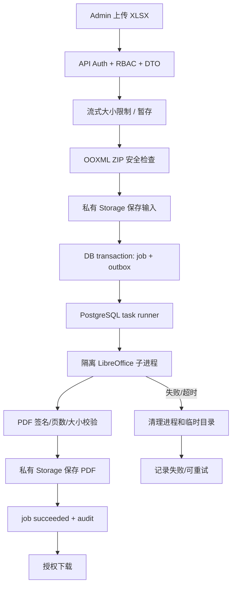

# Admin Excel 转 PDF — 可执行落地实施规范

> 项目：`NotFeel/b2b-inquiry-platform`  
> 文档编号：ADM-EXCEL-PDF-01  
> 目标分支：`main`  
> 范围：Admin 上传报价单 Excel 或 PI Excel，服务端转换成 PDF 并授权下载。  
> 状态：实现规格，不代表功能已完成或已部署。

## 0. 重要历史决策与本次重新引入

仓库历史文档 `docs/30-remove-excel-to-pdf-keep-quote-excel.md`、`docs/08-excel-pdf-pi.md` 和 README 曾明确要求移除 Excel→PDF。本需求是业务方提出的**重新引入**，不是恢复旧实现。编码前必须：

1. 审计当前 main 的代码和数据库，确认旧 PDF 页面、API、任务、表和依赖是否仍残留；不得用文档推断代码现状。
2. 仅新增独立 Excel→PDF 模块，不改现有报价 Excel 生成、模板管理、PI 业务数据/计算/Excel 导出。
3. 当前架构以 `docs/02-architecture.md`、`docs/33-lightweight-cloudflare-neon-r2-implementation.md` 为准：PostgreSQL durable task/outbox + Worker；不恢复 Redis、BullMQ、ioredis。
4. 实施本需求时同步更新 README 和 `docs/08` 中“Excel 转 PDF 已下线/不属于目标功能”的当前状态文字，并增加本文件导航。`docs/30` 保留为历史决策记录，不伪造或删除其历史内容；可在顶部新增“后续重新引入见 docs/38”提示。
5. 原始 XLSX 与 PDF 均为私有业务文件，禁止放入公开 R2/CDN 或第三方在线转换 API。

## 1. 目标和范围

### 1.1 用户流程

`Admin 登录 → 工具/文件中心 → Excel 转 PDF → 选择 .xlsx → 上传 → 服务端验证 → 创建持久化任务 → Worker 转换 → PDF 校验 → 私有存储 → 完成 → 下载/预览/删除`。

上传成功只代表任务已创建，不代表转换完成。UI 展示 queued、processing、succeeded、failed、cancelled、expired；真实状态以项目任务模型为准。

### 1.2 首期范围

- 仅支持 `.xlsx`；拒绝 `.xls`、`.xlsm`、`.ods`、`.csv`、`.xlsb`。
- 主要用于本系统生成的商品报价单 XLSX 和 PI XLSX；有权限的管理员可上传其他合法 XLSX，但执行相同安全校验。
- 默认按工作簿顺序转换所有可见工作表；隐藏工作表跳过。禁止执行宏、更新外部链接或联网刷新公式/数据连接。
- 一个 XLSX 产生一个 PDF；每个工作表遵循其打印区域、页面设置和分页设置。
- 支持上传、任务状态、下载/预览、重试、删除；不修改 XLSX 或原报价/PI 数据。

不做 PDF 编辑、合并拆分、OCR、签名、邮件发送、密码加密 PDF、多格式文档转换或浏览器端打印。

### 1.3 默认限制（部署前需压测）

| 项目 | 初始限制 |
|---|---:|
| 上传 XLSX | 10 MiB |
| ZIP 展开总大小 | 50 MiB |
| ZIP entries | 2,000 |
| 工作表数 | 20 |
| 非空单元格 | 20,000 |
| PDF 页数 | 200 |
| PDF 输出 | 50 MiB |
| 单任务超时 | 90 秒 |
| Worker 并发 | 1 |
| 自动重试 | 最多 2 次，仅临时基础设施错误 |
| 文件保留期 | 7 天，可配置 |

上限必须同时由 API 流式上传、反向代理、Worker 和存储层执行。具体值应按真实报价单/PI 模板和目标主机压测调整。

---

## 2. Admin UI 设计

### 2.1 菜单与路由

菜单建议放入现有“工具/文件中心”分组；没有该分组时复用合适的现有父菜单，禁止重复创建同名分组。

- zh-CN：Excel 转 PDF
- en-US：Excel to PDF
- 建议路由：`/[locale]/tools/excel-to-pdf`
- 复用唯一 Admin Shell，不创建新的侧栏或认证布局。
- 菜单隐藏不代表授权，API 每条路由必须独立 RBAC。

### 2.2 页面线框

```text
Excel 转 PDF / Excel to PDF                      [转换记录]
将报价单或 PI 的 .xlsx 文件转换为 PDF，便于预览和发送。

┌───────────────────────────────────────────────────────┐
│ 选择 Excel 文件                                        │
│ ┌───────────────────────────────────────────────────┐ │
│ │          拖拽 XLSX 文件到这里                       │ │
│ │                或 [选择文件]                        │ │
│ │           仅支持 .xlsx · 最大 10 MB                 │ │
│ └───────────────────────────────────────────────────┘ │
│ 文件名 | 文件大小 | [移除]                              │
├───────────────────────────────────────────────────────┤
│ 转换选项                                                │
│ 页面方向 [自动] 纸张 [自动] 缩放 [保留模板设置]         │
│ 工作表 [全部可见工作表]  □ 黑白输出                     │
│                                  [转换为 PDF]           │
├───────────────────────────────────────────────────────┤
│ 最近转换记录                                            │
│ 文件名 | 类型 | 创建时间 | 状态 | 页数 | 大小 | 操作   │
└───────────────────────────────────────────────────────┘
```

### 2.3 页面控件与交互

上传区支持拖拽和文件选择，前端扩展名/MIME 仅用于友好提示，后端是最终校验边界。上传后展示文件名、大小、移除操作。上传状态至少包括 idle、selected、uploading、validating、queued、uploadFailed、invalidFile、tooLarge。

转换选项仅提供经 LibreOffice 金样本验证支持的参数：
- 方向：自动/纵向/横向，默认自动，优先保留工作簿 Page Setup。
- 纸张：自动/A4/Letter/Legal，默认自动。
- 缩放：保留模板设置/宽度适配一页/每张工作表适配一页宽；默认保留模板设置。禁止“所有内容强制压到一页”。
- 工作表：所有可见工作表；不得通过客户端参数指定隐藏工作表绕过规则。
- 黑白输出：默认关闭。

可先只做默认转换；未实现的选项不得显示为可交互控件。不得承诺与 Microsoft Excel 像素级一致；LibreOffice 与 Excel 的字体、分页、图表和条件格式可能有差异。上传工作簿需要有可用公式缓存值，转换过程不联网刷新。

### 2.4 转换记录

字段：文件名、类型（quotation/pi/other）、创建人、上传时间、状态、页数、PDF 大小、到期日、操作。服务端分页，pageSize 最大 50；支持状态过滤、文件名搜索和日期筛选。

操作：
- 下载/预览：仅 succeeded 且有 download 权限。
- 重试：仅 failed 且有 retry 权限；重新验证输入文件存在且 hash 未变化。
- 删除：二次确认，先撤销下载，再建立物理删除任务。
- 详情：展示安全错误码、面向用户的信息和 requestId；不显示堆栈、文件 key 或内部路径。

PDF 预览和下载均必须走受保护 API，不返回永久公开 R2 URL。浏览器 Blob 下载后释放 object URL。页面在 360px 手机、平板与桌面适配；小屏记录列表变卡片或局部横向滚动，页面本身不得横向溢出。

### 2.5 状态与国际化

状态需覆盖初始、上传、验证、排队、处理中、成功、失败、重试、删除中、过期。轮询复用项目现有任务轮询策略，指数退避；页面隐藏时降频。

所有文案进入 zh-CN/en-US 资源。上传区域可键盘访问；错误显示稳定 messageKey、errorCode 和 requestId。不得将 File 内容、客户信息或长效授权 URL 写入 localStorage/sessionStorage。

---

## 3. 菜单、权限和审计

### 3.1 权限码建议

先查现有 Permission catalog，避免重复 code：
- `excel_pdf.read`：页面、列表、详情。
- `excel_pdf.create`：上传并创建转换任务。
- `excel_pdf.download`：下载与预览。
- `excel_pdf.retry`：重试失败任务。
- `excel_pdf.delete`：删除记录与文件。

如项目权限粒度更粗，可合并为 read/create/manage，但必须最小授权。MenuTranslation 必须有 zh-CN/en-US。Menu 只决定导航；Permission + RolePermission 才是 API 授权事实来源。不得因为新增菜单自动扩大普通角色权限。

建议仅管理员有 retry/delete；业务操作员按业务需求获得 read/create/download。若只允许查看本人任务，必须在服务端落实 owner/data-scope 过滤，不能只在前端过滤。

### 3.2 审计事件

建议事件：`EXCEL_PDF_UPLOAD_ACCEPTED`、`EXCEL_PDF_CONVERSION_SUCCEEDED`、`EXCEL_PDF_CONVERSION_FAILED`、`EXCEL_PDF_DOWNLOAD`、`EXCEL_PDF_RETRY`、`EXCEL_PDF_DELETE_REQUESTED`、`EXCEL_PDF_DELETE_SUCCEEDED`、`EXCEL_PDF_DELETE_FAILED`。

记录 actorId、jobId、输入 SHA-256、文件大小、页数、耗时、状态、错误码、requestId。不得记录文件内容、storageKey、报价逐行金额、完整客户资料、Cookie/session/token、命令参数或临时目录。

---

## 4. 转换架构与引擎

### 4.1 推荐方案：自托管 LibreOffice headless

在现有独立 Worker runtime 内部运行 LibreOffice headless；NestJS API 负责认证、上传校验、私有存储与建任务，不在 HTTP request 中直接执行 soffice。输入文件与 PDF 均保存在私有存储。



### 4.2 选型理由与限制

LibreOffice 可本地运行，无需向外部 SaaS 传输报价或 PI 内容，且有成熟的 Calc→PDF 转换能力。缺点是安装体积、CPU/RAM 占用与 Excel 渲染差异。目标架构文档的 API 主机规格为 2C/1G，必须进行真实峰值 RSS、CPU、磁盘和 P95 测试；若资源不足，拆出独立 Worker 节点或增加内存，不得直接提高并发。

不选第三方在线转换服务，避免客户报价、PI、联系人信息外传。不用 Puppeteer 截取 HTML 表格代替工作簿渲染。ExcelJS/JSZip 不是完整 Excel PDF 渲染引擎。

### 4.3 子进程安全

示意命令：

```bash
soffice \
  -env:UserInstallation=file:///tmp/lo-profile-<random> \
  --headless --nologo --nodefault --nofirststartwizard \
  --convert-to pdf:calc_pdf_Export \
  --outdir /tmp/excel-pdf/<job-id>/out \
  /tmp/excel-pdf/<job-id>/input.xlsx
```

必须 Node `spawn`，参数数组，`shell:false`；禁止 shell 字符串拼接和用户传入 CLI 参数。可执行文件路径由服务端配置固定。

每任务创建随机隔离目录（0700）、文件权限 0600、独立 LibreOffice profile；使用非 root 用户，限制 CPU/RAM/PID/文件描述符/临时磁盘；转换 sandbox 禁止网络出站；禁止宏、外链、外部数据刷新。超时后 kill 整个进程组，finally 清理临时文件和 profile。stdout/stderr 仅脱敏记录，不得写单元格内容。

PDF 输出必须验证 `%PDF-` 文件签名、可解析页数、非空页面、最大页数与最大输出字节。转换失败不得保留半成品下载入口。

---

## 5. XLSX 上传与安全验证

### 5.1 上传约束

优先复用现有安全上传设施；multipart 流式读取，限制 10 MiB。若项目已有 R2 presigned upload，则需 upload-complete 确认、私有对象检查和隔离验证后才可建任务。不能把未经确认的客户端对象交给 Worker。

校验步骤：
1. 扩展名必须为 .xlsx（不区分大小写）；MIME 不可信，只作辅助提示。
2. 验证 ZIP 容器签名、CRC/可读性、entry 数、展开大小和压缩比，拒绝 zip bomb。
3. 必须包含 `[Content_Types].xml`、`xl/workbook.xml` 等 OOXML 结构。
4. 拒绝 vbaProject.bin、macro-enabled content type、`xl/externalLinks/`、外部 TargetMode=External 关系、OLE/ActiveX、外部数据连接。
5. 限制 sheet 数、行列/非空 cell 规模、共享字符串、媒体总量；无法安全预检的超大工作簿拒绝。
6. 拒绝加密/密码保护无法解析的工作簿，错误码 `XLSX_PASSWORD_PROTECTED_UNSUPPORTED`。
7. 原文件名仅作脱敏展示元数据；存储名由服务端随机生成，不含客户名称、报价编号或 PI 编号。
8. 不刷新公式/外部连接、不执行宏、不联网；只使用工作簿已有缓存值。发现外部引用时拒绝。

### 5.2 安全边界

禁止任意 URL fetch（SSRF）、任意路径、任意 soffice 参数、任意字体路径、shell=true。ZIP 检查不应只看扩展名；设置 entry count、展开大小、单 entry 大小、压缩比和解析超时。对不支持的 OOXML feature 应明确返回限制错误，不要假装成功。

### 5.3 存储

输入/输出 FileAsset 均 `isPublic=false`。优先复用 FileAsset、Storage adapter、R2 私有 bucket 和现有删除任务。下载 API 强制 Auth + permission + job owner/data scope。R2 key 随机，API 不返回 key 或公开 URL。保留期默认 7 天；过期清理由持久化删除任务实际删除对象，失败需重试。

---

## 6. API 契约

路径统一 `/api/v1/admin`，具体 controller 路由依照现有 NestJS conventions。每个接口分别认证、授权和校验。

| 方法 | 路径 | 权限 | 作用 |
|---|---|---|---|
| POST | `/excel-pdf/jobs` | excel_pdf.create | multipart 上传并创建任务 |
| GET | `/excel-pdf/jobs` | excel_pdf.read | 分页列表 |
| GET | `/excel-pdf/jobs/:id` | excel_pdf.read | 详情/状态 |
| GET | `/excel-pdf/jobs/:id/download` | excel_pdf.download | 下载 PDF |
| GET | `/excel-pdf/jobs/:id/preview` | excel_pdf.download | inline 预览（可选） |
| POST | `/excel-pdf/jobs/:id/retry` | excel_pdf.retry | 重试失败任务 |
| DELETE | `/excel-pdf/jobs/:id` | excel_pdf.delete | 请求删除输入/输出文件 |

创建任务返回 HTTP 202：

```json
{
  "id": "uuid",
  "status": "queued",
  "fileName": "Quotation_USD_20261031.xlsx",
  "fileSize": 185240,
  "createdAt": "2026-10-31T01:13:35.000Z",
  "requestId": "..."
}
```

不返回 storageKey、私有 URL、Buffer、工作簿单元格内容或客户信息。创建支持 `Idempotency-Key`，防止客户端超时重发导致重复转换。

列表字段：id、fileName、businessType（quotation/pi/other）、fileSize、status、pageCount、outputSize、errorCode、createdAt、completedAt、expiresAt、createdBy。businessType 是用户选择的分类标签，不作为权限判断依据。分页最大 50。

下载只允许 succeeded 且 PDF asset 完整存在的任务；返回 `application/pdf`、安全 Content-Disposition、`Cache-Control: private, no-store`、`X-Content-Type-Options: nosniff`。下载流由服务端鉴权后读取 Storage，不返回长期 presigned URL。

重试时重新验证输入 asset 存在、hash 一致、权限有效；failed→queued 条件更新，设置新 attemptId；禁止重试 queued/processing/succeeded。删除先撤销下载能力，再建持久化对象删除任务。

---

## 7. 数据模型与 PostgreSQL durable task

先审计 `database/prisma/schema.prisma`、migration 和代码：FileAsset 是否支持私有 XLSX/PDF、purpose、hash、size、状态和过期时间；OutboxEvent / PG task runner 是否允许新增 task type 和 payload schema version；QuoteExportJob 是否专属于 Excel 生成；AuditLog 是否有事件类型和 JSON metadata；删除任务是否支持两个 asset。

优先扩展已有通用任务/outbox 为 `EXCEL_PDF_CONVERT` type；若无合适通用任务模型，则添加独立 `ExcelPdfConversionJob` 表。禁止创建竞争的第二套任务状态系统，也不要为本功能增加 Redis/BullMQ。

参考状态机：queued→processing→succeeded|failed|cancelled|expired。failed 可手动 retry→queued。Worker 通过现有原子 claim/lease/heartbeat 机制领取任务；过期 lease 可恢复。PDF 上传私有存储且完整校验后，才能将 job 更新 succeeded。R2/DB 非原子：使用待确认状态、幂等 key 和补偿删除任务处理孤儿对象。

如新增表，建议字段：id、creatorId、inputAssetId、outputAssetId、inputSha256、outputSha256、inputBytes、outputBytes、pageCount、businessType、status、attemptCount、attemptId、errorCode、errorMessageKey、idempotencyKey、leaseUntil、createdAt、startedAt、completedAt、expiresAt。字段命名与索引必须适配实际 schema conventions。新增 migration 必须 additive，并提供数据验证和回滚说明；不应无必要新增字段或表。

---

## 8. Admin 前端实现

建议功能边界（按仓库实际结构适配）：

```text
apps/admin/src/
  app/[locale]/tools/excel-to-pdf/page.tsx
  features/excel-pdf/
    api/excel-pdf.api.ts
    components/excel-file-dropzone.tsx
    components/conversion-options-form.tsx
    components/conversion-job-table.tsx
    components/conversion-job-status.tsx
    hooks/use-excel-pdf-jobs.ts
    types/excel-pdf.types.ts
    schemas/excel-pdf-form.schema.ts
```

使用现有 API client、Session、错误处理、表格/上传组件、Admin Shell 和 locale 路由。上传采用 FormData，不手动指定 multipart Content-Type boundary。提交时带 Idempotency-Key；客户端超时后以相同 key 查询/重试。成功后列表刷新并选中最新任务；轮询使用退避。下载按 Blob 处理，安全解析 Content-Disposition 文件名并释放 object URL。所有文案进入 zh-CN/en-US 资源。不要把文件内容/PI 数据持久化到浏览器存储。

---

## 9. API / Worker 代码实现边界

建议模块路径（实际适配项目）：

```text
apps/api/src/modules/excel-pdf/
  excel-pdf.module.ts
  excel-pdf.controller.ts
  excel-pdf.service.ts
  dto/create-excel-pdf-job.dto.ts
  dto/list-excel-pdf-jobs.dto.ts
  excel-pdf-upload.validator.ts

apps/worker/src/tasks/excel-pdf/
  excel-pdf-task.handler.ts
  xlsx-zip-validator.ts
  libreoffice.runner.ts
  excel-pdf-converter.ts
  pdf-output-validator.ts
  temp-workspace.ts
```

Controller 仅处理认证、RBAC、multipart 和响应；Service 负责 job/outbox、FileAsset、Storage、审计；Converter 是独立 adapter；Validator 负责输入资源约束。转换绝不能运行在 API 请求生命周期内。Worker shutdown 时停止领取新任务并正确处理中断；失败状态不可被旧 attempt 覆盖。

---

## 10. 菜单/权限 Seed 与国际化

- 通过项目现有幂等 reference seed 或 SQL 修复机制新增 Menu 与 zh-CN/en-US MenuTranslation。
- 新增 Permission code 时先检查现有目录；创建权限定义不等于给角色授权。
- 只有经过确认的角色才授予 create/read/download；retry/delete 默认管理员专用。
- 菜单父级不存在时不自行新建平行菜单树；先选择现有合适父级。
- 更新菜单翻译覆盖检查，新增 menu 必须通过 `pnpm check:menu-translations`。

---

## 11. Worker 部署与资源管理

- 仅在 Worker 镜像安装 LibreOffice headless 和所需字体；API 镜像不要安装。
- 固定基础镜像与包版本/tag/digest，不使用 latest；非 root 运行。
- Worker 临时目录使用受限 tmpfs/volume；只读根文件系统；限制 CPU/RAM/PID/临时盘。
- 禁止转换容器网络出站；存储读写由 Worker 主进程的 Storage adapter 执行，必要时按最小权限提供网络。
- Cloudflare Workers 只负责 Admin UI/BFF 请求转发；不在 Cloudflare Worker request CPU 生命周期中执行 soffice。
- 若 API 与 Worker 同机，先做压测；转换导致 API readiness/P95 恶化时必须把 Worker 分离部署或提升规格。
- 监控 queued age、转换时长、失败率、retry、RSS、临时磁盘、PDF 页数/大小。

配置必须先检查现有 ConfigModule、环境变量 schema 和部署文档后决定。建议逻辑配置：enabled 默认 false、maxUploadBytes 10 MiB、maxOutputBytes 50 MiB、timeoutMs 90,000、maxSheets 20、maxPages 200、retentionDays 7、workerConcurrency 1。只将运维确实需要调节的项目放入 `.env.example`；不暴露任意 CLI 参数。

---

## 12. 测试与验收

### 12.1 单元测试

- OOXML：合法 xlsx；伪装扩展名；损坏 ZIP；缺少 workbook.xml；entry/展开大小/压缩比超限；宏、外链、OLE、ActiveX、加密工作簿拒绝。
- LibreOffice runner：固定 spawn 参数、shell=false、超时 kill process group、异常 exit、空 PDF、输出大小超限、临时文件清理。
- PDF validator：签名、页数、可解析性、空页/损坏输出/超页拒绝。
- 状态机：queued→processing→succeeded/failed；lease 恢复；重试次数；幂等；双 Worker 竞争同一任务。
- 权限：未登录 401，无权限 403，跨用户 job 下载按项目防枚举策略拒绝，已删除/未成功 job 下载拒绝。
- 审计脱敏：不含 storageKey、文件内容、客户资料、PI 明细、token 或完整命令参数。

### 12.2 API 集成测试

1. 未登录上传/list/detail/download/retry/delete 均 401。
2. 缺 create/read/download/retry/delete 对应权限时分别 403。
3. 合法报价 XLSX 上传返回 202，任务 queued；Worker 完成后 PDF 可解析。
4. 合法 PI XLSX 可转换；PI 原始业务数据和 XLSX 不变。
5. 格式伪装、超大文件、zip bomb、宏/外链/加密文件拒绝。
6. 转换失败不产生可下载 output asset。
7. R2/DB 失败的补偿与孤儿清理可观察、可重试。
8. retry 并发、删除、到期清理物理对象与数据范围测试。
9. PDF 不会进入公开 API、公开 CDN 或无需授权的 URL。

### 12.3 Admin E2E

`登录 → Excel 转 PDF → 上传 quotation.xlsx → queued → processing → succeeded → 下载 PDF → 校验页数/非空 → 删除 → 验证物理对象删除完成`。PI 文件再执行一轮。测试 360px、768px、1280px，以及键盘上传、拖拽、错误格式、网络中断、重复点击、轮询失败、下载失败和权限拒绝。

### 12.4 金样本视觉回归

以当前正式报价模板生成含 Logo、商品图片、长英文名称、价格和 footer 的 XLSX；另准备 PI XLSX。检查页数、方向、打印区域、重复表头、商品图片、边框、字体、合并、页眉页脚、币种与金额。与 Microsoft Excel 参考 PDF 逐页比较；允许已记录的引擎差异，关键字段/图片不可丢失。测试记录转换器版本、OS 镜像 digest 和日期；不提交真实客户数据样本。

---

## 13. 执行拆分（AI Coding Agent）

### Phase 0：仓库审计（先做）

阅读 `AGENTS.md`、`docs/02-architecture.md`、`docs/08-excel-pdf-pi.md`、`docs/30-remove-excel-to-pdf-keep-quote-excel.md`、`docs/33-lightweight-cloudflare-neon-r2-implementation.md`、RBAC/菜单/文件存储文档。检查 schema/migrations、FileAsset、QuoteExportJob、OutboxEvent、PG task runner、Storage adapter、权限 seeds、菜单 seeds、Admin routes、Worker Dockerfile。输出旧 PDF 代码/表/依赖残留审计表。记录 main SHA、工作区状态，创建功能分支；不要直接在 main 修改业务代码。

### Phase 1：DB/API/Worker

审计后确定通用 task type 是否可扩展；确有需要才加 additive migration。实现上传验证、job/outbox、RBAC、审计、LibreOffice converter、PDF validator、私有存储、授权下载、重试、删除和过期清理。

### Phase 2：Admin

新增菜单、翻译和 permission seeds；构建上传页面、转换选项、记录、状态、下载/预览/重试/删除；加入双语和响应式测试。角色授权必须经审查，不得 seed 时静默授予普通角色。

### Phase 3：部署与安全

Worker 镜像增加 LibreOffice/字体；API 镜像不装。加入资源限制、无网络隔离、健康指标与配置。功能开关默认关闭，先 preview 环境验收。

### Phase 4：测试与文档

执行 workspace 测试、lint、typecheck、build；记录未运行项目及原因。更新 README、docs/08、部署文档和 docs/30 历史说明。本文件仅说明计划，不代表代码实现。

---

## 14. 发布与回滚

发布顺序：备份 PostgreSQL 元数据；部署 additive migration（如有）；部署 API/Worker 镜像且关闭功能；验证 soffice、字体和临时盘；执行报价单与 PI 金样本 smoke test；运行幂等 seed；preview 验收后启用；监控队列延迟、RSS、失败率、临时磁盘与 API P95。

回滚：关闭功能开关并停止 Worker 领取 `EXCEL_PDF_CONVERT`；API 入口返回 disabled，不只隐藏菜单；保留 job、审计、FileAsset 与对象；回滚 API/Worker 镜像；additive migration 默认不反向删除；不删除报价单 Excel、PI Excel、模板与 PI 业务数据。

---

## 15. Definition of Done

- [ ] zh-CN/en-US 菜单及页面正常，复用 Admin Shell。
- [ ] 每个接口服务端认证与 RBAC 正常。
- [ ] 仅合法安全 XLSX 可上传；宏、外链、zip bomb 等拒绝。
- [ ] API 只负责验证/建任务，Worker 隔离执行 LibreOffice。
- [ ] 使用 PostgreSQL durable task/outbox；不引入 Redis/BullMQ。
- [ ] 输入/输出均私有存储，下载强制授权，不存在公开 URL。
- [ ] 报价单 Excel、PI Excel 的原有导出链路无回归。
- [ ] PDF 经签名、页数、大小和可解析性检查。
- [ ] 重试、超时、Worker 崩溃恢复、删除与过期清理有自动化测试。
- [ ] Excel/LibreOffice/WPS 与 PDF 查看器人工验收完成。
- [ ] lint、typecheck、tests、build 的真实结果记录完整。
- [ ] README、docs/08、docs/30 历史记录和部署文档已同步更新。