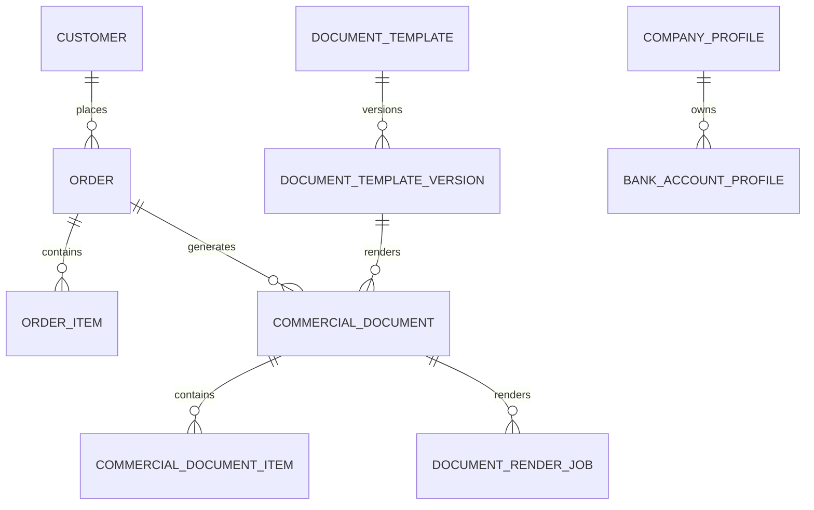

# CI / PI 商业单据中心、订单客户信息修正与模板引擎 — 可执行需求及技术实施规范

> 文档编号：DOC-41 / B2B-COMMERCIAL-DOCUMENTS-01  
> 目标仓库：`NotFeel/b2b-inquiry-platform`  
> 目标分支：`main`  
> 文档状态：需求与实施基线（不是功能已完成声明）  
> 关联规范：`docs/08-excel-pdf-pi.md`、`docs/39-admin-quotation-calculator-and-order-center.md`、`docs/04-data-model.md`、`docs/05-api-contract.md`  
> 本次目标：基于现有报价计算器、订单、PI 模型和用户提供的 Commercial Invoice 样本，扩展订单资料维护、CI/PI 文档创建、可配置 PDF 模板填充与历史文件追溯。  
> 实施记录：`docs/42-commercial-documents-implementation.md`（本文件保留为需求与验收基线，不代表所有阶段均已完成）。

---

## 0. 产品决策摘要

本次不是在 PI 页面简单增加一个 CI 按钮，而是将现有“形式发票 PI”升级为 **商业单据中心 / Commercial Documents**。系统围绕订单建立一份可追溯的交易数据快照，再按单据类型生成 PI 或 CI。

### 0.1 关键业务决策

1. 报价计算器是客户和商品交易信息的主要录入入口；创建订单时将客户、商品、包装、价格、币种、汇率、费用等保存为订单快照。
2. 订单管理是订单事实资料的维护入口。允许授权人员修正订单客户/收货资料，但必须明确区分“只修改本订单快照”和“同步更新客户主档”。
3. PI 与 CI 共用订单数据，但属于不同单据实体、不同编号、不同状态、不同字段集合、不同模板。
4. PI/CI 创建时先从订单预填资料，再由操作人员在单据编辑页补齐和覆盖本单据专属信息；不得要求重复录入订单已有资料。
5. 已签发的 PI/CI 不允许直接覆盖。修改后创建 revision，旧版本 PDF、数据快照、模板版本和哈希必须保留。
6. 模板采用“业务数据模型 + 字段映射 + 可视化模板设计 + PDF 渲染”的方案。优先以 HTML/CSS 模板渲染 PDF；保留现有 Excel 模板流水线；后续可增加原始 PDF 坐标叠加模式。
7. CI 金额、币种和商品明细必须来自订单快照或经过明确确认的单据覆盖值；服务端使用 Decimal 重新计算，禁止信任浏览器传入的总额。
8. CI 的贸易术语、交货地点、收货人、运输、原产国、HS Code、包装件数、重量、银行账户等字段需要单独维护，不能假设报价计算器已经包含。

### 0.2 术语与文件边界

| 单据 | 用途 | 系统规则 |
|---|---|---|
| Quotation | 报价及报价核算 | 现有报价计算器/报价草稿 |
| Order | 已确认的交易订单 | 交易事实和金额快照 |
| PI / Proforma Invoice | 形式发票 | 付款前确认交易条款、金额、付款方式 |
| CI / Commercial Invoice | 商业发票 | 出口、清关、运输及交易申报使用 |
| Packing List | 装箱单 | 本次不实现，但 CI 数据模型应预留包装明细复用 |

PI 与 CI 不是同一 PDF 改标题。两者可以共享卖方、买方、商品行、币种、金额等数据，但 CI 应具备清关和运输申报信息。具体法定/海关要求会因目的国、商品和贸易方式而异，系统字段不能替代报关行或海关的合规审核。

---

## 1. 现有项目审查结论与范围边界

### 1.1 当前仓库已有能力（基于 main 分支代码/文档审查）

- 已有报价计算器页面：`apps/admin/src/app/[locale]/(admin)/quotation-calculator/page.tsx`。
- 已有订单管理页面：`apps/admin/src/app/[locale]/(admin)/orders/page.tsx`。
- 已有 PI 页面：`apps/admin/src/app/[locale]/(admin)/pi-documents/page.tsx`。
- 已有订单/报价 API 客户端：`apps/admin/src/lib/quotation-order-api.ts`。
- 已有报价订单后端模块：`apps/api/src/modules/quotation-export/quotation-order.controller.ts`、`quotation-order.service.ts`。
- 已有 PI 后端模块：`apps/api/src/modules/pi/pi.controller.ts`、`pi.service.ts`、`pi-calculator.ts`。
- 已有 PostgreSQL Prisma 模型：`Quotation`、`QuotationItem`、`Order`、`OrderItem`、`OrderFee`、`Customer`、`PiDocument`、`PiItem`。
- `docs/39` 已定义报价、订单、客户快照、金额计算、费用、汇率、幂等和订单级双海运报价；其原始范围明确不含 PI/PDF 模板生成。
- `docs/08` 已定义 PI 独立模型、revision、服务端金额计算和 Excel 模板版本化机制。

### 1.2 当前页面观察

根据本次提供的后台截图：

- 订单管理页当前显示订单编号、状态、订单日期、CNY 总额、外币总额和 Excel 导出操作；页面顶部有 Excel 报价模板选择器。
- 订单列表没有客户名称、联系人、国家、收货地址等信息，也没有详情、编辑或客户资料修正入口。
- 形式发票 PI 页面当前为“暂无数据 + 新建”，缺少订单选择和订单预填的可见入口。
- 报价计算器页面已有客户与单据区域：报价标题、公司、联系人、电话、邮箱、国家/地区代码、订单日期；收货地址区域有收件人、城市、州/省/地区、邮政编码、街道地址。
- 报价计算器商品行已有 SKU/名称、内部成本、每箱数量、箱数、商品总数、箱规、重量、销售单价、CBM 和总重量等字段。
- 报价计算器已有币种、汇率、汇率日期、海运计费方式、体积重系数、CBM/KG 海运单价、配送费等输入。

### 1.3 本次不应破坏的现有规则

- 订单的商品、包装、费用、金额和汇率是历史快照；商品主档更新不能改变已创建订单。
- 商品内部采购成本不得出现在客户可见的 PI/CI PDF 中，除非将来明确增加独立权限和业务审批；默认永不输出。
- 订单计算金额由后端 Decimal 引擎计算。前端仅展示和输入业务参数。
- Customer 主档与 Order 客户快照分离。修正一个订单的客户信息不应静默改变该客户其他订单。
- 已签发单据冻结；后续更正通过 revision 处理。
- 继续使用现有两层字典、RBAC、审计、对象存储和 Worker 任务体系，不另造平行基础设施。

---

## 2. CI PDF 字段拆解与字段来源矩阵

依据用户上传的 `CI_Commercial_Invoice_20201020(1).pdf` 第 1 页解析。以下为该样本中实际出现的字段，并补充系统化建议。

### 2.1 CI 字段清单

| PDF 区域 | PDF 字段 | 必填建议 | 数据来源/维护位置 |
|---|---|---:|---|
| Header | Commercial Invoice 标题 | 是 | 单据类型固定文案/模板 |
| Invoice | Invoice Number | 是 | CI 创建时系统生成，可人工覆盖需权限 |
| Invoice | Invoice Date | 是 | CI 编辑页默认当前日期 |
| Invoice | Contract No. | 否 | 订单合同号；订单字段或 CI 覆盖 |
| Trade | Trade Term | 是 | CI 贸易与运输区 |
| Trade | Named Place / Delivery Address | 按贸易术语 | CI 贸易与运输区 |
| Trade | Currency | 是 | 默认订单币种；CI 可覆盖需重新核算 |
| Trade | Payment Terms | 是 | 默认订单/PI 付款条款；可选字典或自定义 |
| Seller | Seller / Exporter 公司名 | 是 | 全局公司资料档案 |
| Seller | 地址、国家 | 是 | 全局公司资料档案 |
| Seller | 联系人、电话、邮箱 | 建议 | 全局公司资料档案 |
| Buyer | Sold To 公司/个人名称 | 是 | Order 客户快照 |
| Buyer | 买方地址、国家 | 是 | Order 客户/账单地址快照 |
| Buyer | 联系人、电话、邮箱 | 建议 | Order 客户快照 |
| Consignee | Ship To / Consignee | 视交易 | Order 收货地址；CI 可独立覆盖 |
| Notify Party | Notify Party | 可选 | CI 编辑页 |
| Items | Item Description | 是 | 订单商品描述快照，可在 CI 行覆盖 |
| Items | SKU / Product Code | 建议 | OrderItem 快照 |
| Items | HS Code | 强烈建议 | 商品出口资料主档 + CI 行覆盖 |
| Items | Country of Origin | 是 | 商品原产国主档/CI 行覆盖 |
| Items | Qty、Unit | 是 | OrderItem 快照 |
| Items | Unit Price | 是 | OrderItem 销售单价快照 |
| Items | Line Amount | 是 | 服务端计算 |
| Totals | Subtotal | 是 | 服务端计算 |
| Totals | Freight / Shipping Fee | 按订单费用 | Order 费用快照，CI 可按费用类型映射 |
| Totals | Insurance | 按交易 | Order 费用或 CI 费用 |
| Totals | Discount / Other Charges | 有则显示 | 订单费用/CI 费用 |
| Totals | Grand Total | 是 | 服务端计算 |
| Totals | Amount in Words | 建议 | 服务端按币种生成 |
| Totals | Exchange Rate | 有换汇时 | 订单汇率快照 |
| Shipping | Shipping Method | 建议 | CI 运输区 |
| Shipping | Estimated Transit Time | 可选 | CI 运输区 |
| Shipping | Port of Loading | 视运输 | CI 运输区 |
| Shipping | Port of Discharge | 视运输 | CI 运输区 |
| Shipping | Route / Destination | 视运输 | CI 运输区 |
| Shipping | Packages / Cartons | 建议 | 订单箱数汇总/CI 覆盖 |
| Shipping | Gross Weight / Net Weight | 按申报要求 | 订单包装快照/补录 |
| Shipping | Measurement / CBM | 按运输要求 | 订单包装快照计算 |
| Payment | Account Holder | 有电汇时 | 收款账户档案快照 |
| Payment | Account Number | 有电汇时 | 收款账户档案快照 |
| Payment | Wire Routing Number | 适用时 | 收款账户档案快照 |
| Payment | ACH Routing Number | 适用时 | 收款账户档案快照 |
| Payment | SWIFT/BIC | 国际电汇时 | 收款账户档案快照 |
| Payment | Bank Name | 有电汇时 | 收款账户档案快照 |
| Payment | Bank Address | 有电汇时 | 收款账户档案快照 |
| Notice | Payment / Shipment Notice | 可选 | 模板固定条款或 CI 自定义备注 |
| Notice | Country of Origin Declaration | 按商品 | 商品原产国和声明模板 |
| Signature | Seller Signature / Stamp | 视公司流程 | 公司资料/签章文件 |
| Signature | Buyer Signature | 可选 | 通常留空供买方签署 |

### 2.2 PDF 样本中的具体异常（生成前必须校验）

样本第 1 页出现：
- 商品表头写 `Unit price (AUD)`，但行金额、Subtotal 和 Total 标注 USD。系统必须阻止这种币种不一致。
- Trade Term 文本把 DDP 和目的地址放在同一字段。系统要拆成 `incotermCode=DDP`、`namedPlace` 和具体交货地址。
- PDF 地址中出现 Snellville / Snelville 拼写差异；不得自动猜测正确地址，应允许管理员修正并在预览确认。
- Country 使用 America；客户国家应使用 ISO 3166-1 alpha-2 代码（如 US），模板显示名由字典/国家库映射。
- 汇率为 `1 USD = 6.68 CNY`，而报价计算器既有方向为 `1 CNY = X 目标货币`。CI 必须保存明确的 base/quote 方向，显示时转换为人类可读表达，禁止方向混淆。
- 样本有商品原产国声明，但没有每行 HS Code、净重、毛重和包装数量字段。若客户/货代/目的国要求，必须在 CI 表单补录，不能凭空推导。

---

## 3. 报价计算器：客户资料补充设计

### 3.1 当前已有字段

截图中报价计算器“客户与单据”区域已包含：

- 报价标题
- 公司
- 联系人
- 电话（E.164）
- 电子邮箱
- 国家/地区代码（ISO 两位字母）
- 订单日期
- 收货人
- 城市
- 州/省/地区
- 邮政编码
- 街道地址

以上字段应保留，并继续作为新建订单的基础输入。

### 3.2 必须补充的客户/地址字段

| 字段 | 中文 | 类型 | 规则 | 用途 |
|---|---|---|---|---|
| customerId | 已有客户 | UUID | 选已有客户自动填充，可切换新客户 | 客户主档关联 |
| customerType | 客户类型 | enum | COMPANY / INDIVIDUAL | 买方展示 |
| legalCompanyName | 公司法定名称 | string | 企业客户建议必填 | Sold To |
| contactName | 联系人 | string | 建议必填 | 联系信息 |
| email | 邮箱 | string | 格式校验 | 联系信息 |
| phoneE164 | 国际电话 | string | 沿用当前电话规则；按现有模型决策 | 联系信息 |
| countryCode | 国家代码 | string(2) | ISO alpha-2 | 地址国家 |
| billingAddressLine1 | 账单地址 1 | string | 视业务必填 | Sold To |
| billingAddressLine2 | 账单地址 2 | string | 可选 | Suite / Unit |
| billingCity | 账单城市 | string | 条件必填 | Sold To |
| billingState | 州/省/地区 | string | 条件必填 | Sold To |
| billingPostalCode | 邮编 | string | 视国家规则 | Sold To |
| billingCountryCode | 账单国家 | string(2) | 默认客户国家 | Sold To |
| shippingRecipient | 收货人 | string | 订单必填 | Consignee |
| shippingCompany | 收货公司 | string | 可选 | Consignee |
| shippingPhoneE164 | 收货电话 | string | 按承运要求 | Consignee |
| shippingAddressLine1 | 收货街道地址 | string | 订单必填 | Ship To |
| shippingAddressLine2 | 收货地址补充 | string | 可选 | Ship To |
| shippingCity | 收货城市 | string | 订单必填 | Ship To |
| shippingState | 收货州/省 | string | 依国家规则 | Ship To |
| shippingPostalCode | 收货邮编 | string | 依国家规则 | Ship To |
| shippingCountryCode | 收货国家 | string(2) | 订单必填 | Ship To |
| taxId / vatNumber | 税号 | string | 可选，按目的国 | 买方税务信息 |
| website | 网站 | string | 可选 | 客户档案 |
| buyerReference | 买方采购参考号 | string | 可选 | CI/PI |
| contractNo | 合同编号 | string | 可选 | CI/PI |
| preferredLanguage | 客户文件语言 | locale | 默认 en-US | PI/CI 输出 |

### 3.3 地址模型建议

不要继续把客户所有地址都塞进一个字符串。建议 Customer 主档使用结构化账单地址与默认收货地址；Order 保存以下独立 JSON 快照或结构化字段：

- `buyerSnapshot`：买方主体、联系人、电话、邮箱、税号、账单地址。
- `consigneeSnapshot`：收货人、收货公司、电话、收货地址。
- `notifyPartySnapshot`：可选通知方；默认不从客户主档自动推断。
- `customerSnapshot`：为兼容现有报价/订单历史保留；迁移期间定义唯一数据来源，避免同一字段在多个 JSON 重复冲突。

如果当前订单 schema 已经保存 `customerSnapshot`，第一阶段可以在该 JSON 中增加 versioned schema 的 `buyer`、`billingAddress`、`consignee` 子对象；如需要查询/筛选客户国家、公司名称，优先用结构化列而不是 JSON-only。

### 3.4 页面布局

报价计算器“客户与单据”改为两级折叠分组：

**第一行：客户选择**
- 选择已有客户 / 填写新客户。
- 已有客户通过公司名、联系人、E.164 电话、邮箱搜索。
- 选择客户后填充主档；用户修改本次订单信息时默认仅修改订单草稿，不自动覆盖客户主档。
- 提供“将本次修改同步更新客户主档”复选项；同步需要 customer.update 权限，并在保存前明确提示。

**第二行：买方信息（Sold To）**
- 客户类型、公司法定名称、联系人、电话、邮箱、税号、国家。
- 账单地址：地址 1/2、城市、州/省、邮编、国家。

**第三行：收货信息（Ship To / Consignee）**
- “与账单地址相同”开关。
- 收货公司、收货人、收货电话、地址 1/2、城市、州/省、邮编、国家。
- 允许收货地址国家与账单国家不同。

**第四行：订单/买方参考**
- 报价标题、报价日期、有效期、订单日期、Buyer Reference、Contract No.
- 订单日期只在直接创建订单或从报价转订单时作为订单字段。

桌面端使用 2–3 列网格；地址组单独占整行；移动端单列。默认展开客户选择、买方、收货地址；其他参考信息折叠。

---

## 4. 订单管理页面功能重构

### 4.1 订单列表字段

当前列表只显示订单号、状态、订单日期、CNY 总额、外币总额和 Excel 导出。建议调整为：

| 列 | 内容 |
|---|---|
| Order No. | 订单编号 |
| Customer | 公司/个人名称 |
| Contact | 联系人 |
| Country | 国家 |
| Order Date | 订单日期 |
| Status | CONFIRMED / CANCELLED |
| Currency | 币种 |
| Total | 外币订单总额 + CNY 参考金额（可配置显示） |
| Documents | PI 数量 / CI 数量 / 最近单据状态 |
| Updated At | 最后修改时间 |
| Actions | 详情、编辑、创建 PI、创建 CI、导出报价 Excel |

增加搜索和筛选：
- 订单号、公司名、联系人、电话（按权限）、邮箱（按权限）。
- 状态、币种、国家、订单日期范围。
- 是否已创建 PI、是否已创建 CI。
- 分页、每页条数、排序。

### 4.2 订单详情页/抽屉

点击订单号或“详情”打开详情抽屉/独立页面，采用 Tab：

1. **订单概览**：订单号、状态、日期、创建人、来源报价、币种、总额。
2. **客户资料**：Sold To、Billing Address、Consignee、Notify Party（若有）。
3. **商品明细**：SKU、名称、箱数、每箱数量、总件数、单价、行金额、箱规、CBM、重量。
4. **费用与汇率**：海运方式、CBM/KG 两套报价、选中方式、汇率及日期、费用行、CNY/外币合计。
5. **商业单据**：PI/CI 编号、revision、状态、生成时间、下载 PDF、创建新 revision。
6. **操作日志**：修改人、修改时间、修改字段、修改前后值摘要（敏感数据脱敏）。

### 4.3 订单客户信息修改流程（解决“第一次填错无法修改”）

提供明确的“编辑客户/收货信息”按钮。

编辑弹窗分组：
- 买方主体：公司法定名称、联系人、电话、邮箱、税号、国家。
- 账单地址：地址 1/2、城市、州/省、邮编、国家。
- 收货地址：收货公司、收件人、电话、地址 1/2、城市、州/省、邮编、国家。
- 买方参考：Buyer Reference、Contract No.

保存策略：
1. 默认只更新该 Order 的客户/收货快照。
2. 可选“同步更新客户主档”；只有具备 customer.update 权限才显示。
3. 订单原值写入审计记录，日志中电话、邮箱、详细地址必须脱敏或按最小必要原则保存。
4. 修改订单快照时使用乐观锁（updatedAt/version）防止多人覆盖。
5. 保存后重新读取订单详情并刷新列表。
6. 不自动改变已生成的 PI/CI；已签发单据继续显示签发时快照。
7. 若订单已有 issued PI/CI，显示提示：“本次修改仅影响订单当前资料，不会修改已签发文件。需要同步更正单据，请创建新 revision。”
8. 订单状态为 CANCELLED 时默认禁止编辑；管理员可通过单独权限执行受审计修正，或先恢复/重新开启订单（需明确业务决策）。
9. 修改客户资料不修改商品价格、费用和总额。若修改商品/价格/贸易费用，应走独立的订单变更流程和 revision，不复用客户资料编辑接口。

### 4.4 订单编辑边界

- 客户信息可在订单确认后修正，但必须记录审计。
- 商品数量、价格、币种、汇率、运费、费用属于交易金额事实，不允许通过“编辑客户”接口修改。
- 已签发 PI/CI 不得被订单变更静默覆盖。
- 如果确需改商品、金额或运输条件，建议增加“订单变更 revision”流程；第一阶段先实现客户资料修正，不扩大订单编辑范围。

---

## 5. PI / CI 商业单据中心页面重构

### 5.1 菜单与信息架构

建议保留现有菜单权限体系，但把“形式发票 PI”菜单升级为：

- 中文：商业单据
- 英文：Commercial Documents

页面顶部提供类型筛选：
- 全部
- PI（Proforma Invoice）
- CI（Commercial Invoice）

列表字段：
- Document No.
- Type（PI/CI）
- Revision
- Related Order
- Buyer
- Currency
- Total
- Issue Date
- Status（DRAFT / REVIEW / ISSUED / SUPERSEDED / CANCELLED）
- Template / Template Version
- Actions（编辑、预览、签发、下载 PDF、复制 revision）

### 5.2 创建单据的交互

从订单管理点击“创建 PI”或“创建 CI”：
1. 打开单据创建向导，自动携带 orderId。
2. 读取订单详情及订单快照。
3. 用户选择单据模板（类型匹配、语言匹配、启用状态）。
4. 预填订单客户、商品、金额、币种、汇率、费用和卖方资料。
5. 展示缺失字段检查清单；未满足必填项不能签发，但允许先保存草稿。
6. 用户填写/确认单据专属字段。
7. 进入 PDF 实时预览，修改表单时预览可重新生成。
8. 保存草稿。
9. 预览确认后执行“签发”；服务端冻结单据快照并生成最终 PDF。
10. 下载或通过业务允许的渠道发送客户。

也允许从商业单据页面点击“新建”，但必须先选择订单；不建议保留完全脱离订单的空白 PI/CI 手工 JSON 录入作为默认入口。若需手工单据，提供“无订单创建”权限并明确标记来源。

### 5.3 单据编辑页布局

采用左侧表单、右侧 PDF 预览的工作台（桌面端）；移动端采用“编辑 / 预览”标签切换。

**顶部固定栏**
- 单据类型：PI / CI
- 关联订单号
- 单据编号
- Revision
- 状态
- 保存草稿、预览、签发、下载

**左侧字段分组**
1. 订单与模板：订单选择、模板选择、语言、币种。
2. Seller / Exporter：从公司资料档案读取；允许本单据覆盖。
3. Buyer / Sold To：从订单 buyerSnapshot 读取；可修正本单据版本。
4. Consignee / Ship To：从订单收货快照读取；可覆盖。
5. Notify Party：可选，默认空。
6. Invoice Details：发票编号、日期、合同号、Buyer Reference、贸易术语、Named Place、付款条件。
7. Goods / Items：商品行编辑、HS Code、原产国、数量单位、单价、行金额。
8. Charges / Totals：运费、保险、折扣、其他费用、总金额、金额大写。
9. Shipping & Delivery（CI 重点）：运输方式、起运港、目的港、运输路线、预计运输时间、包装件数、净重、毛重、CBM、唛头。
10. Payment Information：收款账户选择、账户快照、银行名称/地址、SWIFT、Wire Routing、ACH Routing。
11. Declaration & Notes：原产国声明、真实性声明、付款/运输备注。
12. Signature & Stamp：卖方签字/盖章、买方签字留白、签章图片。

PI 可隐藏 CI 专属字段或按模板决定是否展示；CI 可选择是否展示 PI 付款说明。所有字段必须由模板配置决定是否输出，不能因字段为空而打印 “null” 或空占位标签。

---

## 6. 字段归属：哪些放报价计算器、订单、PI/CI 页面维护

### 6.1 三层数据归属原则

| 信息 | 报价计算器 | 订单 | PI/CI |
|---|---|---|---|
| 客户名称/联系人/电话/邮箱 | 输入/选择 | 保存快照，可修正 | 预填，可按单据覆盖 |
| 账单地址 | 输入/选择 | 保存快照，可修正 | Sold To 预填/覆盖 |
| 收货地址 | 输入/选择 | 保存快照，可修正 | Consignee 预填/覆盖 |
| 国家代码 | 输入 | 快照 | 预填/覆盖 |
| 税号/VAT | 客户档案可维护 | 快照 | 预填/覆盖 |
| SKU/商品名称 | 选择商品 | 商品快照 | 商品行预填/描述可覆盖 |
| 箱数/每箱数量 | 输入/商品主档 | 快照 | 预填 |
| 销售单价/币种/金额 | 计算 | 交易快照 | 预填；修改需明确重算和确认 |
| 汇率及日期 | 输入 | 快照 | 预填并明确方向 |
| 运费/其他费用 | 计算 | 费用快照 | 预填；CI 按费用类型映射 |
| 贸易术语/Named Place | 可选报价阶段录入（建议后续） | 订单交易条件快照 | 创建单据时必填/覆盖 |
| Payment Terms | 报价阶段可选 | 订单交易条件快照 | PI/CI 预填/覆盖 |
| 卖方公司资料 | 不录入 | 不重复保存 | 公司资料档案预填 |
| 收款银行账户 | 不录入 | 不重复保存 | 银行账户档案预填 |
| HS Code | 商品主档维护 | 商品行快照 | CI 预填/覆盖 |
| Country of Origin | 商品主档维护 | 商品行快照 | CI 预填/覆盖 |
| 净重/包装件数/唛头 | 包装信息可计算/补录 | 订单包装快照 | CI 确认/补录 |
| 运输方式/港口/预计运输时间 | 可录基础偏好 | 订单运输快照 | CI 单据确认/覆盖 |
| 声明/签章 | 不维护 | 不维护 | 公司/模板档案 + 单据覆盖 |

### 6.2 必须在订单创建前补齐的报价计算器字段

优先补客户资料和地址：
- 客户类型、法定公司名。
- Billing Address（账单地址）。
- Shipping Address（收货地址），支持与账单地址不同。
- 收货公司、收件人、收货电话。
- 税号/VAT（可选）。
- Buyer Reference、Contract No.（可选）。
- 客户文件语言（默认 en-US）。

不建议把银行账号、卖方公司地址、公司盖章、CI 声明等塞进报价计算器；这些是公司级/单据级资料。

### 6.3 建议在商品主档增加的出口属性

- HS Code（字符串，不做数值，保留前导零）。
- Country of Origin（ISO 国家代码）。
- Customs Description（英文申报品名）。
- Net Weight per Unit（可选）。
- Material / Composition（按商品类别选填）。
- Brand / Model（按申报需要）。
- Export Unit（PCS、SET、KG 等）。
- Package Mark（可在订单/CI 覆盖）。

商品主档变更不得修改已保存订单和已签发单据；下单时复制成商品行快照。

---

## 7. 高自定义模板填充方案（核心架构建议）

### 7.1 不建议只做“上传一个固定 PDF，然后按坐标写字”

坐标叠加 PDF 有以下缺点：
- 字段长度变化会溢出或覆盖其他内容。
- 商品行数量变化时无法自然扩展表格。
- 地址多行、长公司名称、不同语言会破坏布局。
- 页面增加、删除、换序时需要重新测量坐标。
- 用户很难自行维护模板。

因此不应把固定 PDF 坐标作为唯一模板能力。

### 7.2 推荐采用三种模板模式，分阶段实现

| 模式 | 说明 | 建议阶段 |
|---|---|---|
| HTML/CSS 模板（主方案） | 使用 HTML + CSS + 字段占位符 + 商品循环表格，服务端渲染 PDF | 第一阶段 |
| DOCX 模板 | 上传 DOCX，使用占位符替换、表格循环和转换 PDF | 第二阶段，可选 |
| PDF 背景坐标叠加 | 上传不可编辑 PDF 作为底图，管理员在预览上拖拽字段控件设置坐标 | 第三阶段，可选 |

**MVP 建议：HTML/CSS 模板编辑器 + 字段映射管理 + PDF 预览。** 模板可以由开发人员先提供默认 PI、CI 样式，管理员在后台维护标题、字段显示、顺序、标签、字体、颜色、Logo、签章、页脚和条款。后续再开放拖拽式设计器。

### 7.3 模板管理页面

菜单：商业单据 → 单据模板 / Document Templates。

列表字段：
- Template Name
- Document Type（PI/CI）
- Language
- Paper Size（A4/Letter）
- Orientation（Portrait/Landscape）
- Version
- Status（Draft/Active/Disabled）
- Default Template
- Updated By / Updated At
- Actions（编辑、复制、预览、启用、停用、版本历史）

创建/编辑模板采用 Tab：

**Tab 1：基本信息**
- 模板名称、单据类型、语言、纸张大小、方向、默认模板、页边距。
- 适用币种/地区可选。

**Tab 2：字段配置**
- 左侧字段树（Seller、Buyer、Invoice、Items、Totals、Shipping、Payment、Notice、Signature）。
- 右侧字段属性：显示/隐藏、标签文字、字段 key、必填、默认值、格式化规则、对齐、字体、字号、宽度。
- 允许字段分组、拖动排序。
- 不允许管理员填写任意 JS、SQL 或服务端表达式。

**Tab 3：商品表格**
- 列配置：序号、SKU、Description、HS Code、Origin、Qty、Unit、Unit Price、Amount、Net Weight、Gross Weight。
- 列显示/隐藏、顺序、宽度、标签、数字格式。
- 商品行使用循环数据，不能把商品行数量写死。
- 多页时自动重复表头、控制行拆分、汇总金额跟随明细。

**Tab 4：样式与素材**
- Logo、公司抬头、颜色、字体、页眉、页脚。
- Seller Stamp 图片、签名图片。
- 图片上传走现有私有文件存储和权限机制；模板发布后记录素材版本。

**Tab 5：条款与声明**
- 付款条款、运输条款、原产国声明、真实性声明。
- 支持多个预设条款和自定义文本。
- 支持条件显示（如有 SWIFT 才显示 SWIFT 行），但条件只能选择受控字段和比较操作。

**Tab 6：预览与发布**
- 使用示例订单/示例单据数据预览。
- 缺少字段警告、溢出检查、页数检查。
- 通过后发布新模板版本；已被单据引用的模板版本不可原地覆盖。

### 7.4 模板字段映射格式示例

字段 key 稳定、标签可翻译。建议模板配置 JSON（示例）：

```json
{
  "schemaVersion": 1,
  "documentType": "CI",
  "locale": "en-US",
  "page": {
    "size": "A4",
    "orientation": "portrait",
    "marginMm": { "top": 12, "right": 12, "bottom": 14, "left": 12 }
  },
  "sections": [
    {
      "key": "invoiceHeader",
      "visible": true,
      "fields": [
        { "key": "document.number", "visible": true, "required": true, "label": "Invoice No." },
        { "key": "document.date", "visible": true, "required": true, "label": "Invoice Date" },
        { "key": "order.contractNo", "visible": true, "required": false, "label": "Contract No." },
        { "key": "trade.incoterm", "visible": true, "required": true, "label": "Trade Term" },
        { "key": "trade.namedPlace", "visible": true, "required": true, "label": "Named Place" }
      ]
    },
    {
      "key": "items",
      "visible": true,
      "columns": [
        { "key": "items.sku", "visible": true, "label": "SKU", "width": "15%" },
        { "key": "items.description", "visible": true, "label": "Description", "width": "30%" },
        { "key": "items.hsCode", "visible": true, "label": "HS Code", "width": "12%" },
        { "key": "items.quantity", "visible": true, "label": "Qty", "width": "10%" },
        { "key": "items.unitPrice", "visible": true, "label": "Unit Price", "width": "15%" },
        { "key": "items.amount", "visible": true, "label": "Amount", "width": "18%" }
      ]
    }
  ]
}
```

模板 JSON 仅定义展示，不负责计算。金额、数量、金额大写、汇率方向、贸易术语校验均由后端业务层处理。

### 7.5 占位符命名规范

建议固定 namespace：
- `document.number`、`document.date`、`document.revision`
- `order.number`、`order.date`、`order.contractNo`
- `seller.companyName`、`seller.address`、`seller.phone`、`seller.email`
- `buyer.companyName`、`buyer.contactName`、`buyer.email`、`buyer.phone`
- `buyer.billingAddress.*`
- `consignee.name`、`consignee.address.*`
- `trade.incoterm`、`trade.namedPlace`、`trade.paymentTerms`
- `shipping.method`、`shipping.portOfLoading`、`shipping.portOfDischarge`
- `shipping.cartonCount`、`shipping.netWeightKg`、`shipping.grossWeightKg`、`shipping.cbm`
- `payment.accountHolder`、`payment.bankName`、`payment.accountNumber`、`payment.swift`
- `totals.subtotal`、`totals.freight`、`totals.insurance`、`totals.otherCharges`、`totals.grandTotal`、`totals.amountInWords`
- `declaration.countryOfOrigin`、`declaration.text`
- `signature.sellerStamp`、`signature.buyerSignaturePlaceholder`

商品行用 `items[]` 集合循环，不允许模板执行任意表达式。

### 7.6 PDF 渲染技术建议

第一阶段推荐在 Worker 使用受控 HTML/CSS → PDF 渲染（Chromium/Playwright 或项目验证后选择的等效引擎）：
- A4/Letter、页边距、页眉页脚、字体、图片、表格、多页重复表头。
- PDF 生成在 Worker 执行，不阻塞 API 请求线程。
- PDF 生成后做页数、文件大小、内容完整性检查，再存入私有对象存储。
- API 返回任务状态和授权下载地址。
- 需要 CI/PI 的视觉回归样本，固定金样本 PDF 并对关键字段/页数/截图做回归。
- 不能直接把用户上传 HTML 当可信代码执行；模板内容采用受控字段组件或严格净化，禁用 script、iframe、外部网络资源和任意文件协议。
- PDF 里的金额、客户地址、银行信息、签章都属于敏感商业资料，必须使用私有存储和权限下载，不能放公共 CDN。

---

## 8. 数据库模型与迁移建议

### 8.1 当前已有模型的复用

- `Order` / `OrderItem` / `OrderFee`：订单主数据、商品行、费用。
- `Customer`：客户主档。
- `PiDocument` / `PiItem`：现有 PI 模型，保留并演进，不另建重复 PI 表。
- `QuoteTemplate`：当前报价/PI Excel 模板体系可参考，但需确认它的文件类型、字段映射结构是否适合 HTML/PDF 模板；不建议将 HTML 模板直接混入只支持 xlsx 的记录。
- `QuoteExportJob` / Worker / Storage：复用异步导出模式、任务状态、私有文件存储。
- `AuditLog`：记录订单修正、单据创建、签发、revision、模板发布和下载行为。

### 8.2 推荐新增/扩展模型

最终 schema 需先与当前 `database/prisma/schema.prisma` 核对后 additive migration，不得按此草图盲目直接迁移。

**Order 扩展**
- `version Int @default(1)` 或等效乐观锁字段。
- 结构化 buyer/consignee 快照版本字段；如使用现有 JSON，增加 schemaVersion。
- 贸易条件快照：Incoterm code、版本、Named Place、付款条款。
- Contract No.、Buyer Reference。
- 订单修改审计由 AuditLog 记录。

**CommercialDocument（建议统一 PI/CI 主实体）**
- id、documentType（PI/CI）、documentNo、revisionNo、status。
- orderId（关联 Order；允许受控无订单来源时为空）。
- currency、issueDate、validUntil。
- sellerSnapshot、buyerSnapshot、consigneeSnapshot、notifyPartySnapshot。
- tradeSnapshot、shippingSnapshot、paymentSnapshot、declarationSnapshot、signatureSnapshot。
- totalsSnapshot、calculationSnapshot。
- templateId、templateVersion。
- pdfFileKey、pdfSha256、pdfSize、generatedAt。
- createdById、issuedById、issuedAt、supersedesId。
- unique(documentType, documentNo, revisionNo)；同一单据编号版本唯一。

**CommercialDocumentItem**
- documentId、lineNo、productId nullable。
- skuSnapshot、descriptionSnapshot、hsCodeSnapshot、originCountrySnapshot。
- quantity、unit、unitPrice、currency、discountAmount、lineAmount。
- cartons、unitsPerCarton、netWeightKg、grossWeightKg、cbm、packagingSnapshot。

**DocumentTemplate / DocumentTemplateVersion**
- 模板类型、名称、语言、纸张、状态、版本。
- templateSource（HTML/JSON/CSS 等受控源文件）。
- fieldSchema、layoutConfig、asset references、checksum。
- publishedAt、publishedBy、createdBy。
- 已发布版本不可原地覆盖。

**CompanyProfile / BankAccountProfile**
- 公司名称、注册地址、国家、联系人、电话、邮箱、税务编号、Logo、签章。
- 银行账户支持多账户、多币种、多用途、启停和默认账户。
- CI/PI 创建时将所选资料复制为快照；档案修改不能回写历史单据。

**DocumentRenderJob**
- documentId、templateVersion、status、fileKey、sha256、errorCode、attempts、requestedBy、createdAt、finishedAt。

### 8.3 数据关系



如果选择统一 CommercialDocument 实体，现有 PiDocument 需要兼容迁移方案：
- 不允许删除或重建历史 PI。
- 可先保留 PiDocument 作为 PI 主表，同时新增 CI 表；但长期建议统一到 CommercialDocument。
- 若迁移历史 PI 到统一表，必须双读/双写过渡、数量/金额/文件哈希核对，并在单独发布中切换。不能在本需求一次性破坏现有 PI 数据。
- MVP 更稳妥的路径：保留 PiDocument，新增 CI Document 模型，抽象共用渲染服务和模板表；后续再评估统一主表。

---

## 9. API 契约建议

以下是建议端点命名，最终按现有 controller 的路由与 DTO 风格统一。

### 9.1 Order

- `GET /admin/orders`：支持分页、关键词、国家、币种、状态、文档状态筛选。
- `GET /admin/orders/:id`：返回订单、客户快照、商品行、费用、关联单据。
- `PATCH /admin/orders/:id/customer-snapshot`：只修正当前订单买方/收货人快照。
- `POST /admin/orders/:id/sync-customer-profile`：可选同步客户主档，独立权限、独立审计。
- `GET /admin/orders/:id/document-prefill?type=CI`：返回创建单据的预填数据和缺失字段清单。

### 9.2 Commercial Documents

- `GET /admin/commercial-documents`
- `GET /admin/commercial-documents/:id`
- `POST /admin/orders/:id/commercial-documents`：从订单创建 PI/CI 草稿。
- `PATCH /admin/commercial-documents/:id`：仅 draft/review 可修改。
- `POST /admin/commercial-documents/:id/preview`：生成预览，不改变签发状态。
- `POST /admin/commercial-documents/:id/render`：创建 PDF 任务。
- `POST /admin/commercial-documents/:id/issue`：校验通过后冻结并签发。
- `POST /admin/commercial-documents/:id/revisions`：基于当前版本创建新 revision。
- `POST /admin/commercial-documents/:id/cancel`：按权限取消。
- `GET /admin/commercial-documents/:id/download`：授权下载。

### 9.3 Templates

- `GET /admin/document-templates?type=CI`
- `POST /admin/document-templates`
- `PATCH /admin/document-templates/:id`
- `POST /admin/document-templates/:id/validate`
- `POST /admin/document-templates/:id/preview`
- `POST /admin/document-templates/:id/publish`
- `GET /admin/document-templates/:id/versions`

### 9.4 DTO 与服务端验证

- 所有 ID 使用 UUID schema；金额用字符串 Decimal 输入，不用 JS number 作为可信金额。
- 订单 customer snapshot 更新使用 version/updatedAt 条件更新；版本冲突返回 409。
- 单据类型只允许 CI/PI 枚举。
- currency 必须是启用的 currency 字典项。
- Incoterm code 使用受控枚举/字典，namedPlace 按所选规则必填。
- HS Code 保留字符串和前导零，格式按业务配置校验，不强行统一全球长度。
- quantity > 0；unitPrice >= 0；lineAmount 服务端重算。
- 文件模板只能引用已发布且类型匹配的版本。
- 签发前检查模板要求字段、业务要求字段、商品行数据和币种一致性。
- 银行账号、SWIFT、税号等敏感字段不写入普通日志。

---

## 10. 单据计算、快照与一致性规则

1. 订单总额是订单交易快照；PI/CI 创建时默认复制订单商品行和费用。
2. 若 CI 单据需要修改销售单价、数量或费用，必须显式开启“单据金额覆盖”，显示差异并重新计算，不能静默覆盖订单。
3. 默认策略：CI 的商品、数量、销售单价、金额与订单一致；如果 CI 作为海关申报用途需要申报币种/单价调整，必须保存申报口径、调整原因和审批人，不得改变订单本身的财务金额。
4. 单据总额 = 商品行金额合计 - 折扣 + 运费 + 保险 + 其他费用；各费用的计入与展示由配置决定，但每项只能计入一次。
5. 货币字段必须统一：document currency、item currency、unit price currency、line amount currency 必须一致；不一致时必须有明确换算记录。
6. 汇率必须存方向，例如 `baseCurrency=CNY`、`quoteCurrency=USD`、`rate=0.1380`、`rateDate`。显示“1 CNY = 0.1380 USD”；如果输出“1 USD = X CNY”，由服务端取倒数并按显示精度格式化。
7. Amount in Words 由服务端按币种生成；若币种不支持金额大写，显示数字金额，不生成错误英文。
8. 数量、重量、CBM、单价精度和舍入规则应存 pricingPolicy/calculationPolicy，历史单据不能随代码升级改变。
9. CI 不应默认把内部成本、markupPercent、成本分摊明细、采购价输出到 PDF。
10. 对 CI/PI 预览与签发都运行相同的服务端校验；签发时必须基于已保存 revision 的数据快照重新渲染 PDF。

---

## 11. 权限、审计与安全

建议权限码：
- `order.read`（已有）
- `order.customer_snapshot.update`
- `order.customer_profile.sync`
- `commercial_document.read`
- `commercial_document.create`
- `commercial_document.update`
- `commercial_document.preview`
- `commercial_document.issue`
- `commercial_document.revision.create`
- `commercial_document.cancel`
- `commercial_document.download`
- `document_template.read`
- `document_template.create`
- `document_template.update`
- `document_template.publish`
- `company_profile.manage`
- `bank_account.manage`

权限必须在 API 端逐端点验证，前端隐藏按钮不是安全边界。银行资料维护和单据下载应单独授权。签发、取消、revision、模板发布、订单客户资料修改都写 AuditLog。日志只保存变更字段名和脱敏摘要，避免记录完整银行账号和客户个人信息。

PDF 和模板文件使用私有对象存储：
- 不允许公开 bucket URL。
- 下载使用登录鉴权或短时签名 URL。
- 生成任务与文件关联需校验当前用户权限。
- 设定文档保留策略和删除审计；已签发文件不能被普通用户物理删除。
- 模板资源禁用外部网络拉取，防止 SSRF；不执行上传模板脚本。
- PDF 输出不应包含内部采购成本、权限字段或未授权数据。

---

## 12. 开发实施阶段与任务拆分

### Phase 0：审计与数据契约确认

- [ ] 检查当前 Prisma Customer、Order、OrderItem、OrderFee、PiDocument、PiItem 字段和迁移。
- [ ] 检查订单 create/detail/list API、quotation-order DTO、前端 calculator 表单和客户主档 API。
- [ ] 确认现有订单快照 JSON 的真实结构，禁止直接改名/删除历史字段。
- [ ] 确认现有 PI 页面 JSON 商品输入的兼容方式；新增订单预填入口。
- [ ] 定义 buyer/billing/consignee 快照 schemaVersion。
- [ ] 定义 CI 金额口径、币种和贸易条款校验规则。
- [ ] 确认 PDF 渲染技术在当前 Worker/Docker 镜像中的依赖体积、字体和内存。

### Phase 1：报价计算器客户信息补齐

- [ ] 扩展客户选择与客户主档 DTO：email、地址、税号、客户类型等。
- [ ] 增加账单地址和收货地址分离表单。
- [ ] 支持“账单地址同收货地址”复制开关。
- [ ] 保存订单时创建 buyer/consignee 快照。
- [ ] 旧订单兼容读取旧 customerSnapshot；缺失字段显示空值并标注需补全。
- [ ] 新客户与已有客户的去重仍以规范化电话/现有策略为准，不用空字符串或虚构电话。

### Phase 2：订单管理详情和客户资料修正

- [ ] 扩展订单列表展示客户名称、联系人、国家、币种、文档数量。
- [ ] 增加搜索/筛选和订单详情页/抽屉。
- [ ] 增加编辑客户/收货资料入口。
- [ ] 新增 PATCH snapshot API，支持 version/updatedAt 乐观锁。
- [ ] 默认仅改订单快照；同步客户主档为独立操作和权限。
- [ ] 已签发 PI/CI 时提示历史文件不受影响。
- [ ] 审计变更并脱敏。

### Phase 3：CI 数据模型和从订单创建草稿

- [ ] 增加 CI 主表、CI item、CI 费用/快照、revision 关系。
- [ ] 订单详情增加“创建 PI”“创建 CI”。
- [ ] 从订单自动预填 buyer、consignee、seller、items、totals、currency、exchange rate。
- [ ] 新增 seller/company profile 和 bank account profile 管理。
- [ ] 增加 HS Code、Country of Origin、customs description 商品出口属性。
- [ ] 增加 CI 专属 shipping/trade/payment/declaration 字段。
- [ ] 实现缺失字段检查清单；保存草稿允许不完整，签发严格校验。

### Phase 4：模板与 PDF 引擎

- [ ] 新建 DocumentTemplate / DocumentTemplateVersion。
- [ ] 新建受控 HTML/CSS 模板渲染服务。
- [ ] 支持字段映射、显示隐藏、标签、顺序、样式、商品循环表格。
- [ ] 支持 A4/Letter、页眉页脚、自动分页、重复表头。
- [ ] 支持 Logo/公司章/签名素材。
- [ ] Worker 执行 PDF 生成、哈希计算、私有存储。
- [ ] 管理端模板预览、字段预检、版本发布。
- [ ] 默认提供一套与上传 CI 样本字段对应的 CI 模板和一套 PI 模板。

### Phase 5：PI 与 CI 统一工作台

- [ ] PI 现有创建流程支持从订单预填。
- [ ] PI 页面由 JSON 商品录入逐步迁移到结构化表单；旧接口兼容。
- [ ] CI 创建/编辑/预览/签发/下载/revision 全流程。
- [ ] 商业单据列表统一显示 PI/CI。
- [ ] 单据历史保存 templateId/version、data snapshot、PDF key、SHA-256。
- [ ] 签发后锁定当前 revision；修改必须新建 revision。

### Phase 6：验收与发布

- [ ] 执行迁移前数据库备份和 staging 验收。
- [ ] 执行 API/Admin/Worker 单元、集成、权限和端到端测试。
- [ ] 对不同商品行数、长地址、长商品描述、不同币种、不同国家地址进行 PDF 视觉回归。
- [ ] 生产部署后抽查订单快照、CI/PI PDF、私有下载和审计记录。
- [ ] 回滚只回退应用版本；保留 additive migration 和已生成业务文件，不自动删除订单/单据数据。

---

## 13. 验收用例（必须通过）

### 13.1 客户和订单

1. 新客户输入公司、联系人、电话、邮箱、账单地址、收货地址，创建订单后所有信息正确保存。
2. 账单地址与收货地址不同，订单详情分别显示。
3. 已有客户选择后自动预填；修改本订单资料不改变客户主档。
4. 勾选同步客户主档后，仅在具备权限时更新主档，并产生审计记录。
5. 修改订单客户资料后，订单金额、商品、费用、汇率不变。
6. 两个管理员同时编辑，后提交者收到版本冲突，不静默覆盖。
7. 已签发 CI/PI 后修正订单，旧 PDF 不改变，并提示需要新 revision。

### 13.2 CI/PI

1. 从订单创建 CI，客户、收货人、商品、数量、单价、币种和金额自动预填。
2. 从订单创建 PI，复用相同客户和商品快照，不要求重复输入。
3. 缺少 HS Code、原产国、贸易术语地点、银行账户等时允许保存草稿，签发前显示具体缺失项。
4. 商品行币种和单据币种不一致时禁止签发。
5. 商品数量、单价被修改后，服务端重新计算金额。
6. CI 的金额大写与数字金额一致。
7. CI 模板隐藏某字段后 PDF 不再输出该字段；字段顺序变化后按新顺序渲染。
8. 商品行超过一页，表格自动分页并重复表头。
9. 长公司名、长地址、多行备注不会覆盖相邻字段。
10. PI/CI revision 生成后旧 revision 的 PDF、模板版本、哈希和快照仍可查看。
11. 银行账号、税号、客户地址不会出现在公共 URL 或普通日志。
12. 无权限用户无法预览、签发或下载受保护的 CI/PI。

### 13.3 模板

1. 未发布模板不能用于正式签发。
2. 模板字段 key 不存在时预检失败并指出字段。
3. 模板类型 PI/CI 不匹配时拒绝使用。
4. 发布新版本不改变历史单据所引用的旧版本。
5. 禁止 script、iframe、外部资源 URL、file:// 读取。
6. PDF 生成失败时任务状态为 FAILED，返回稳定错误码，可人工重试。
7. 重复提交 render/issue 请求具备幂等保护，不生成重复编号或重复签发版本。

---

## 14. 发布顺序、兼容和回滚

1. 先部署 additive migration；不得删除旧 Customer、Order、PiDocument 字段。
2. API 先兼容旧快照和新快照；再发布 Admin。
3. 订单列表/详情上线后，先允许修正客户快照。
4. CI 模型与模板管理上线后，再开放 CI 创建。
5. PDF Worker、字体和对象存储权限验收通过后，再开放签发。
6. PI 迁移必须保持旧 PI 列表、详情、revision 和 Excel 导出兼容。
7. 回滚时先回退 Admin/API/Worker；不自动 DROP 新表、不删除已签发 PDF、不清除历史快照。
8. 数据库迁移如需反向执行，必须单独审核且确认没有新业务记录依赖。

---

## 15. 交付定义

本需求完成后，运营人员应能够：

1. 在报价计算器录入客户主体、账单地址和收货地址。
2. 创建订单后查看订单客户资料和完整交易快照。
3. 发现首次录入错误时，在订单详情中修正客户/收货信息，而不改变其他订单。
4. 从订单一键创建 PI 或 CI，自动填充已有数据。
5. 在单据编辑页补齐贸易术语、运输、银行、HS Code、原产国、声明和签章等专属字段。
6. 选择不同模板、语言和布局，预览并生成专业 PDF。
7. 签发后冻结文件；后续修正通过 revision，保留旧文件与完整审计。
8. 管理员无需修改代码即可在模板允许的范围内调整字段显示、顺序、标签、样式和商品表格列。

**最终推荐：先完成“订单客户资料可修正 + 从订单创建 CI 草稿 + HTML/CSS 模板 PDF + revision”，再开放可视化拖拽模板设计器。** 不建议第一期就做任意 PDF 坐标编辑器；先保证业务数据准确、金额一致、历史可追溯和文件可稳定生成。
